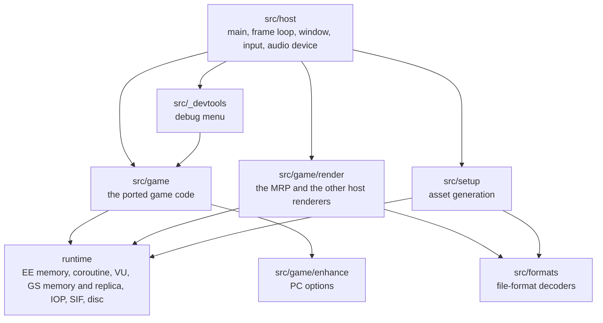

# Architecture

The source tree, what lives where, and the rules the code follows.

## The source tree

```
src/
  game/            the port: the game's code, function by function
    boot/          the boot module: intro, title screen, main menu, the start of a new game
    ovl/           the level overlay's code: game frame, mobys, hero, camera, HUD, menus,
                   weapons, VU programs, and each level's own classes
    lib/           the base executable's libraries: libc, libcdvd, libgraph, libmc,
                   libvu0, soft-float, the movie player, the 989snd EE client
    math/          the overlay's vector and matrix routines
    input/         the pad packet into the game's pad state
    render/        the host's renderer: the MRP, its lighting, materials, level of detail, effects
                   and ambient particles, plus older renderers kept for comparison
    enhance/       the PC options: Graphics, Controls and Advanced pages
  formats/         decoders for the game's file formats
  io/              memory-mapped files, byte readers
  platform/        the operating system's calls (Linux, Windows) behind one small interface
  profiler/        the host's frame profiler (the debug menu's Profiler tab, RAC1_PROFILER_*)
  jobs/            the host's job pool: the renderer's scene building spread over the cores
  host/            main, the frame loop, window and input, audio output, test scripting
  setup/           the setup mode: ISO checks, extraction, asset generation
  _devtools/       the debug menu (openly invented, never part of the port)
runtime/           the PS2 hardware layer, no game logic
  ee/              EE: the coroutine, the game thread, timer 1, float rounding, the R5900 interpreter
  vu/              VU0 and VU1, the VIF, the VU interpreter, building blocks of translated programs
  gs/              the GS's local memory (game state), its blending as GPU state; the GS replica (the faithful reference)
  vk/              the experimental Vulkan backend: device, swapchain, frames, helpers
  iop/             IOP memory, the 989snd sound driver's IOP side, audio streams
  sif/             SIF RPC between the EE and the IOP's servers
  ipu/             the movie decoder
  kernel/          EE memory and scratchpad, the memory journal, the drawing's copy of memory, the disc,
                   a few kernel calls
  level/           loading a level's overlay sections into EE memory
third_party/
  989snd/          OpenGOAL's reimplementation of the 989snd sound driver (ISC)
  glad/            the generated OpenGL loader
  gamecontrollerdb/ the SDL game controller database
tools/
  setup.py         the guided setup (run through setup.sh)
  gen_vk_shaders.py the Vulkan renderer's shaders, compiled to SPIR-V at build time
  launcher/        the launcher for Windows and Linux (C#, see The launcher)
  overlay_match/   generates the per-level address maps from the player's disc
  codegen/         the code generators and their inputs (see "The generated code" below)
  oracle/          headless runs that record the oracle's RAM dumps (see The oracle)
tests/
  oracle/          the oracle: each port checked against the original code (see The oracle)
data/
  lights/          each level's light file: its sun, lights, interiors, emissive surfaces, materials,
                   ambient particles (our own art choices, no game data)
  regions/         the PAL disc's region table (addresses only)
cmake/             dependencies downloaded at configure time
assets/generated/src/
                   the generated code, written by the setup from the player's disc (not in the repository)
```

The build (`CMakeLists.txt`) produces one executable, `rac1-native`, from static libraries:
`rac1_formats`, `rac1_profiler`, `rac1_jobs`, `rac1_runtime`, `rac1_game`, `rac1_setup`, `rac1_devtools`,
and the third-party ones. It is C++20, built with `-Wall -Wextra -Wpedantic -frounding-math` (the last because the game's
thread runs the FPU in a non-default rounding mode, see
[Decisions](decisions.md#11-the-ees-float-rounding)). The CMake options that change the game (the others,
`RAC1_NO_GENERATED`, `RAC1_ORACLE` and `RAC1_UCONTEXT`, are for development: see their comments in `CMakeLists.txt`):

- `RAC1_MOVIES` (on by default) decodes the movies with the system's FFmpeg (`libavcodec`,
  `libavutil`) when it is found; without FFmpeg the game runs and skips the movies.
- `RAC1_DEVTOOLS` (on by default) compiles the debug menu. Even when compiled, it only opens with
  `--debug-tools` (see [Settings](settings.md#debug-tools)).
- `RAC1_NATIVE_ARCH` (off by default; `./setup.sh --native-arch on`) compiles the game for the
  machine that builds it (`-march=native`: AVX2, AVX-512 where the CPU has them), which the game,
  always built on the player's own machine, can afford. The float rules stay: `-ffp-contract=off`
  keeps `a * b + c` two roundings even on a CPU with FMA (the PS2 has none), and nothing like
  `-ffast-math`. See [Threads and the cores](#threads-and-the-cores).
- `RAC1_GEN_DEBUG_INFO` (off by default) compiles the generated sources with debug info. Off, they are
  built with `-g0`: the same machine code, about a third less time to compile them, less memory per
  compile job and a far smaller program (about 140 MB instead of 335 MB). Turn it on to step into the
  generated `*_tr.cpp` files in a debugger.

GLFW, GLM, Dear ImGui, TinyGLTF, miniaudio, Vulkan-Headers and volk are downloaded by CMake at
configure time, each pinned to a release and checked against its SHA-256 (`cmake/dependencies.cmake`,
`THIRD_PARTY_NOTICES.md`). The Vulkan renderer's shaders are compiled at build time by `glslc` or
`glslangValidator` when one is installed; without either the game is built with OpenGL only (see
[Vulkan](vulkan.md)).

## The layers



### `src/game/`: the port

Everything that is the game lives here. Every function in `src/game/ovl`, `src/game/boot`,
`src/game/lib` and `src/game/math` carries an annotation on the line before it saying what it is;
almost all of them port one original function:

| Annotation | Meaning |
|---|---|
| `// orig: 0x00211670` | a function of the base executable or of Veldin's overlay (the reference build) |
| `// orig: L1:0x002f4348` | a function of level 1's own overlay (code that exists only there, or is built differently there); several levels can be listed |
| `// orig: front:0x001eb0a8` | a function of the boot module |
| `// orig: (host) ...`, `// orig: (helper) ...` | host code standing in for something, or a helper split out of a ported function |
| `// orig: (none) — enhancement ...` | PC-only code (the options pages and the enhancements) |

The [Port catalog](catalog/README.md) lists every function of the game by these annotations: its port's
file, or the host code that stands in for it.

The rules a port follows are in [Overview](overview.md#the-porting-rules). In practice:

- **Game state lives in EE memory, at its original address.** The port reads and writes it through
  `ee_read` and `ee_write` (`runtime/kernel/ee_memory.h`) and the MIPS-named helpers built on them,
  `lbu`, `lh`, `lw`, `lwc1`, `sb`, `sh`, `sw`, `swc1` and so on (`src/game/ovl/ovl_common.h`).
  EE memory is a host buffer of 64 MB, of which the game uses the low 32 MB as on the PS2; the
  scratchpad is at 0x70000000. There are no C++ structs mirroring the game's records: a moby is a
  0x100-byte record read at its offsets.
- **Unported callees are stubs.** `TODO_PORT(0xADDR, "name")` (`src/game/port_stubs.h`) logs
  `[TODO_PORT] Unported call to 0x... (name) from caller: ...` once per address and caller, accepts
  any arguments, does nothing, and returns a zero value of whatever type is expected.
- **An FPU divide is `fpu_div`**, because the EE's divider rounds to nearest while the rest of its
  FPU rounds toward zero (`src/game/ovl/ovl_common.h`).
- **Generated files.** Part of `src/game/` is not written by hand but generated from the game's
  own code; those files are not in the repository (see [The generated code](#the-generated-code)).
- **Translated VU microprograms** (`moby_vu1.cpp`, `world_vu1_*.cpp`, `particles_vu1.cpp`,
  `world_light_vu0.cpp`...) are the VU code the game uploads, translated instruction by instruction,
  in an exact form and a faster `_fast` form. They are registered by the hash of the code they
  replace and run when the game starts that code. Most of them are generated files.

The oracle (`tests/oracle/`, built with `-DRAC1_ORACLE=ON`) runs the original code in the R5900
interpreter beside each port and compares them; see [The oracle](oracle.md).

`src/game/render/` and `src/game/enhance/` are host code that sits beside the port: the renderer
reads the game's state and draws it; the options pages are built from the game's own menu widgets
and data. Neither changes the game's behaviour unless an enhancement is turned on.

### The generated code

About 230 source files of the port (some 48 MB of C++) are translated instruction by instruction
from the game's own MIPS and VU code, by the generators in `tools/codegen/`. They are proved against
the original like any port, and never edited by hand. Because they are a mechanical rewrite of the
game's code, they are not in the repository: the setup generates them from the player's own disc,
as other static-recompilation projects do.

| Kind | Files | Generator | From |
|---|---|---|---|
| `*_tr.cpp`, `*_tr_N.cpp` and a few others (`sky_ee.cpp`, `novalis_birdbot.cpp`, `title_sky.cpp`...) | 171 | `gen_mkall.py`: `mkall.py` (`mkall_l8.py` .. `mkall_l18.py` for levels 8 to 18) and `mips2cpp.py`, whole functions and their callees | each level's overlay; the boot module |
| `*_asm.cpp` | 34 | `gen_asm.py`: `asm2fn_batch.py` and `asm2fn.py` | the levels' overlays |
| `moby_skin.cpp`, `moby_shadows_asm.cpp`, `world_cull.cpp`, `world_lighting.cpp` | 4 | `gen_asm2cpp.py`: `asm2cpp.py`, plus the reviewed changes kept as patches | Veldin's overlay |
| `moby_vu0*.cpp`, `moby_vu1*.cpp`, `world_vu1_*.cpp`, `world_light_vu0*.cpp` | 18 | `gen_moby_vu_fast.py`, `gen_world_vu.py`, `gen_light_vu0.py`: `vu2cpp.py` and `vu2cpp_fast.py` | the VU microcode in the boot executable |

`tools/codegen/generate_all.py` runs all of them (`--list` shows the units, `--files` the files they
write). The generators read only:

- the disc image: each level's overlay, read from the disc by `tools/overlay_match/`
  (`tools/codegen/ovlist.py`), with `tools/codegen/r5900dis.py` disassembling it;
- the boot executable, `assets/dumps/SCUS_971.99`, and the overlay address maps,
  `assets/generated/overlay_map/`, both made from the disc by the setup (from the PAL disc, through the
  region table: see [The region layer](#the-region-layer));
- their committed inputs in `tools/codegen/`, which hold no game data: `gen/mkall/` (each run: the
  level, the entry functions with their names and signatures, the generator's options, and call-site
  glue), `gen/asm2cpp/` (the routines and the review's patches), `asm2fn_specs/`, the `*.glue` files
  (C++ statements for the calls into hand-written ports, keyed by address), and `gen/skel/`, the
  skeleton of each output file (its head, includes, the hand-written C++ around the generated
  functions, and where each generated function goes);
- the headers of `src/game/`, whose `// orig: 0x...` declarations tell the generators which callees
  are ported and with which signature, and the levels' variant tables (`src/game/ovl/variants_l<n>.cpp`).

The headers that declare the generated functions stay in `src/game/` with the hand-written code,
which calls through them.

The setup runs `generate_all.py --out assets/generated --no-insn-comments`, so the files land in
`assets/generated/src/game/...`, mirroring `src/`. `--no-insn-comments` leaves out the comment each
translated line carries with its original instruction (`// lw a1,0xf0(sp)`); the code is the same,
token for token. The setup also writes `assets/generated/src/generated_sources.cmake`: the list of
the files, and a fingerprint of the generators and of the headers they read. `src/game/CMakeLists.txt`
adds those files to `rac1_game` (`RAC1_GENERATED_SRC` points elsewhere if needed). Configuring fails
with a message asking for `./setup.sh` when the list is missing, a file is missing, or the
fingerprint no longer matches the sources (after a `git pull` that changed a generator or a header);
`./setup.sh` then generates the code again before it builds.

The generated files are built with the same include paths as the rest of `src/game/`
(`#include <game/ovl/...>`), and compile to the same code as in the project's development
repository, where they are committed with their instruction comments.

### `runtime/`: the hardware

`runtime/` models the parts of the PS2 the game talks to, and nothing else. It takes no game decision
and knows nothing about Ratchet & Clank. It provides:

- EE memory, the scratchpad and a **journal** (`runtime/kernel/ee_journal.h`) that records writes so
  a run of ported code can be undone; the renderer uses it to run passes a second time without
  changing the game's state (see [Rendering](rendering.md#level-of-detail));
- the **coroutine** the game frame runs on (`runtime/ee/ee_thread.cpp`; its stack switch is the
  platform's, by hand on x86-64 and AArch64: [Platforms](platforms.md#the-host-interface)), the
  **game thread** that runs it beside the drawing (`game_thread.cpp`, see
  [Threads and the cores](#threads-and-the-cores)) and the EE's **timer 1** (`ee_timer.cpp`);
- the **copy of the game's memory** a pipelined frame's drawing reads (`runtime/kernel/ee_copy.h`:
  taken at the frame's preparation, read through `draw_lw` and its kin);
- the **float rounding** of the EE (`runtime/ee/ps2_fpu.h`);
- **VU0 and VU1** with the VIF and the GIF's output (`runtime/vu/`), running the translated programs
  or, for testing and fallbacks, the VU interpreter;
- the **GS's local memory** (`runtime/gs/gs_memory.cpp`): the 4 MB the game's uploads write and its
  GS -> EE transfers read back, so game state; the textures decoded from it; the GS's blending as GPU state
  (`gs_blend.cpp`), shared by every drawer;
- the **GS replica** (`runtime/gs/gs_emu.cpp`, `gs_draw.cpp`), the faithful reference only: the MRP reads
  the frame's chain with its own reader ([Rendering](rendering.md#the-2d));
- the experimental **Vulkan** backend's device, frames and helpers (`runtime/vk/`, see [Vulkan](vulkan.md));
- the **IOP side**: IOP memory, the SIF RPC servers the game calls, the 989snd sound driver and its
  streams (`runtime/iop/`, `runtime/sif/`);
- the **disc** (`runtime/kernel/disc.cpp`), read by sector from the files the setup extracted from the
  player's disc (`assets/disc/`: `layout.txt` maps every byte of the image to a file or to zero, so a
  read gives the image's bytes wherever it falls; `RAC1_READ_ISO=1` reads the image itself, to
  compare), and the **movie decoder** (`runtime/ipu/`);
- the **R5900 interpreter** used to prove ports (`runtime/ee/ee_interpreter.cpp`), compiled but not
  used while playing.

### `src/_devtools/`: openly invented

The debug menu (free camera, level select, teleport, items and unlocks, freezing mobys, rendering switches, the light
editor, the profiler) is
invented code, useful for development and testing, and never presented as part of the port. Nothing
in `src/game/` or `runtime/` includes it, and `RAC1_DEVTOOLS=OFF` compiles it out.

## Threads and the cores

The game's own code runs on one thread at a time, in the game's own order: the EE's main thread is a coroutine
(`runtime/ee/ee_thread.cpp`) of the thread that runs the game frames. That is the host's main thread (which also holds the GL
context, or drives the Vulkan renderer), or, beside the drawing of a pipelined frame, the **game thread** (below). Nothing of the
game's update is split over threads or reordered, so the game's state is the same, word for word, however many cores the machine
has and whichever thread ran a frame. What runs elsewhere is the host's work on what the game left behind:

- the **MRP chain worker** (`src/game/render/mrp_chain.cpp`) reads a copy of the frame's chain: the 2D, the effects (their
  VU1 programs), the texture uploads ([Rendering](rendering.md#the-2d)); on the faithful path the GS replica's worker
  (`runtime/gs/gs_emu.cpp`) runs the replica on it instead;
- the **MRP scene worker** (`src/game/render/mrp_world_renderer.cpp`) captures the world's scene inputs, builds the scene, then
  the frame's triangles, draw commands and batches (`build_triangles`; a texture the build meets first is decoded there, its GL /
  Vulkan image made by the main thread when it takes the frame). With the pipelined frame (on in a window) it does so during the
  next game update. One frame's outputs: the next build starts only after the frame was drawn (`RAC1_MRPW_BUILD_THREAD=0`: the
  triangles on the main thread at the drawing, as before);
- the **job pool** (`src/jobs/job_pool.h`) spreads the renderer's per-moby work over the cores: the moby chains' decoding after the
  moby pass and its LOD / widened-view re-run (`mrp_scene.cpp`), and the moby draw lists' transforms (`mrp_moby_renderer.cpp`).
  Each job writes its chunk's results apart and the caller appends them in order, so the lists are the same as on one thread
  (`RAC1_JOBS=1`); the workers run with the calling thread's float environment (the game's thread rounds toward zero). The
  pool runs one job at a time: two callers at once (the game thread's decoding beside the main thread's drawing) take turns;
- the **game thread** (`runtime/ee/game_thread.h`) runs a host frame's game frames while the main thread draws the pipelined
  frame prepared at the end of the host frame before; the main thread joins it before it prepares the next frame. The same game
  frames in the same order, with the main thread's float environment; the game's sound's random numbers are one sequence for
  both threads (989snd `RandUseGame`). The drawing reads only what that frame's preparation took: the view, the LOD widening, the
  drop shadows (`g_draw_from_snapshot`), the moby draw lists, the world's scene, the chain reader's run of its chain, and a copy of
  the game's memory the modern lighting and the ambient particles read (`runtime/kernel/ee_copy.h`: the base executable's and the
  overlay's data, the moby array; `RAC1_DRAW_MEM_CHECK=1` names any read outside it). What the update may not do beside the
  drawing waits for its end: the game's own GS transfers (`gs_exec_load_image` / `gs_exec_store_image`: the GS's local memory) and
  the pause menu's picture store (a GL / Vulkan copy, run by the main thread: `game_thread::on_main`). Not for a frame of a
  blocking loop, a level's exit or load, the boot, a movie, the full-screen menu, nor with the debug menu open (its tabs write the
  game's memory); never in a deterministic headless run (`RAC1_GAME_THREAD=2` forces it there for testing: the RAM hashes are
  those of `=0`). Pads: GLFW's input is read on the main thread for each of the host frame's game frames before the game thread
  starts (`pad_presample`);
- the audio threads (the IOP's mirror, the device's callback).

The rule for anything new on another thread: only work whose results the game never reads back (the
renderer's input), or that is pure; it reads the game's memory only while the game's thread is not
running (the main thread waits for the job), or from a copy. A draw-time reader of the game's memory reads it through
`draw_lw` .. `draw_lwc1` (`ee_copy.h`), or from a capture taken at the frame's preparation. Ideas that would need the game's own
code split over threads are not faithful and are not done: updating the mobys in parallel (their
updates read and write each other's state and the shared scratchpad in the game's order), skinning
the real pass's mobys in parallel (the pose routine's scratchpad, VU0 registers and flags carry from
one moby to the next, and the game reads the joints it leaves), or running the moby pass's LOD re-run
beside the game's update (it would need its own copy of the 32 MB, the VU0 and the host state its
code touches). The game's update itself is made cheaper instead: the VU0 macro ops keep their flags
in registers through the joints' pose (`vu0m::LocalFlags`, `src/game/ovl/vu0_regs.h`), the pose's hot loops keep the VU0's
registers themselves in SIMD registers (`moby_joints.cpp`, `RAC1_VU0_SIMD`: the same ops, the same roundings, no FMA; two
independent matrix chains at once with AVX2 on a CPU that has it), and
`RAC1_NATIVE_ARCH` compiles everything for the player's CPU. Every such change is checked to leave
the game's state as it was: `RAC1_RAMHASH` (EE RAM and scratchpad, page by page, every game frame)
against the unchanged build on long runs of several levels, the oracle's reference batches, and the
reference images. Thread safety is checked with a ThreadSanitizer build (see [Performance](performance.md)).

## Per-level overlays and the `OV` macros

Each level of the game ships its own overlay: the whole engine linked again at other addresses, plus
the level's own classes and data. The same function or variable therefore sits at a different
address on many levels. For example, the overlay's main loop starts at 0x245c28 on Veldin and at
0x259c40 on Novalis, where the code is laid out differently. (Some data, such as the moby pool's
pointers at 0x15ffd8, happens to stay put.)

The ports are written against **Veldin's** addresses (level 0, the reference) and made relocatable
with the macros in `src/game/ovl/ovl_reloc.h`:

| Macro | Use |
|---|---|
| `OV(0x0015ffd8)` | a data address in the overlay (its sections, 0x15ef00 to 0x1ea300) |
| `OVF(0x00211670)` | a code address in the overlay (0x1eaa00 to 0x2f0cd0) |
| `OvConst<0x001b4950u>` | a named constant address, translated where it is used |
| `NOT_ADDR(x)` | a literal that falls in the overlay's range but is not an address (a colour, a mask) |
| `ovl_code_to_veldin(fn)` | the reverse: a level's code address back to Veldin's, to find its port |

`$gp`-relative addresses are written `OV(0x00166c00u - k)`.

**How the translation works** (`ovl_reloc.cpp`). On Veldin every macro is the identity. When a level
is loaded, `ovl_reloc_set_level` reads that level's map, `assets/generated/overlay_map/level<N>.txt`
(`front_reloc.txt` for the boot module). The maps are generated from the player's own disc during the
setup, by `tools/overlay_match/overlay_match.py` and `front_match.py`: they match each level's
functions and data to Veldin's. Each macro use site caches its translated address until the level
changes, so the cost on the hot path is one comparison.

**Dispatch.** A level's tables (class update functions, camera types, sound handlers) hold that
level's own code addresses. To find the port, the dispatchers translate the address back to Veldin's
with `ovl_code_to_veldin` and look it up in registries keyed by Veldin's addresses; code that exists
only in one level is registered under that level's own address (for example
`ovl_register_level_moby_fn` in the Novalis files). See
[Game logic](game-logic.md#mobys).

**The default.** Every level runs on its own overlay. `RAC1_OWN_OVERLAY=0` (with `--debug-tools`)
runs every level on Veldin's overlay image instead, for comparison.

## The region layer

The ports carry the North American build's addresses (`SCUS-97199`). The European PAL build
(`SCES-50916`) is the same code relinked: most of it moved by a few bytes, a few functions changed.
The **region table**, `data/regions/SCES-50916.txt`, records where the PAL build put each piece of the
North American build: per overlay (the boot module and levels 0 to 18), `code` and `data` runs (an
address range and its shift), the `entry` of each function the PAL build changed, and a few lines for the
code generators (`fix`, `start`, `nostart`, `pair`, below). It holds addresses, shifts and the PAL
executable's checksum, never the game's bytes. `tools/overlay_match/region_maps.py table` writes it from
both discs, on a developer's machine.

**At setup** (`tools/setup.py`, on the PAL disc): `region_maps.py apply` makes the game's maps from the
PAL disc and the table: `level<n>.txt` and `front_reloc.txt` (North American Veldin to the disc's
overlays) and `region_level<n>.txt` / `region_boot.txt` (the table's runs, for the runtime).

**The code generators** read the PAL overlays through `tools/overlay_match/region_view.py`: each code run
is moved back to its North American address, and the fields the linker relocated (`jal` targets, a `lui`
half and the offsets that complete it, `$gp` offsets, jump tables) are taken back through the table. The
rebuilt code is word for word the North American code; the table's `fix` lines correct the few fields
the analysis cannot take back alone (a `lui` half built in another function, an address two runs claim),
`start` / `nostart` lines align the function starts, and `pair` lines pair the few functions the PAL
build rewrote (`region_view.py check` compares the rebuilt code with the North American disc's). The
generators' own maps go to `overlay_map/codegen/`. A function the PAL build changed has no North American
code on the PAL disc: it is translated from the PAL code instead, placed at the North American entry, and
marked `STAND-IN` in the generated file.

The generated level-only code is made region-proof by `tools/codegen/reloc_level.py` (run by the
generators on every file that names a level's own addresses): a jump table's `switch` compares
`lvl_key(pointer)` (the pointer back to the North American address), and a `lui` half kept apart from its
low half becomes `L<n>_PAGE` with its uses folded into the full address. On the North American disc the
code it writes computes the same values.

**At run time** (`src/game/ovl/ovl_reloc.h`): `disc_other_region()` reads the disc's `SYSTEM.CNF`; on
the PAL disc the game loads `SCES_509.16`, translates Veldin's addresses too, and translates:

| Form | Use |
|---|---|
| `L<n>_ADDR(0x...)` / `LvlConst<n, 0x...>` | an address of level n's own overlay |
| `L<n>_CASE(0x...)` with `switch (lvl_key(fn))` | a `case` label of a dispatch switch |
| `L<n>_PAGE(0x...)` | a `lui` half, never translated |
| `FR(0x...)` / `FrConst<0x...>` | an address of the boot module (the title) |

On the North American disc all of these are the identity. A function the PAL build changed is found
through its `entry` line, and its North American port runs in its place.

## Runtime files

The game runs from the repository's root: every path is relative to the working directory.

| Path | What | Read by |
|---|---|---|
| `assets/disc/` (`layout.txt` and the files it lists) | the player's disc, extracted by the setup (`tools/disc_extract.py`): every sector the game reads, each level's data WAD included | `runtime/kernel/disc.cpp`, `runtime/level/level_loader.cpp` |
| `assets/iso/rac1-ntsc-u.iso` or `rac1-pal.iso` (or `$RAC1_ISO`) | the player's disc image, read only with `RAC1_READ_ISO=1` (to compare) and by the setup | `runtime/kernel/disc.cpp` |
| `assets/dumps/SCUS_971.99` (`SCES_509.16` from the PAL disc) | the game's executable, extracted from the disc | `runtime/kernel/ee_memory.cpp`, `src/game/boot/front_image.cpp` |
| `assets/generated/overlay_map/` | the per-level address maps | `src/game/ovl/ovl_reloc.cpp` |
| `assets/generated/mrp/moby/`, `assets/generated/mrp/world/` | the MRP's assets | `mrp_moby_renderer.cpp`, `mrp_world_renderer.cpp` |
| `third_party/gamecontrollerdb/gamecontrollerdb.txt` | the controller database | `src/host/orig_main.cpp` |

At build time, `assets/generated/src/` holds the generated code (see
[The generated code](#the-generated-code)); the game does not read it while it runs.

All of `assets/` is generated by the setup from the player's own disc (see [Setup](setup.md)) and is
never committed. The player's own files (settings, controls, saves) live in the usual XDG
directories; see [Settings](settings.md) and [Saves](saves.md).

## Keeping the game out of the repository

`tools/git-hooks/pre-commit` refuses a commit that would add the game's code or data: anything
under `assets/` or a build directory, the sources `tools/codegen` generates (by the list
`generate_all.py --files` prints), disc images, executables, the game's file types, images
outside `docs/`, and files over 1 MiB. Contributors enable it once per clone:

```bash
git config core.hooksPath tools/git-hooks
```
