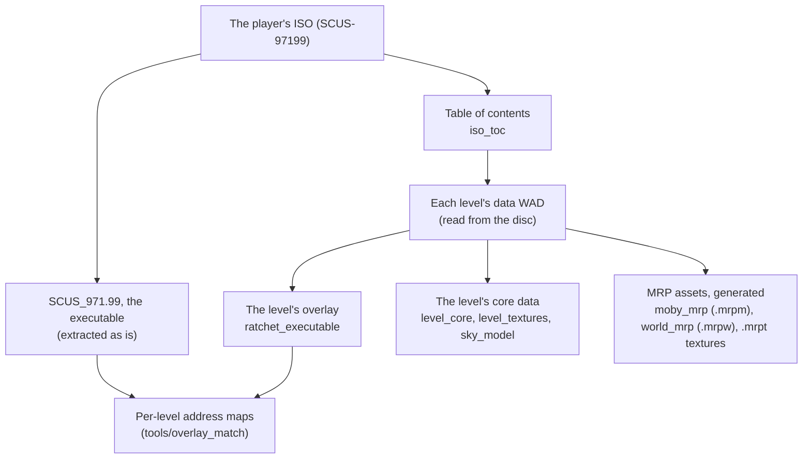

# File formats

A short index of the game's file formats the port reads, with the decoders in `src/formats/`. Nothing
here comes with the game's data: the setup extracts and generates everything from the player's own
disc (see [Setup](../setup.md)).

Most of the port does not decode the game's files at all: like the original, the ported loaders copy
a level's data into EE memory and the ported game code reads it there. The decoders below are for the
setup, the host's renderers and the overlay loader.



## The disc

**The table of contents.** Beside its ISO 9660 file system, the disc carries Insomniac's own table
of contents at sector 1500: one entry per level, giving the sectors of everything that level needs
(its data, its gameplay data for each region, its sound and music, its scenes). Decoder:
[`iso_toc`](../../src/formats/iso_toc.h). Used by the setup and the runtime to find each level's data.

**The executable**, `SCUS_971.99`, is a normal PS2 ELF. The setup copies it out unchanged; the port
loads its sections into EE memory as the PS2 would. The boot module (the front end) is a section of
it.

## A level's data

**The level data WAD** (read directly from the disc at the sector and size in the table of contents)
holds the level's overlay and its core data.

**The overlay** is stored as an Insomniac "Ratchet Executable": a sequence of blocks, each with a
16-byte header (the EE address to copy to, the byte count, the ELF section type it stands for, and
the overlay's entry point, repeated in every block) followed by its bytes. The base executable keeps
stub functions that the loader patches with jumps into the overlay. Decoder:
[`ratchet_executable`](../../src/formats/ratchet_executable.h); used by the level loader
(`runtime/level/level_loader.cpp`).

**The level core** is the level's main data block, compressed, with an index of its sub-assets:
moby classes, tie and shrub classes, textures, animations. Decoder:
[`level_core`](../../src/formats/level_core.h).

**Textures** are 8-bit indices into a 256-colour palette, the palette in the GS's own order (bits 3
and 4 of an index swapped) and its alpha on the GS's 0 to 0x80 scale. Decoder:
[`level_textures`](../../src/formats/level_textures.h).

**The sky** (shells and sprites) has its own small format. Decoder:
[`sky_model`](../../src/formats/sky_model.h).

**Scene WADs** group sounds and data blocks by scene, each data block compressed with the game's LZ
scheme (its decompressor is here too). Decoder: [`scene_wad`](../../src/formats/scene_wad.h).

## Models

**Moby classes**, **tie classes** and **shrub classes** are the game's model formats: packets of
vertex data laid out for the VU programs that draw them, with texture references, levels of detail
and, for mobys, skinning data and animations. The decoders
[`moby_model`](../../src/formats/moby_model.h), [`animation`](../../src/formats/animation.h),
[`tie_model`](../../src/formats/tie_model.h), [`shrub_model`](../../src/formats/shrub_model.h) and
[`level_mesh`](../../src/formats/level_mesh.h) serve the older host renderers, which are kept for
comparison. The MRP does not use them: it uses its own assets, below.

## The MRP's assets

The MRP's assets are not the game's format but the project's own, generated by the setup from the
game's data. Each keeps a model **as the game's VU program assembles it**: the setup runs the ported
VU programs on the game's packets and records what they produce, every level of detail and every mip
included. See [Rendering](../rendering.md).

| File | What | Format |
|---|---|---|
| `assets/generated/mrp/moby/level<N>/<class>.mrpm` | one moby class: its packets, their decoding, each vertex's skinning record | [`moby_mrp`](../../src/formats/moby_mrp.h) |
| `assets/generated/mrp/world/level<N>/world.mrpw` | the level's tfrags, tie classes and shrub classes, with the VU1 program's "kick program" for each | [`world_mrp`](../../src/formats/world_mrp.h) |
| `textures.mrpt`, `textures_{tfrag,tie,shrub}.mrpt` | the textures, decoded, with every mip | the same files |

`world_mrp.cpp` also holds the CPU reference of the world programs' math, which the GPU's output is
checked against.

## The level cache

The level cache is the project's own container for data the port reads out of a level's files once and
then loads from the cache: tables, and later other structures. It is made from the player's own disc,
never shipped and never in the repository. Library: [`level_cache`](../../src/formats/level_cache.h);
test: `tests/unit/level_cache_test.cpp` (built with the developer's tests, `RAC1_UNIT_TESTS`, which is
on when `RAC1_ORACLE` is). Nothing reads or writes these files yet.

**Files.** One file per planet, `<cache folder>/planetNN.r1lc` (`NN` the level, 00 to 18), and
`boot.r1lc` for the boot module. The folder is given by the caller (`level_cache::file_path`).

**Layout.** Little-endian throughout. Every field is written and read one byte at a time, so the same
file is read the same way on little-endian and big-endian hosts.

| Offset | Size | Field |
|---|---|---|
| 0x00 | 4 | magic, the characters `R1LC` |
| 0x04 | u16 | format version: 1 |
| 0x06 | u16 | flags: none are defined in version 1, so 0 |
| 0x08 | 16 | the disc's serial (`SCUS-97199`), ASCII, padded with zeros |
| 0x18 | u8 | the disc's region: 0 unknown, 1 NTSC-U, 2 PAL, 3 NTSC-J |
| 0x19 | 3 | zero |
| 0x1c | 20 | the sources' fingerprint (below) |
| 0x30 | u32 | the number of chunks (at most 1024) |
| 0x34 | u32 | the file's size in bytes |
| 0x38 | u32 | zero |
| 0x3c | u32 | CRC-32 of bytes 0x00 to 0x3b, then of the whole chunk table |

The chunk table follows at 0x40, 20 bytes per chunk:

| Offset | Size | Field |
|---|---|---|
| 0x00 | u32 | the chunk's id: four characters, the first in the low byte, so a hex dump shows `TABL` |
| 0x04 | u16 | the chunk's own version, set by the code that makes it |
| 0x06 | u16 | zero |
| 0x08 | u32 | the offset in the file, a multiple of 16 |
| 0x0c | u32 | the size in bytes |
| 0x10 | u32 | CRC-32 of the chunk's bytes |

After the table come zeros up to the next multiple of 16, then the chunks themselves: in table
order, each starting at a multiple of 16, with zeros between them. The file ends with the last byte
of the last chunk. Version 1 is not compressed. The CRC is the common CRC-32: polynomial 0xedb88320,
reflected, the same as zlib's `crc32`.

**The fingerprint** is SHA-1 over the files the chunks were made from, read through the disc reader
(so a mod that replaces one of those files also changes the fingerprint). For each source, in a fixed
order, the hash takes: the length of its name (u32), its name, its size (u64), then its bytes. In
Python:

```python
h = hashlib.sha1()
for name, data in sources:
    h.update(struct.pack("<I", len(name)) + name + struct.pack("<Q", len(data)) + data)
```

The code that makes a chunk decides which sources go in: the boot executable and the level's files.
SHA-1 is used because the setup already uses it for every disc file (`layout.txt`). It is a check
that the inputs are the same, not a security measure.

**Rebuild, never patch.** A cache file is never changed in place or upgraded. The reader rejects a
file if anything does not match, and the file is then made again from the disc. The reasons are: the
file is missing or cannot be read; it is shorter or longer than its header says; it has the wrong
magic; it has an older or newer format version, or a flag this build does not know; the table is out
of order or misaligned, has duplicate ids or nonzero reserved bytes, or has a chunk that runs past
the end; a CRC does not match; the file was made from another disc (serial or region) or from other
sources (fingerprint); or a chunk the caller needs is missing or has another version. The reader
always gives the reason in plain words. Writing is atomic: the file is written to `<name>.tmp` in the
same folder and then renamed over the old one, the same way the saves are written, so a crash never
leaves half a file.

**Reading.** `open` reads only the header and the chunk table, which is at most 20 KB. Each chunk is
then read separately into the caller's buffer, and its CRC is checked. The reads are in file order,
and the whole file is never held in memory, which suits low-memory consoles. A file that is already
in memory (a buffer, or a mapping through `io/mapped_file.h`) can be opened from there, and its
chunks can be used in place. The bytes between chunks are not covered by any CRC and are not
checked.

## Decoders kept but not used

[`level_collision`](../../src/formats/level_collision.h) (the collision tree),
[`level_gameplay`](../../src/formats/level_gameplay.h) (moby placements, cameras, paths, volumes),
[`sound_bank`](../../src/formats/sound_bank.h) (989snd banks) and
[`vag`](../../src/formats/vag.h) (Sony's ADPCM sound format) are compiled, but nothing calls them:
the ported game code reads those structures in EE memory, and the sound driver reads the banks
itself.
