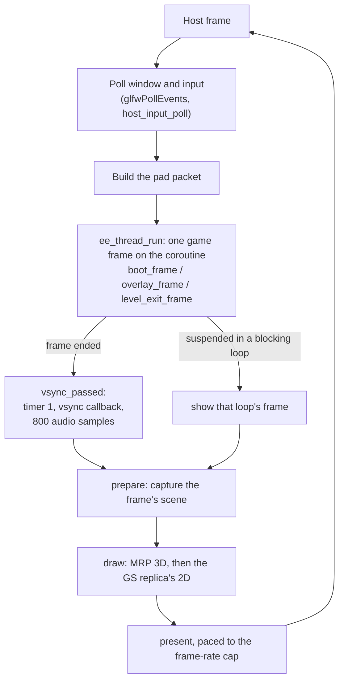
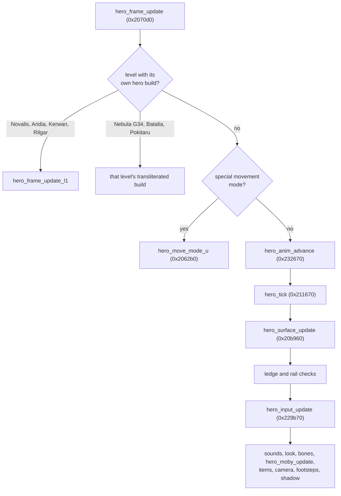

# How the game runs

A technical walk through the game's code as it runs in the port: the start and the main loop, the
boot, levels and overlays, mobys, the hero, the camera and the cutscenes. Functions are named by
file and function; the hexadecimal address in parentheses is the original function each one ports
(its `// orig:` annotation). Addresses are Veldin's (level 0) unless marked otherwise; on other
levels they are relocated (see [Architecture](architecture.md#per-level-overlays-and-the-ov-macros)).

## Start and the main loop

### The host's `main`

`main` in `src/host/orig_main.cpp` is the program's entry. It is host code: the base executable's
own start is not ported, and what it does is reproduced inline here.

1. `--setup` hands off to the setup mode (`rac1::setup::run_setup`, see [Setup](setup.md)).
2. The FPU is put in the EE's rounding mode (`ps2fpu::enter_ee_rounding`, see
   [Decisions](decisions.md#11-the-ees-float-rounding)).
3. A GLFW window with an OpenGL 4.6 core context is opened (an invisible one in a headless run),
   or, with the Renderer setting on Vulkan, a window without a context for the
   [Vulkan](vulkan.md) renderer (OpenGL's instead when Vulkan cannot start); the shaders are loaded, the translated VU programs are registered and the renderer is chosen.
4. The game's globals that the base executable would have set are written (the level number, the
   video mode), the memory card is inserted, the sound driver's IOP side and the audio output are
   started, and the vsync hook for blocking loops is installed.
5. The game starts either with the boot module (the normal start: intro, title, main menu) or, for
   testing, directly in a level (`overlay_entry_start`).

### One host frame

The game's logic always advances one 1/60 s frame per pass of its main loop; it has no variable
time step. The host runs game frames inside `ee_thread_run` (`runtime/ee/ee_thread.cpp`), which
calls one of:

- `boot_frame` (`src/game/boot/front_end.cpp`) during the boot module;
- `overlay_frame` (`src/game/ovl/overlay_entry.cpp`), one pass of the game's main loop (0x245c28);
- `level_exit_frame` (`src/game/ovl/level_exit.cpp`) while leaving a level.

When a game frame ends normally, `vsync_passed` (in `orig_main.cpp`) does what a vsync does on the
PS2: it advances the EE's timer 1 (`runtime/ee/ee_timer.cpp`), runs the game's vsync callback, and
advances the sound driver by 800 samples (1/60 s at 48 kHz).

Presentation is paced by `HostPacer` in `orig_main.cpp`, to the frame-rate cap set in Options >
Graphics (60 by default). The game's frame and the picture can also be pipelined: a frame's scene is
captured right after its update and drawn while the next update runs.

### The game frame on a coroutine

Some of the game's code runs several frames inside one call and waits for the vsync in the middle,
for example the screen fade (`screen_fade`, 0x1f9838, in `src/game/ovl/screen_fade.cpp`). The game
frame therefore runs on a coroutine of the host thread
([Decisions](decisions.md#12-the-games-frame-on-a-coroutine)):

- `ee_thread_run(fn)` runs `fn` on a coroutine with its own stack (`ucontext` on Linux, a fiber on Windows).
- `ee_thread_vsync(kind, shown)` is called where the original waits for a vsync inside such a loop.
  It always calls the vsync hook (so timer 1, the vsync callback and the sound advance exactly as on
  the PS2). If `shown` is true, it suspends the coroutine; the host shows the loop's frame and
  resumes the game at the next host frame.
- `kind` says what the host shows: `Kicked` (the packets the loop built for that frame), `Held` (the
  screen keeps its picture) or `Scene` (a whole game frame built by the loop, as the Vendor does).

The screen fade calls `ee_thread_vsync(kicked ? Kicked : Held, advanced_original_fades())`. By
default `shown` is false: the fade's n + 2 frames all run inside one host frame, with the same memory
writes and frame counter as on the PS2, and the screen cuts. With Options > Advanced > Fades >
Original, each fade frame is shown.

### `overlay_frame`: the game's main loop

`overlay_frame` dispatches on the game mode at 0x15f5c4:

| Mode | Update | Draw |
|---|---|---|
| 0, gameplay | `gameplay_frame` (0x297f78, `game_frame.cpp`) | `render_frame_gate` (0x1f8e30), then `render_frame` (0x1f85b8) |
| 1, movie | `movie_mode_update` (`movie_mode.cpp`) | |
| 2, cutscene | `cutscene_update` (`cutscene.cpp`) | `mode2_draw` |
| 3, menu | `menu_update` | `menu_draw_mode3` |
| 4, full-screen screens (memory card...) | `screen_update` (`screens.cpp`) | `screen_draw_mode4` |
| 5, Vendor | `vendor_mode_update_tr` | `vendor_mode_draw_tr` |
| 6, ship sequences | `ship_sequence_update` (`arrival.cpp`) | `ship_sequence_draw` |

`gameplay_frame` runs the frame's subsystems behind a set of enable bits: the hero
(`hero_frame_update`), the mobys (`moby_updates`), the particles, the camera (`camera_update`), and
so on. When the hero dies, the level is restarted through `level_setup`.

## The boot

The boot module is the game's front end: its own build of the engine, separate from the levels.
The port loads it from the game's executable (`front_image_load`, `src/game/boot/front_image.cpp`)
and runs it with the overlay translation set to the boot image (`OVL_FRONT`). Its functions are
annotated `// orig: front:0x...`.

- `boot_start` and `boot_frame` (`front_end.cpp`) run the boot module's main (front:0x1e9658),
  split into host frames: the PS2 memory card check pictures, the intro movie (`0.pss`), the
  copyright picture, the title, and the attract movies when the title is left alone.
- `src/game/boot/title.cpp` and `title_load.cpp` are the 3D title scene: its camera, sky, sounds,
  update and draw (`title_update` front:0x1eb0a8, `title_draw` front:0x1eb410).
- `title_menu.cpp` is the main menu (`title_menu_update` front:0x2192a8).
- `boot_start.cpp` holds the boot module's start-up helpers; `level_read.cpp` reads the disc's table
  of contents and a level's files.

**New Game.** The main menu's New Game opens the memory card screens (game mode 4,
`src/game/ovl/screens.cpp`) and the new game's slot choice (`new_game_slots_update`, 0x281200, in
`save_menus.cpp`). Leaving the title for a level goes through the same level exit as a planet change:
`level_exit_start` in `level_exit.cpp` plays, for a new game on Veldin, the story cards and the
opening movies, then loads Veldin.

## Levels and overlays

Each of the game's 19 levels (0 Veldin to 18 the final Veldin) ships three things on the disc: the
level's data (a WAD), its sound bank, and an **overlay**: the whole engine linked again at other
addresses, together with the level's own classes and data.

Loading a level in the port:

1. `engine_image_load` (host code in `orig_main.cpp`, standing in for the original's loader)
   copies the level's overlay into EE memory: `LevelLoader::load_level_overlay`
   (`runtime/level/level_loader.cpp`) reads its sections and copies each to its address, or clears
   it for a section that holds no data. Then `ovl_reloc_set_level` switches the address translation
   to that level.
2. The ported loaders read the level's files from the disc image into EE memory, exactly where the
   original puts them (`level_read.cpp`, `level_load.cpp`).
3. `gameplay_load` (0x241940, `level_load.cpp`) unpacks the level's gameplay data and fills the moby
   pool; `level_setup` (0x244110, `level_setup.cpp`) sets up the level and registers its classes.

Leaving a level: `level_change_request` (0x24d430, `level_change.cpp`) saves to the chosen memory
card slot, and `level_exit_start`, `level_exit_frame` and `level_exit_finish` (parts of 0x292e08,
`level_exit.cpp`) run the ship's departure, the loading screen and the story cards and movies.

### One codebase, nineteen overlays

The ports are written against Veldin's addresses. Every address inside the overlay goes through a
macro from `src/game/ovl/ovl_reloc.h` (`OV`, `OVF`, `OvConst`) that translates it to the loaded
level's address, using per-level maps generated from the player's own disc by the setup (see
[Architecture](architecture.md#per-level-overlays-and-the-ov-macros)).

Code that exists only in one level's overlay is ported at that level's own address and tagged with
it, for example `// orig: L1:0x002f4348` for a Novalis class. Engine functions that are different
code on some levels have level builds of their own: `hero_state_update_l1.cpp` is annotated
`// orig: L1:0x002370b8 L2:0x00225c20 L3:0x0020ef60`, the same function as built for Novalis,
Aridia and Kerwan.

### Machine-transliterated files

Much of the level-only code is not written by hand. Files named `*_tr*.cpp` (and `*_asm.cpp`) were
transliterated instruction by instruction from the overlay's MIPS code by a generator, then proved
against the original with the oracle. They keep the original's control flow and the PS2's float
rules by construction, and use a uniform calling convention (`TrRet` in
`src/game/ovl/novalis_mobys2.h`). They are not in the repository: the setup generates them from your
disc with the generators in `tools/codegen/` (see
[Architecture](architecture.md#the-generated-code)).

## Mobys

A moby is any object that moves or acts: Ratchet, enemies, crates, bolts, doors, the Vendor. The
port has no C++ struct for a moby: it reads and writes the original's 0x100-byte moby records in EE
memory at their original offsets. Some of them:

| Offset | Meaning |
|---|---|
| +0x10 | position |
| +0x20 | state (0xff ends the list; 0xfe and above: free) |
| +0x22 | class index |
| +0x34 | flags |
| +0x74 | update function (an address in the overlay's code) |
| +0x78 | the moby's private variables ("pvars") |
| +0xa6 | class id |

The pool is set up by `gameplay_load` from pointers in the overlay's data (its start at
`OV(0x15ffd8)`); `moby_spawn` (0x24e838, `ovl_24_25.cpp`) allocates from it.

**The update.** `moby_updates` (0x2648e0, `moby_update.cpp`) runs the frame's moby work.
`moby_visible_queue` (0x250768) chains the mobys to update by class, and `moby_update_visible`
(0x264848) walks that chain: for each moby it advances the animation (`moby_anim_advance`), calls the
class's update function (`ovl_call_moby_fn`), and updates its transform (`moby_update_transform`).

**Finding a class's code.** A moby's update function at +0x74 is copied from the overlay's class
table when the class is set up (`class_update_fn_set`, 0x264688), so on any level it holds that
level's code address. `ovl_call_moby_fn` (`src/game/ovl/ovl_dispatch.cpp`) finds the port:

1. a function that exists only in this level is looked up by (level, address);
2. otherwise the address is translated back to Veldin's (`ovl_code_to_veldin`) and looked up in the
   registry of ported classes, which is keyed by Veldin's addresses (`ovl_register_moby_fn`, for
   example in `moby_classes.cpp`).

**A class that is not ported** reaches `TODO_PORT` (`src/game/port_stubs.h`). The macro prints
`[TODO_PORT] Unported call to 0x... (name) from caller: ...` once per address and caller, accepts
any arguments, does nothing, and converts to a zero value of whatever type the caller expects. The
moby is simply not updated.

## The hero

Ratchet's state lives in the player block at 0x13f350 (the hero's state number is at +0x2084, his
moby's address at +0x2080). The hero's update is `hero_frame_update` (0x2070d0,
`src/game/ovl/hero_update.cpp`), called by `gameplay_frame`.

- `hero_tick` (0x211670) reads the sticks into the player block, runs the state machine
  `hero_state_update` (0x217970, `hero_state_update.cpp`), builds the rotation matrix
  (`euler_to_mat4_vu`), then the gait (`hero_gait_update`, 0x211380), the motion
  (`hero_motion_update`, 0x221310) and the timers (`hero_timers_update`, 0x2215c8).
- `hero_input_update` (0x229b70, `hero_transitions.cpp`) turns input into state changes: jumps,
  attacks, item use.
- `hero_set_state` (0x2223f8, `hero_state.cpp`) enters a new state; `hero_input.cpp` holds the
  helpers (`hero_try_jump`, `hero_item_use`, `hero_hurt`, `hero_land`...).
- `hero_init` (0x204c60) places Ratchet when a level starts.

Several levels build parts of the hero code differently. The `*_l1` files are Novalis's build of
the same functions (shared by Aridia and Kerwan, with `hero_l2_small.cpp` for Aridia's few
differences), and Nebula G34, Batalia and Pokitaru dispatch to their own transliterated builds.
(The code's level names and the names in the game are mapped in [Status](status.md#level-names).)

The optional modern controls and Ratchet & Clank 3 movement plug into these functions at a few
points; see [Advanced options](advanced.md).

## The camera

`camera_update` (0x1ed0a8, `src/game/ovl/camera.cpp`) runs once per gameplay frame. The game keeps
48 camera slots, each with a type from the overlay's camera type table (an id and its accept, init,
update and exit functions). `camera_update` selects the active camera, runs its type's functions,
handles transitions between cameras, and copies the result into the view: the position at 0x166dc0,
the rotation rows at 0x166fd0..0x166ff0, the angles at 0x166dd0. Then come the shake, the ground
check and the fog.

| File | Camera |
|---|---|
| `camera_follow.cpp` | the follow camera behind Ratchet (`cam0_init`, `cam0_update`) |
| `camera_look.cpp` | the look-around camera (`cam_look_update`) |
| `camera_types.cpp` | types 5, 6 and 7 (`cam5_update`, `cam6_update`, `cam7_update`, `cam7_track`) and `camera_collide_sweep` (0x1ed6a8), which keeps the camera out of walls |
| `camera_mods.cpp` | camera modifiers (`cam_mod_update`, `cam_mod6_update`) |

Cameras that only exist in some levels are dispatched to those levels' ports first; the rest are
found by their Veldin address (`ovl_code_to_veldin`).

`render_view_setup` (0x1f6e48, `overlay_entry.cpp`) then builds the view matrices the render passes
use: the world-to-view rotation at 0x166c80 and the projection products after it.

## Cutscenes and movies

- **In-engine cutscenes** are game mode 2: `cutscene_start` (0x298840), `cutscene_update`
  (0x298f90), `cutscene_camera` (0x298de8) and `cutscene_end` (0x298b18) in
  `src/game/ovl/cutscene.cpp`. The cutscene's data blocks are streamed from the disc
  (`cutscene_block_read`). Their subtitles are drawn by `cutscene_subtitle_draw` (0x1f9a20) when
  Options > Subtitles is on.
- **Movies** are game mode 1 (`movie_mode.cpp`) when played from a level, and are also played by the
  level exit and the boot (`movie_start`, `movie_frame`, `movie_stream_start` in `movies.cpp`). The
  game's movie player is replaced by host code in `src/game/lib/movie_player.cpp`, which hands the
  file to the movie decoder in `runtime/ipu/movie_hw.cpp` (see [Audio](audio.md#movies)).
- **Story cards** (the still pictures between planets) are `card_start` and `card_frame` in
  `movies.cpp`.
- **Ship sequences** (landing, take-off, flying to another planet) are game mode 6, in
  `src/game/ovl/arrival.cpp`; the loading screen's flight between planets is drawn by
  `src/game/ovl/flight_draw.cpp`.
