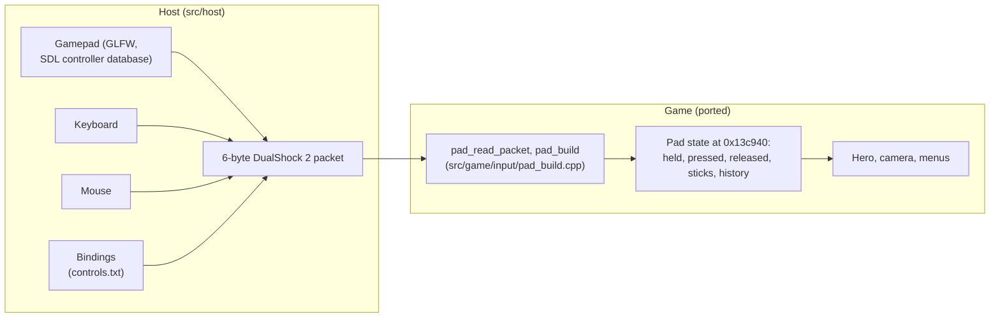

# Input

How the game reads its controller, and how the port maps a PC's keyboard, mouse and gamepads onto
it.



## The pad as the game sees it

On the PS2 the game reads a DualShock 2 through Sony's pad library. In the port the library is gone:
each game frame the host builds the 6-byte packet a DualShock 2 returns, and the game's own code turns
it into its pad state.

**The packet** (`g_host_pad_packet`, `src/game/ovl/overlay_entry.cpp`): two bytes of buttons, active
low, then the right stick's x and y and the left stick's x and y, each 0 to 255 with 0x7f at rest.
The button bits:

| Bit | Button | Bit | Button |
|---|---|---|---|
| 0x0001 | L2 | 0x0100 | Select |
| 0x0002 | R2 | 0x0200 | L3 |
| 0x0004 | L1 | 0x0400 | R3 |
| 0x0008 | R1 | 0x0800 | Start |
| 0x0010 | Triangle | 0x1000 | Up |
| 0x0020 | Circle | 0x2000 | Right |
| 0x0040 | Cross | 0x4000 | Down |
| 0x0080 | Square | 0x8000 | Left |

**The pad state** at 0x13c940 is filled by the ported `pad_read_packet` (0x266f50) and `pad_build`
(0x2671b0) in `src/game/input/pad_build.cpp`. Some of its fields:

| Offset | Contents |
|---|---|
| +0x100 to +0x10c | the sticks as floats: right x, right y, left x, left y |
| +0x1a0 | buttons held (the left stick also sets the d-pad bits here) |
| +0x1a4, +0x1c4 | buttons pressed this frame |
| +0x1a8, +0x1c8 | buttons released this frame |
| +0x1c0 | buttons held |

The game applies its own dead zone: a stick byte within 0x30 of the centre reads as zero, and the
rest is scaled to reach 1 at full deflection. It keeps a 30-frame history of presses and stick
movements, which it uses to detect flicks and quick inputs.

Which button does what in each situation (gameplay, menus, cutscenes) is decided by the game's own
code reading these fields.

## How the host builds the packet

`host_input_poll` and `pad_packet` in `src/host/orig_main.cpp` read the devices through GLFW;
`src/host/host_input.cpp` holds the bindings and turns the inputs into the packet
(`host_input::compute`, `to_packet`).

- **Gamepads.** Every joystick GLFW recognises as a gamepad is read, and their inputs are merged: the
  buttons of all of them, each stick from the pad that deflects it furthest, each trigger from the
  pad that presses it furthest. A virtual or silent device listed before the real pad (a virtual
  controller's driver, a second view of the same pad) cannot hide it (#98). With more than one
  gamepad, a pad counts only once it has moved from how it read when first seen (a button pressed, an
  axis moved by 0.3), so a device stuck at a deflection does not hold an input. The Controls page
  names the pad last used. Gamepads are polled every frame, so one can be connected after the game
  has started. At start the log lists every joystick GLFW sees, which helps in a bug report:

  ```
  [controls] joysticks: 0: Xbox Controller (GUID 78696e70757401000000000000000000, gamepad yes); 1: ...
  ```

  A round stick's range is mapped onto the DualShock 2's square one (`stick_to_square`). The host
  adds no dead zone of its own: the game's applies. An analog trigger counts as pressed past 0.1.
- **The controller database.** GLFW recognises a gamepad from an SDL-format mapping. The game loads,
  in order: `third_party/gamecontrollerdb/gamecontrollerdb.txt` (the community
  [SDL_GameControllerDB](https://github.com/mdqinc/SDL_GameControllerDB), shipped with the source),
  then a `gamecontrollerdb.txt` next to `controls.txt` (by default in `~/.config/rac1-native/`), then
  the `SDL_GAMECONTROLLERCONFIG` environment variable (`load_controller_db`). A controller missing
  from the database can be added in either of the last two places.
- **Controllers missing from the database.** On Linux, a controller with no mapping that has the
  layout of the kernel's Xbox driver (`xpad`: 11 buttons, or 12 with a Share button, 6 axes and a
  D-pad) is given the Xbox layout (A, B, X, Y, the bumpers, Back, Start, Guide, the sticks and their
  clicks, the triggers, the D-pad). Many Xbox-compatible controllers are such. Any other controller
  with no mapping is not used. In both cases the log names it, with its GUID:

  ```
  [controls] joystick 0: <name> (GUID 0300...): no mapping, not used (add its mapping: docs/input.md)
  ```

  To add its mapping, write one line in SDL's format (`<GUID>,<name>,a:b0,b:b1,...,platform:Linux,`)
  into `~/.config/rac1-native/gamecontrollerdb.txt`. Tools such as SDL's `controllermap`, or Steam's
  controller settings (which set `SDL_GAMECONTROLLERCONFIG`), can make one. Please also send it to
  [SDL_GameControllerDB](https://github.com/mdqinc/SDL_GameControllerDB), or in a bug report here.
  For testing, `RAC1_PAD_FALLBACK=force` (with `--debug-tools`) gives the Xbox layout even to a mapped
  controller of that layout, and `RAC1_PAD_FALLBACK=0` turns the fallback off.
- **Keyboard and mouse.** Bound like any other input. Stick directions can be bound to keys (full
  deflection) or to mouse movement.
- **Mouse look.** When the right stick is bound to the mouse and mouse look is on, a left click in the
  window captures the cursor (raw motion when the system supports it, `glfwRawMouseMotionSupported`:
  no pointer acceleration); that click is not passed to the game. Losing focus or opening the debug
  menu releases it. The mouse has two modes (`mouse_mode`, Options > Controls > Mouse Mode, #117):
  - **Direct** (the default): the mouse's movement turns the camera by an angle proportional to it,
    with no acceleration, no speed cap and no stick in between, so it does not depend on the frame
    rate (the movement of each game frame is applied whole). At sensitivity 1.0 a pixel is 0.0025
    radians (a full turn in 2500 pixels). The follow camera's offset is turned by the yaw before the
    camera's own turn, collision and aim run, so it stays out of walls as before; the pitch is the
    camera's own pitch spring held where the mouse put it (the stick's springs back when let go),
    reached at the camera's own rate. While strafing or aiming (see
    [Advanced options](advanced.md#modern-aiming)) the mouse turns the aim instead, the modern aim at
    the **Aim Sensitivity** (a factor of the mouse's). Moving the mouse right turns the view right
    and up looks up; Invert Look swaps up and down; the game's own Camera options are the stick's
    and do not change the mouse. Where the follow camera is not the one playing (the first-person
    view, the menus, the quick select's paused world, cutscenes, the levels with their own camera
    code) the mouse is the right stick, as in Stick mode. The game is told the angles beside the
    pad's packet (`advanced_host_input`, `advanced_mouse_camera` in
    `src/game/enhance/advanced.cpp`); it asks for them only when it ran the follow camera the frame
    before (`advanced_mouse_direct`).
  - **Stick**: the earlier "relative analog" way, kept as it was and fully supported (some players
    prefer it): the movement is a stick deflection, the camera then turns at the stick's speed with
    its springs, everywhere the right stick works. At sensitivity 1.0, 20 pixels of movement in one
    game frame is a full deflection.

  Mouse Sensitivity and Invert Look apply to both modes; Aim Sensitivity only to Direct (in Stick
  mode the aim turns at the stick's own aiming rate).
- **The mouse wheel.** Each notch is a press of what it is bound to: one game frame held, one
  released, so that fast scrolling still gives one press a notch (up to 4 notches wait their turn).
  By default the wheel goes through the weapons (below).
- **Next and previous weapon.** Two actions of the PC version that are no PS2 button (#61): the next
  (or previous) weapon of the quick select's list is put in Ratchet's hand at once, without opening
  the ring, the way the quick select equips it; while the ring is open (Triangle held), they move its
  selection instead. They work where the quick select could open.

### Default bindings

| PS2 | Gamepad | Keyboard and mouse |
|---|---|---|
| Left stick | left stick | W A S D |
| Right stick | right stick | mouse movement, I J K L |
| Cross | A (bottom) | Space |
| Circle | B (right) | left mouse button |
| Square | X (left) | F, mouse button 4 (thumb) |
| Triangle | Y (top) | E |
| L1 | left bumper | Q |
| R1 | right bumper | Left Shift, Left Ctrl |
| L2 | left trigger | right mouse button, Z |
| R2 | right trigger | C |
| L3 | left stick click | V |
| R3 | right stick click | middle mouse button, B |
| Start | Start | Escape, Enter |
| Select | Back | Tab, Backspace |
| D-pad | d-pad | arrow keys |
| Next weapon | - | wheel down, X |
| Previous weapon | - | wheel up |

What each button does in the game is the original's. The optional modern controls change L2 and R2
in gameplay (see [Advanced options](advanced.md#modern-aiming)): with them the right mouse button
aims and the left one fires. A `controls.txt` written by an earlier version keeps its bindings; only
the new actions (the weapons) get their defaults.

## The bindings file, `controls.txt`

The bindings are kept in `~/.config/rac1-native/controls.txt` (`$XDG_CONFIG_HOME/rac1-native/` if
set, or the file named by `RAC1_CONTROLS_FILE`). If it does not exist, the defaults are written there
at start. The Controls page saves it on every change.

```
mouse_sensitivity = 1
mouse_look = 1
invert_look_y = 0
select = pad:back, key:tab, key:backspace
l2 = pad:+lefttrigger, key:z
cross = pad:a, key:space  # Jump
right_stick_left = pad:-rightx, mouse:-x, key:j
```

- One `control = input, input, ...` line per control. A control left out keeps its default; a
  control with nothing after `=` is unbound.
- Inputs: `key:<name>`, `mouse:left`, `mouse:right`, `mouse:middle`, `mouse:button4` to `button8`,
  `mouse:+x` / `-x` / `+y` / `-y`, `mouse:wheelup` / `mouse:wheeldown`, `pad:<SDL button name>`,
  `pad:+<axis>` / `-<axis>`.
- Settings: `mouse_sensitivity`, `aim_sensitivity` (Direct, while aiming: a factor of the mouse's),
  `mouse_mode` (`direct` or `stick`), `mouse_look`, `invert_look_y`.
- The two PC actions: `next_item`, `prev_item`.
- `#` starts a comment. Unknown lines are reported and ignored.

## The Controls page

Options > Controls (`src/game/enhance/controls.cpp`), in the pause menu and the main menu:

- **Device**: Gamepad or Keyboard / Mouse, the set of bindings shown and edited.
- One row per control: Cross, Circle, Square, Triangle, L1, R1, L2, R2, L3, R3, Start, Select,
  D-pad, Left Stick, Right Stick, Next Weapon, Previous Weapon.
- **Invert Look**, **Mouse Mode** (Direct, Stick), **Mouse Sensitivity** (0.25 to 4), **Aim
  Sensitivity** (0.25 to 4, of the mouse's), and **Reset to Defaults** (the keyboard and mouse's also
  puts back the mouse's mode and sensitivities).

To rebind, select a row and press Cross: the page waits for every input to be released, then takes
the next one (it gives up after 5 seconds). A mouse wheel notch counts as a key. For the stick and d-pad rows on a gamepad, move a stick
or press the d-pad; on the keyboard, press four keys in turn (up, down, left, right), or move the
mouse to bind it as that stick. If the new input was already used by another control, the two swap,
and the page says so.

The bindings' column shows the connected gamepad's own labels: PlayStation symbols, Xbox's A, B, X,
Y, LB, RB, LT, RT, or Nintendo's B, A, Y, X, L, R, ZL, ZR, recognised from the gamepad's name (with
no gamepad connected, PlayStation's). The rows' names always use the PlayStation symbols, as the
game does.
