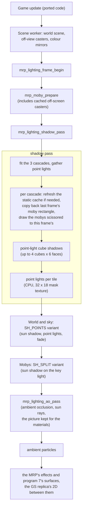

# Lighting

The game's own lighting, how the MRP reproduces it, and the optional modern lighting on top of it:
point lights per pixel, cascaded sun shadows, sun rays, ambient occlusion and an in-game light editor.

> **The modern lighting is EXPERIMENTAL.** It is off by default and will stay off by default.
> It is not yet fully usable on some planets, and it is not a porting priority: it will be
> worked on later. With Options > Graphics > Lighting on Original (the default) the picture is
> the original's lighting, pixel for pixel, and nothing here has any effect. The modern lighting
> only changes the picture, never the game: it reads the game's memory and does not write to it,
> so the game's state is the same with it on or off. It is a labelled enhancement (see
> [Settings](settings.md)).

**What it is today.** Its parts work and have been run on every level of the game (Veldin to the
Veldin finale) at each quality without crashes or shader errors, but how good the result looks
differs a lot between planets. Where each part comes from is described in
[How a level is analysed](#how-a-level-is-analysed).

- **The sun** is the light the game itself lights Ratchet with in the zone where he stands: the
  hero's light sets, turned and faded as he moves from one zone to the next. A level's own file
  may turn it (`sun <azimuth> <elevation>`, the [sun editor](#the-sun-editor)) where the game's
  direction leaves whole areas in the permanent shade of the level's walls (Novalis). Where the zone's light does not come from above, there is no sun and no sun
  shadows there. Outdoors and in short covered places (a passage, a tunnel, under a bridge) the sun
  is always on. In the level's **interiors**, marked in its file (caves, closed rooms, ships' holds:
  `interior` boxes around the camera, `interior_set` light sets), the sun is off and the picture is
  the original's lighting ([Interiors](#interiors)).
- **Shadow Strength** (Options > Graphics, 50 to 100 %, default 70 %): how much of the sun's light
  a shadow hides, the same everywhere; the rest stands for the sky's light in the shade.
- **The world is lit by the sun, not by the baked key light.** The terrain and the objects of the
  world are lit by the game as a painted base colour plus the zone's lights. With the lighting on,
  the key light's baked term is taken off and the same light is put back from the sun's direction,
  times the shadow's visibility; the mobys are lit the same way. Lit and shaded ground follow the
  same sun, a point is lit or not whatever blocks it, near or far, and turning the sun turns the
  whole lighting ([How the world is lit](#how-the-world-is-lit)).
- **No drop shadows.** With the lighting on, the original's drop shadows under Ratchet and the
  mobys are never drawn, even where there is no sun (Daino's choice, 2026-10-19). The game still
  computes them; only the drawing is left out. Where there is no sun shadow nothing replaces them;
  with Ambient Occlusion on, the occlusion darkens where the feet meet the ground.
- **The objects that glow** (lamps, screens, strips) are bright textures in the game, not lights.
  When a level loads they are found automatically and turned into small point lights. This is
  our own heuristic, not game data, and it can be wrong (see the table below).
- **Lights placed by hand** with the [light editor](#the-light-editor) cover what the automatic
  search can't find. The project ships no hand-placed lights; its level files only turn off an
  automatic class the search got wrong (Gaspar, Orxon), turn the sun (every level but Rilgar, Blarg
  and Batalia, most of them from Anya-Thoughtmane's lighting pass, #90), turn the sun rays off (Blarg,
  Rilgar, Batalia, Oltanis), mark interiors (Blarg, Orxon), mark emissive surfaces and
  [materials](materials.md), list [ambient particles](particles.md), or make every object of a class a light
  (Novalis's neon tubes and hanging bulbs, Kerwan's street lamps, Oltanis's plaza lamps; Veldin's and
  Novalis's lamps, fires and eyes from a tester's survey, #102).
- **Sun rays** (Options > Graphics, Off by default): shafts of light from the sun through openings
  ([Sun rays](#sun-rays)).

**State per level** (what the project's own surveys found, with the lighting set to Medium,
point-light shadows and ambient occlusion on; levels 8 to 18 also at Low and High). "Works" means
no crash, no artefact worth noting and shadows where they should be; it does not mean every lamp is
lit. Levels 8 to 18 were surveyed headless (the start of each level, a walk and a turn of the
camera, and a few places reached by moving Ratchet), not played through: their rows say what was
seen, and every one of them still needs a playtest.

| Level | State |
|---|---|
| Veldin | Works. A low, warm sun outdoors; the lighting follows Ratchet into his house (a different light set). Glowing panels are found. |
| Novalis | Works. Sun checked against the level's look. Few automatic lights. |
| Aridia | Works. |
| Kerwan | Works. Few automatic lights; the street lamps (moby class 1827) are lights from the level's file. The sun comes low through the first tunnel's mouth, the city backlit. |
| Eudora | Works. The heaviest level for the lighting (its forest has many shadow casters; roughly twice the frame time of the lighting off in the survey, on an integrated GPU). Trees and woodwork glow bright orange in the textures: they are recognised as materials and not turned into lights. Need some works. |
| Rilgar | Works. Same warm-material handling as Eudora. Needs some works, some automatic lights are a bit non-sense |
| Blarg (Nebula G34, Blarg's station) | **Still a mess, possibly better.** Playtesting found some zones pitch dark: the station's closed zones are lit by a light that reaches the floor only through the geometry above it, so the sun's shadow covered the whole zone. Closed zones are marked [interiors](#interiors) in `data/lights/level06.txt` (light set 6 so far, a closed room the old covered-view check found); the lounges with large windows keep their shadows. Other closed zones: to mark while playing. The hangar has only a faint, low blue sun. |
| Umbris | Works outdoors: the dead trees cast long shadows. Near the lava the zone's light comes from below, so there is no sun there and the shadows fade out. No automatic lights are found on this level. |
| Batalia | Works outdoors: a low warm sun (15 degrees) gives long shadows across the decks in the rain. No automatic lights: the towers' cyan bands are thin strips on their objects' textures (2 or 3 of a triangle's 7 samples, under the objects' 4-of-7 rule), so they cast no light. |
| Gaspar | Works outdoors (sun at 40 degrees). Inside the buildings the view is covered from the sun and the picture is the original's. The tanks' gold band (tie class 1558, paint) was taken for a lamp and lit their corner gold: turned off in `data/lights/level09.txt`. The robots' shots, the game's own lights, light the floor and pillars per pixel, strongly. |
| Orxon | Works outdoors (sun at 20 degrees). The base's rooms and corridors are covered from the sun: the original's look. The rooms' mint floor panels (tie class 1521) were taken for lamps and lit the floor with itself: turned off in `data/lights/level10.txt`. |
| Pokitaru | Works (sun at 30 degrees): shadows on the boardwalks at the start. No automatic lights are found on this level. |
| Hoven | Works outdoors on the snow (sun at 30 degrees). A few blue panels inside give 16 small lights. |
| Gemlik Base | Works: a moon base in space, lit low from the side (11 degrees: the level's own sun, turned to the sun in its skybox), with long shadows. Ratchet in a shadow is almost black: the level's light without its key light is nearly nothing (the game's own formula, see [How a shadow darkens](#sun-shadows-cascaded-shadow-maps)). |
| Oltanis | **Needs Daino's eye.** The key light is dim and grey, yet it is the brightest of its set, so its shadows are full; the streets between the tall buildings are mostly in shadow and Ratchet is dark there. Where almost the whole view is shaded the sun fades out (the view covered), so the shadows come and go as the camera turns toward or away from the lit plazas. The street lamps are mobys, which give no automatic lights (the level's 137 are beacons on top of the towers, high above the streets); the level's file makes them lights (moby class 1511). |
| Quartu | **Needs Daino's eye.** The factory at night: the courtyards' walls shade most of the view, so the sun is often faded out (the original's look) and comes back, with dark courtyards, when the camera sees the lit ground or the sky. 7 small lights. |
| Kalebo III | Works: the city on its platforms in the sun (30 degrees) with clean shadows. 85 automatic lights (cyan strips of tie class 2157), away from the start. |
| Drek's fleet | Works as the original indoors: the ships' halls and corridors are covered from the sun (none of the view sees it), so the picture is the original's with the occlusion on top. The sun is the zone's second light (the first comes from below). The orange door trims (tie class 2154, warm, 14 % of the class: just under the material share) give 10 faint lights: borderline. |
| Veldin finale | Works outdoors (sun at 40 degrees). The bridges' cyan strips (tie class 2033) light the bridges' undersides strongly cyan: **needs Daino's eye**. Ratchet in the cliffs' shadows is dark. |

Until a planet has had a playtest with the modern lighting, it may look wrong there: shadows from a
doubtful sun, a zone far too dark, or lamps that cast no light.

The rows that speak of a view covered from the sun, or of the sun fading out, were written with the
[covered views' probe](#views-covered-from-the-sun-off-testing) on. It is now off by default: the sun
stays on there unless the place is marked an [interior](#interiors). Those rows await a new survey.

This page assumes the renderer described in [Rendering](rendering.md). Code paths are under
`src/game/render/` unless stated.

## The original game's lighting

The PS2 game has no per-pixel lighting. Everything is lit per vertex, and much of it is baked.

**The data.** The level data provides up to 12 sets of directional lights; the level load copies
them to a table at 0x17fec0 (0x40 bytes a set) (`src/game/ovl/level_load.cpp`). One more set is
rewritten every frame by `level_lights_update` (0x23e890, `src/game/ovl/effect_light.cpp`), turned
with the camera. Beside them sit **8 dynamic point-light slots** (0x1802c0): a colour, an intensity,
a position and a radius each. Explosions, weapons and some effect objects take a slot with
`light_add` (0x23e738), which refuses when the frame is heavily loaded. `light_assign` (0x23ea10)
then writes the light's index into a spare nibble of each overlapping terrain piece, moby and shrub.

**Mobys.** For each moby, the moby draw loop (0x2559c0, `src/game/ovl/moby_draw.cpp`) builds an
8-row light record: one directional light set (or two blended by a factor), plus the point lights
that reach the moby summed into a third direction and colour, back-light factors and an ambient
colour. The VU1 program then lights each vertex:

```
d   = max(L · n, -|back| * d)          for each of the three lights
c   = sum(colour * d) * q + ambient
```

followed by the EE's fixed-point colour step.

**The world.** tfrag, tie and shrub colours are lit on the EE and VU0 into the level's data
(`world_tfrag_lighting` 0x295350, `world_tie_lighting` 0x297728, `world_shrub_lighting` 0x288908 in
`src/game/ovl/world_lighting.cpp`, with the VU0 program in `world_light_vu0.cpp`): a base colour, a
normal from two angle bytes, a blend of light sets, and the point lights named in the piece's
nibbles. This runs at level load and again, per frame, for the visible pieces, so a nearby explosion
lights the ground through the vertex colours.

**Fog** is computed per vertex (the VU programs' fog byte) and blended with the fog colour in the
GS. **Drop shadows** are shadow volumes counted in the frame's alpha channel.

### How the MRP reproduces it

By default (Options > Graphics > Lighting > Original) the MRP draws exactly this:

- **Mobys:** `mrp_scene` captures each moby's 8-row light record from the ported moby pass, and the
  moby vertex shader (`mrp_moby_renderer.cpp`) evaluates the formula above per vertex, including the
  fixed-point colour step.
- **World:** the lit colours the ported EE code wrote are mirrored to the GPU; only the instances
  whose colours changed are uploaded each frame (`resident_colours_update` in `mrp_world_static.cpp`,
  `tfrag_colours_update` in `mrp_tfrag_gpu.cpp`).
- **Fog** per vertex as the VU programs compute it, blended in the fragment shader as the GS does.
- **Drop shadows** with a stencil counter in place of the alpha channel (`mrp_shadows.cpp`).

The modern lighting's code lives only in separate shader variants (`SH_POINTS` for the world,
`SH_SPLIT` for mobys). With the lighting off, the original programs are bound unchanged, because
adding even inactive code to them changed the rounding of a few pixels.

## What the modern lighting adds

| Feature | What it does | Applies to |
|---|---|---|
| Sun shadows | Cascaded shadow maps from the zone's own key light (the one that lights Ratchet) | world and mobys, cast and received |
| Static shadow cache | The world's shadow casters drawn once per cascade and reused | performance |
| Point lights per pixel | The game's own point lights lit per pixel, plus automatic emitters | the world |
| Point lights per screen tile | Each pixel only walks the lights that reach its tile | performance |
| Point-light shadows | Cube shadow maps for the nearest point lights | world and mobys |
| Shadow distance | How far mobys cast | sun shadows |
| Ambient occlusion | Screen-space darkening where surfaces meet | the 3D |
| Light editor | Lights placed by hand, saved per level | the world |
| Emissive surfaces | Textures marked in a level's file keep the original's brightness, not darkened by shadows | the world and mobys |
| Materials | Textures tagged in a level's file shine, get wet, ripple, flow (Surface Detail; [Materials](materials.md)) | the world and mobys |

The whole module is active only when Lighting is not Original, the MRP draws both the world and the
mobys, and the shared projection is in use: in practice during gameplay, not on the title screen, in
menus or during fades (`mrp_lighting_shadow_pass`).

## The frame with modern lighting



There is no depth prepass and no compute-shader light culling; the order above is the `draw` step in
`src/host/orig_main.cpp`.

## How a level is analysed

This section says where the modern lighting's sun, lights, emitters and shadows come from. Everything
is read from the game's data in EE memory after the level has loaded. The exceptions are labelled
as our own choices: the thresholds, the automatic lights and the lights placed by hand. None of it
changes the game's state. The code is `mrp_lighting.{h,cpp}` (sun, shadows, per-pixel lights,
occlusion), `mrp_world_renderer.cpp` (`build_emitters`, the automatic lights) and
`mrp_world_static.cpp` (off-view shadow casters).

### The game data used

Addresses are those of Veldin's overlay; they are relocated for each level's own overlay.

| What | Where | Written by |
|---|---|---|
| **Directional light sets**: 16 x 0x40 bytes | 0x17fec0 | the level load, from the level's light block |
| per set: colour 1 (rgb; w = back-light factor), direction 1, colour 2, direction 2 | +0x00 / +0x10 / +0x20 / +0x30 | |
| **Light sets a moby uses**: set A, set B, blend weight (/256) | moby +0x38, +0x39, +0x3a | the game, per zone |
| **The game's point lights**: 8 slots x 0x20 (colour, position at +0x10, radius at +0x1c) | 0x1802c0 | `light_add` (0x23e738): explosions, weapons, level lights |
| slot in use (non-zero) | 0x1804c0 + 0x30 * i + 0x10 | |
| **The world's vertex colours** (lighting already computed by the game) | tie: instance data +0x40 (64 RGBA); tfrag: per vertex | the game's world lighting routines |
| geometry and textures of tie, shrub and tfrag | the level's assets and their copies in EE memory | `tools/setup.py` |

A light set's direction is the direction the light **travels**; the direction toward the sun is its
opposite.

### The sun

The sun is not invented. It is the directional light the game uses to light **Ratchet in the zone
where he stands**.

1. **The hero's sets.** Read set A, set B and the weight from the hero's moby (the first one in the
   list, `*(0x15ffd8)`). A set number above 15 means "none" and set 0 is used.
2. **The sun of one set** (`set_sun`). Of the set's two lights, take the **brightest one that comes
   from above**, that is, whose direction toward the light is at least about 11.5 degrees above the
   horizon (z >= 0.2). Brightness is the largest of the colour's r, g, b. The shadow's weight is
   that light's brightness divided by the brightest light in the set, so a dim light gives faint
   shadows. If neither light comes from above, the set has **no sun**.
3. **Blend.** The weight comes from the hero's sets: if both have a sun, blended with the game's
   weight (+0x3a / 256); if only one has, its weight scaled by its share of the blend. The direction
   is set 0's whenever set 0 has a sun (#3: a room's own set does not turn the shadows); only where
   it has none is the direction blended from the hero's sets as well.
4. **Transitions.** When the zone changes, the direction turns at most **1 degree a frame** and the
   weight changes at most **1/30 a frame**. In a zone without a sun the shadows fade out in about
   half a second instead of vanishing. At weight 0 the cascades are not drawn. The original's drop
   shadows do not come back (they are never drawn with the lighting on).
5. **Interiors** (our choice): the weight is faded to 0 in the level's interiors, see
   [Interiors](#interiors).
6. **The level's own sun** (our choice): the level's file may give the sun a direction of its own,
   see [The level's own sun](#the-levels-own-sun).
7. **Overrides for testing:** `RAC1_SUN_DIR=x,y,z` turns the sun as a level's file would (a sun
   of weight 1 where the zone has none), `RAC1_SUN_ZONE=1` takes the
   direction from the hero's sets everywhere (the way before #3), `RAC1_SUN_TRACE=1` prints the hero's sets and a census of the
   sets the level's mobys use, `RAC1_SUN_COVER=1` turns the covered views' probe back on (now off,
   see below) and `RAC1_SUN_COVER_TRACE=1` prints it.

What the levels up to Umbris give (direction toward the sun):

| Level | Hero's set at the start | Sun |
|---|---|---|
| Veldin | 0 outside (1 in his house) | (0.40 -0.85 0.34), low and warm |
| Novalis | 0 | (0.78 -0.32 0.54) |
| Aridia | 0 | (0.89 0.32 0.34) |
| Kerwan | 0 | (0.82 -0.05 0.57) |
| Eudora | 0 | (-0.72 -0.58 0.38) |
| Rilgar | 0 | (-0.90 -0.35 0.27) |
| Blarg | 0 in the hangar (its main light comes from below), 2 to 8 in the other zones | hangar: the second light, low (12 degrees) and blue, weight about 0.5 |
| Umbris | 0 outside; 5 / 6 near the lava (light from below) | (-0.92 0.01 0.40); no sun near the lava |
| Batalia | 0 | (-0.68 -0.69 0.26), low and warm |
| Gaspar | 0 | (-0.74 0.20 0.64); the set's second light comes from below |
| Orxon | 0 | (0.66 -0.66 0.34); the set's second light comes from below |
| Pokitaru | 0 | (0.58 -0.65 0.50) |
| Hoven | 0 | (-0.61 -0.61 0.50) |
| Gemlik Base | 0 | (-0.94 0.00 0.34) |
| Oltanis | 0 | (-0.68 -0.56 0.48), dim and grey (0.26) but the set's only light: full weight |
| Quartu | 0 | (0.94 0.00 0.34) |
| Kalebo III | 0 | (0.72 -0.47 0.50) |
| Drek's fleet | 0 | (0.77 0.41 0.48): the set's second light (its first comes from below) |
| Veldin finale | 0 | (-0.76 -0.07 0.65); the set's second light comes from below |

On levels 8 to 18 the hero kept set 0 in every survey run (the other sets the level data holds,
up to 8 on Hoven, are used by other mobys), so their sun is set 0's everywhere; their rooms are
dealt with by the next section.

### Interiors

Our choice, not the game's. A cave, a closed room or a ship's hold is lit by its zone's key light
coming from above, so the sun's shadow of the roof would cover everything there: the sun is turned
off and the picture is the original's lighting (with the point lights and the occlusion on top).
Which places are interiors is data, in the level's file (`data/lights/levelNN.txt`):

- `interior x0 y0 z0 x1 y1 z1`: a box; the sun is off while the **camera** is inside it. The
  camera, not the hero: the picture is what the camera sees (a camera inside a room shows the room),
  and it also works in Clank's and the vehicles' parts, where the hero moby is not the one on screen.
  Draw a box a little larger than the room.
- `interior_set <n>`: the sun is off while the hero is lit with the level's light set `n` (moby
  +0x38): when an interior is a zone of its own in the game's light sets (Blarg's closed rooms).

Entering or leaving, the sun fades over about 0.3 s (`kInteriorFade`), not a pop. The debug menu's
Sun tab shows whether the camera is inside, the hero's light set, the boxes drawn over the picture,
and adds a box around the camera or the hero's set; Save writes them with the level's file. Shipped:
Orxon's base (its first rooms; a box), Blarg's closed room of light set 6. Drek's fleet's halls seen
so far have windows on space and keep their shadows; its enclosed corridors and the levels' caves are
still to be marked in playtests.

### Views covered from the sun (off; testing)

Our choice, not the game's (`cover_probe` in `mrp_lighting.cpp`), **now off**
(`RAC1_SUN_COVER=1` turns it on for testing): a short covered passage (Kerwan's first tunnel
toward the bridge with the arches) faded the sun out, everything brightened, and after it the
shadows came back over a second - very noticeable. The interiors are now decided by data (above).
What it did: A room, a corridor or a ship's
hold is often lit by its zone's key light coming from above, so the sun's shadow of the roof covers
everything in view and only darkens it: Orxon's base, Gaspar's halls, the whole of Drek's fleet,
Blarg's station. The sun's shadows show nothing there, so they fade out:

1. Each frame, after the mobys, the 3D's depth is copied at 128 x 72 (a blit) and a 64 x 36 pass
   takes, per sample, its world point and face normal and tests it against the cascades (one tap,
   offset a little along the normal and toward the sun). A face turned away from the sun is not
   counted (the receivers do not shadow it either); the sky counts as seeing the sun.
2. The result is read back the next frame (a pixel buffer, always the last frame's, so a run gives
   the same picture every time).
3. **Outdoors is remembered.** Whenever at least 5 % of the samples are sky, the camera's position
   is noted (one place every 4 units, up to 1024 per level). Within 12 units of such a place the
   sun is kept whatever the view shows; beyond 24 units only the view's measure counts. A room
   shows no sky.
4. The sun's weight is scaled by the larger of the two: the share of the view that sees the sun
   (0 under 5 %, 1 over 25 %) and being outdoors. The scale follows slowly (3 % of the way a
   frame, about a second), and the weight then fades as between zones. At 0 the picture is the
   original's lighting, with the point lights and the occlusion on top (no drop shadows).
5. The cascades are still drawn while the zone has a sun, for the next frame's test.

In 0.4.0 the view alone decided, so the sun also faded outdoors whenever a shadow filled the
view: Novalis's start valley lies in the shade of its big mushroom trees and of the plateau beside
it (the first surface the sun meets is 10 to 30 units above the ground almost everywhere within
50 units of the start), so looking down at the ground faded every shadow out, Ratchet's included,
and they came back as soon as the camera saw the sky or the lit city. Patches of ground went from
shaded to lit with the camera. The memory of the sky keeps them steady outdoors
(`RAC1_SUN_COVER_SKY=0` gives the old behaviour).

### The sun's shadows

- **Cascades.** Three cascaded shadow maps, split at 18 / 60 / 220 units from the camera, at
  1024 / 2048 / 4096 texels for Low / Medium / High. At High only the near cascade is 4096. Each
  cascade covers the bounding sphere of its slice of the view, snapped to the texel grid so that
  it does not shimmer.
- **What casts.** Whatever the frame draws, plus objects **outside the view**: tie, shrub and tfrag
  instances inside a "capsule" that starts at each cascade and extends toward the sun up to a cut
  plane 400 units from the camera (`caster_volume`). Mobys cast from the frame; those that leave the
  view stay in a cache while they are alive, of the same class, and still.
- **Static cache.** Each cascade's static world is drawn once into a map covering 1.25 times its
  slice, and redrawn only when the slice leaves that box. Each frame the map is copied and the mobys
  are drawn on top, copying back only the rectangle where mobys were.
- **Receiving.** A 3 x 3 PCF filter with a normal-offset bias. The shadowed colour is the one the
  game would give **without** the key light: for mobys from their light record (shader variant
  `SH_SPLIT`), for the world by taking the key light's term off its colour
  ([How the world is lit](#how-the-world-is-lit)).
- **One strength.** A point is in the sun or not, whatever blocks it and however far away: the
  shadow map holds the nearest blocker, so overlapping shadows (a tree's inside a cliff's) do not
  add up or cancel, and Ratchet's shadow shows wherever the ground is otherwise in the sun. The bias
  and the filter are the same number of texels in every cascade, and the cascades blend over a band
  at their edge. (0.4.0 lightened the shadow of a caster far along the sun's ray, to 35 % at 120
  units: a cliff's shadow over Novalis's valley was lighter than a tree's, a tree's shadow vanished
  where it fell inside the cliff's, and Ratchet's was faint in the cliff's. It was there because the
  game's key light put that valley in permanent shade; the level's own sun does that job now.)
- **Shadow Distance.** Beyond 40 / 80 / 140 units, or with no limit, mobys cast no sun shadow.

### The game's lights, per pixel

- **Which.** Each frame the 8 slots at 0x1802c0 are read. Those in use with a colour and a radius
  become per-pixel lights with the game's own formula: colour x 0.5 x max(n . l, 0) x (1 - d / radius).
- **Held vertex colours.** The game already adds these lights into the world's vertex colours. So
  that they are not counted twice, while one of them is lit the vertex colours from before are kept
  (`mrp_lighting_points_freeze`). This starts only after the level's colours have been read at
  least once; on Blarg a light on from the first frame otherwise left the world with no colours.
- **Long-lit lights belong to the level.** A light that has been on for more than **90 frames in a
  row** (Blarg's purple lamp) is the level's: it is left to the game's vertex colours, as on the PS2.
  It gets no per-pixel light, no shadow, and its colours are not held. Explosions and shots are
  short, so they stay per pixel.

### The automatic emitters (our choice)

When a level starts, the textures of the world are searched for glowing surfaces (lamps, panels,
strips).

1. **Sampling.** For each triangle of a tie (the class's LOD 0 geometry) and of a tfrag (the "near"
   copy of its data, rebuilt with the CPU version of the VU1 program and an identity view), take
   7 texture points: the three vertices, the three edge midpoints and the centre.
2. **A glowing texel** has value (max of r, g, b) >= 0.8, saturation >= 0.55 and alpha >= 0x40; a
   warm one (r >= g >= b, b < 0.35: ochre rock, wood, rust) also needs value >= 0.92 or luma >= 0.72.
   A triangle glows with at least 4 of 7 points for ties, 3 of 7 for tfrags (the strips are thin);
   a tfrag triangle with more than 64 square units glowing is ground or wall, not a lamp.
3. **A tfrag's texture** comes from the CLAMP_1 register of the texture change (its MINV field holds
   the level texture's index).
4. **Material, not lamp.** A tie class glowing **in a warm colour** (hue outside 165 to 260
   degrees) over **more than 15 %** of its surface, or over more than 220 square units, is a
   material (orange trees, wood, paint); a tfrag texture in a warm colour over more than 12 %, 70
   square units glowing or 350 in all. A cool colour stays a light (screens, glass, energy, the cyan
   panels of Ratchet's house) unless it covers more than 85 % of a tie class of over 500 square
   units, or more than 75 % (or 500 square units) of a tfrag texture.
5. **Grouping.** Glowing triangles are grouped in cells of 4 units; for ties at most the 12
   largest cells per class. Each cell becomes a light, repeated for every instance of the class with
   its matrix. The colour is the mean of the texels. Intensity is clamp(0.35 + 0.25 * sqrt(area),
   0.35, 0.9) and radius clamp(2 + 3 * sqrt(area), 2, 7). Tfrag lights sit 1.2 units off the surface.
6. **Merge and density.** Nearby lights are merged in cells of 3 units; if more than 88 remain within
   60 units of one light, the cells grow once to 4.5 units (no larger, so that separate lamps are
   not averaged into one in mid-air). On levels 8 to 18 this leaves at most 67 within 60 units of
   one light (Gaspar before its correction), under the shaders' 96; Blarg keeps 101 even in cells
   of 4.5, so there the farthest are faded out (step 7).
7. **Each frame.** The lights within 60 units are taken, nearest first, with a 6-unit fade at the
   edge of that reach, and the same fade toward the first one left out if there are more than the
   shaders light, so that none switches on or off as the camera turns.
8. **Hand corrections.** In the debug menu's Lights tab, section "Automatic emitters", each class
   found has a switch. A class turned off goes into the level's file as `noauto <class>`.

Automatic lights found per level, as the code stands (the survey of levels 0 to 7 found more
before the rules above were tightened):

| Level | Lights (before the merge) | Notes |
|---|---|---|
| Veldin | 82 (135) | |
| Novalis | 0 | |
| Aridia | 104 (112) | all from the terrain |
| Kerwan | 8 (8) | |
| Eudora | 74 (286) | |
| Rilgar | 106 (136) | |
| Blarg | 140 (290) | |
| Umbris | 0 | |
| Batalia | 0 | the towers' bands are too thin for the ties' rule |
| Gaspar | 10 (12) | tie class 1558 turned off (`data/lights/level09.txt`) |
| Orxon | 2 (2) | tie class 1521 turned off (`data/lights/level10.txt`) |
| Pokitaru | 0 | |
| Hoven | 16 (19) | all from the terrain |
| Gemlik Base | 67 (136) | |
| Oltanis | 137 (140) | beacons on top of the towers |
| Quartu | 7 (7) | |
| Kalebo III | 85 (108) | |
| Drek's fleet | 10 (24) | the orange door trims, borderline |
| Veldin finale | 138 (181) | the bridges' cyan strips light them strongly |

### Lights placed by hand (our choice)

Made in the debug menu (F1, Lights tab) and saved in `data/lights/level<NN>.txt`; see
[The light editor](#the-light-editor). They are positions and colours chosen by us, with nothing
taken from the disc. They are lit like the automatic ones and ahead of them.

Before Anya-Thoughtmane's second pass (below) the project's level files placed no light: `level09.txt` (Gaspar) and `level10.txt` (Orxon) each turn
off one automatic class that was taken for a lamp, `level00.txt` (Veldin) makes lamps of classes and marks [emissive surfaces](#emissive-surfaces), and `level01.txt` (Novalis, also its lamps by class and emissive surfaces), `level03.txt`
(Kerwan), `level04.txt` (Eudora), `level14.txt` (Oltanis) and `level15.txt` (Quartu) turn the sun,
each with a comment saying why. `level05.txt` (Rilgar), `level06.txt` (Blarg's station), `level08.txt`
(Batalia) and `level14.txt` turn the [sun rays](#sun-rays) off (`sun_rays off`, #101).

Anya-Thoughtmane's second lighting pass (#102) added her own lines to the files of Veldin to Rilgar (`level00.txt` to
`level05.txt`), merged line by line with ours (our comments, particles and suns kept; Aridia keeps Daino's sun): emissive surfaces
on every one of them (the vendors' blue parts, the gold bolts, Ratchet's garage on Veldin, Aridia's red bulbs, Skid's crashed
ship, the anti-vehicle cannon and the fortress's swing room, Kerwan's lamps, buildings, Qwark-bot and the train's head, most of
Rilgar's lamps), lamps by class on Aridia and Rilgar (the Swingshot's versa-targets, the floating lifts' thrusters), lights placed
by hand on Novalis and Aridia, and Kerwan's street lamps reaching further.

### Point-light shadows, per-pixel cost and occlusion

See [Point-light shadows](#point-light-shadows), [Per screen tile](#per-screen-tile) and
[Ambient occlusion](#ambient-occlusion) below. In short: up to 4 cube shadow maps of 512 px (the
game's lights first, then emitters that have a moby within reach); a 32 x 18 tile grid with a
96-bit light mask per tile; and a depth-only SSAO of 12 samples.

### Guarantees

- **Off means original.** With Lighting on Original the original shaders are bound unchanged; all
  new code is in separate variants. The image is identical pixel for pixel, checked at each change.
- **The game's state never changes.** The modern lighting reads the game's memory and does not
  write it. The one exception is the debug light editor's "Ratchet to it" (see below).
- **Test switches:** sun: `RAC1_SHADOWS`, `RAC1_SHADOW_RES`, `RAC1_SUN_DIR`, `RAC1_SUN_ZONE`,
  `RAC1_SUN_TRACE`, `RAC1_SUN_COVER`, `RAC1_SUN_COVER_SKY`, `RAC1_WORLD_SHADOW`, `RAC1_TFRAG_LIGHT_TRACE`; lights: `RAC1_POINTS`, `RAC1_POINT_SHADOWS`, `RAC1_AUTO_LIGHTS`,
  `RAC1_LIGHTS_TRACE`, `RAC1_LIGHTS_DIR`, `RAC1_EMISSIVE`; shadows: `RAC1_SHADOW_CACHE`,
  `RAC1_SHADOW_MOBY_DIST`; occlusion: `RAC1_AO`. The Graphics menu sets the same values; an
  environment variable, when present, wins.

## Sun shadows: cascaded shadow maps

**The sun** is the light the game lights the hero with in his current zone, with its weight
(`sun_direction` and `set_sun` in `mrp_lighting.cpp`); [How a level is analysed](#the-sun) gives the
steps. It turns at most 1 degree a frame and its weight changes at most 1/30 a frame when the hero
changes zone, and where there is no sun the cascades are not drawn. `fit_cascades` takes the result
each frame.

**Cascades** (`fit_cascades`). Three cascades in a `GL_DEPTH_COMPONENT32F` 2D array texture, with
the view split at 18, 60 and 220 units from the camera. Each slice starts at 0.9 times the previous
one's far distance, so they overlap. Each cascade covers its slice's bounding sphere with an
orthographic light box whose centre is snapped to whole texels, so the shadows do not shimmer as the
camera moves. The box reaches 400 units toward the sun beyond the slice, so tall objects outside the
view still cast into it. Instead of clamping depth, one clip plane per caster pass cuts what lies
further than that toward the sun.

**Resolution** (Options > Graphics > Lighting): Low 1024, Medium 2048, High 4096 texels. At High,
only the nearest cascade is 4096; the two far ones are 2048, drawn into a corner of their layer.

**Casters.** Depth is drawn with a polygon offset. Nothing extra is stored per vertex: the shader
rebuilds each vertex's world position from the camera's clip coordinates and projects it again with
the cascade's matrix.

- **The world.** Opaque batches use a depth-only program; alpha-tested ones (foliage, fences) use the
  full program and discard the pixels that fail the alpha test, so cut-outs cast cut-out shadows.
  Ties, shrubs and terrain outside the view but inside a cascade's volume (a capsule along the sun)
  are found by host copies of the passes' culls, built on the scene worker thread
  (`static_shadow_build` and `CasterVolume` in `mrp_world_static.cpp`, `tfrag_shadow_decide` in
  `mrp_tfrag_gpu.cpp`). A shadow caster is always drawn as its whole model, never clipped.
- **Mobys** (`draw_casters` in `mrp_moby_renderer.cpp`). Mobys on screen cast with their current pose.
  A moby that has left the screen keeps casting from a cache of its last drawn pose, within 400 units
  of the camera, until it dies, moves or changes class. A moby never drawn does not cast.

**Receivers** (`sh_prepare`). Each pixel takes the flat face normal from screen-space derivatives,
applies a normal-offset bias (1.5 texels along the normal, 1 along the sun), finds the first cascade
that contains it, and blends into the next over a narrow band at the edge. Filtering is 3x3 PCF with
hardware depth comparison and bilinear taps.

### How the world is lit

The world's colours (terrain, ties, shrubs) are the game's own relighting (`world_tfrag_lighting`
and its siblings, see [The original game's lighting](#the-original-games-lighting)): per vertex

```
colour = base + 128 * colour1 * max(n . l1, k1 n . l1) + 128 * colour2 * max(n . l2, k2 n . l2)   (bytes, at most 255)
```

with `base` the level's per-vertex colour (painted by the artists: the texture's tint, light and
dark patches of their own), light 1 of set 0 the key light the sun is taken from and light 2 a
small fill. Taking the terrain near the hero apart this way (`RAC1_TFRAG_LIGHT_TRACE`; recomposed
within 1 of 255 of the colour in EE memory) gives, at the start of each level:

| Level | lit = base + key light + second light (means, 0..255) | the vertices' light sets |
|---|---|---|
| Novalis | 93 = 48 + 45 + 2 | set 0 for 408 of 440, sets 1 and 2 for the rest |
| Aridia | 64 = 39 + 26 + 0 | set 0 |
| Kerwan | 72 = 37 + 31 + 5 | set 0 |
| Orxon | 54 = 40 + 14 + 0 | set 0 for 642 of 712 |
| Pokitaru | 108 = 63 + 46 + 0 | set 0 |
| Oltanis | 48 = 34 + 14 + 0 | set 0 |

So the terrain is lit by the same key light, from the same direction, as the sun's.

**With the lighting on, the world is relit by the sun** (`sh_apply`, the `SH_POINTS` variant):

```
colour' = colour + w * (K(n, sun) * v - K(n, key))      K(n, d) = 128 / 255 * colour1 * max(n . d, k1 n . d)
v = 1 - (1 - visibility) * strength
```

The key light's baked term, from the direction the game lit with (`key`), is taken off; the same
light from the sun's direction is put back, times the sun's visibility. `strength` is the Shadow
Strength option (50 to 100 %, default 70 %): the share of the sun's light a shadow hides, the same
for every shadow (no tiers); the rest stands for the sky's light in the shade. The mobys' shadows
use the same strength. `n` is the face normal,
`w` the sun's weight (the zone's, faded in a [covered view](#views-covered-from-the-sun-off-testing): at 0 the
colour is the game's). The painted base and the fill are kept: the base is the ambient. With the
sun where the game has it, a point in the sun keeps its colour and a point in shadow loses the key
light's term; with the sun turned (the level's own sun), the lit sides turn with it. No strength
or ambient setting was needed: in shade a surface keeps base + fill, which is what the game shows
of it without the key light, and what Ratchet shows in the same shade.

**Mobys** are lit per vertex from their light record, whose first direction is the key light (in
the part's own frame): the `SH_SPLIT` vertex shader also computes the colour without it, and the
fragment shader mixes the two by the visibility, the original's formula with the sun blocked.
When the level turns the sun, the record's key direction is turned the same way before it is
drawn (`mrp_lighting_sun_turn`, in `mrp_moby_renderer.cpp`), so the mobys' lit sides follow it.

Before, the world's shadows only took something off: in 0.4.0 55 % of the whole colour (base
included, less at a grazing angle, nothing on a face turned away: ferns and slopes stayed lit inside
a shadow, `RAC1_WORLD_SHADOW=share` gives that back), and the far casters' fade made a cliff's
shadow lighter than a tree's. Remaining differences from the exact formula: the face normal stands
for the game's per-vertex normal, a colour the game clamped at 255 gives back a little less, and a
vertex lit by another light set than set 0 (a few on Novalis and Orxon) is relit with set 0's key
light. Where the key light's colour is not known (`RAC1_SUN_DIR` in a zone without a sun) the world
falls back to the share (`RAC1_SHADOW_STRENGTH`).

The sky is never shadowed. With modern lighting on, the original drop shadows are not drawn.

### The level's own sun

Our choice, not the game's: nothing in a level's sky pins the sun, and on some levels the key
light's direction leaves the places the player walks in permanent shade. A level's file
(`data/lights/levelNN.txt`) may then say `sun <azimuth> <elevation>` (degrees, the direction toward
the sun: azimuth from +x toward +y, elevation above the horizon, 5 to 90). It replaces the
direction wherever the game has a sun; the weight, the colour and what is taken off (the game's own
direction) are the game's. The value was chosen by measuring, along a walk from each level's start,
the share of the view facing the sun that sees it (the covered views' probe, `RAC1_SUN_COVER_TRACE`):

| Level | the key light (azimuth, elevation) | sees the sun | at 50 degrees | the level's own sun | in its file now |
|---|---|---|---|---|---|
| Veldin | -65, 20 | 51 % | 77 % | | 1.1, 17.7 |
| Novalis | -22, 33 | 34 % | 73 % (55 degrees: about 75 %) | **0, 43** | 0, 90 |
| Aridia | 20, 20 | 81 % | 90 % | **33, 19.5** | 33, 19.5 |
| Kerwan | -4, 35 | 30 % | 55 % | **100, 28** | -108.5, 45 |
| Eudora | -141, 22 | 27 % | 47 % | **-141, 50** | 24, 76.2 |
| Rilgar | -159, 16 | 78 % | 86 % | | |
| Umbris | 179, 24 | 87 % | 85 % | | -70.5, 5 |
| Batalia | -135, 15 | 71 % | 88 % | | |
| Gaspar | 165, 40 | 79 % | 82 % | | -101.5, 90 |
| Orxon | -45, 20 | (the walk stays in the opening scene) | | | -52.5, 5 |
| Pokitaru | -48, 30 | 84 % | 85 % | | -145.5, 80.5 |
| Hoven | -135, 30 | 49 % | 74 % | | -180, 90 |
| Gemlik Base | 180, 20 | 82 % | 83 % | **115, 11** | 114.5, 12 |
| Oltanis | -141, 29 | 22 % | 56 % | **-141, 50** | -140.5, 50 |
| Quartu | 0, 20 | 8 % | 43 % | **0, 50** | 0, 5 |
| Kalebo III | -33, 30 | 56 % | 62 % | | -14, 85 |
| Drek's fleet | 28, 29 | 76 % | 74 % | | -91, 5 |
| Veldin finale | -175, 40 | 85 % | 86 % | | -6, 23 |

(Headless, the same scripted walk from each level's start, the second half of 3000 frames; a rough
measure of the places near the start only.) The levels under about a third keep their azimuth and
get a higher sun; Novalis was checked at its start valley (below) and given 55. Later, with the
[sun editor](#the-sun-editor), Daino turned four of them: Novalis to 0, 43 (55 was the first
try), Kerwan to 100, 28 (low, toward the city, through the first tunnel's mouth: the path inside lit,
the city backlit), Aridia to 33, 19.5 (from the big planet in its sky, so the light matches what
the sky shows) and Gemlik Base to 115, 11 (from the sun in its skybox, likewise). Blarg has no sun in
its main zones.

On 25 October the suns of Anya-Thoughtmane's lighting pass (#90, #101), set with the sun editor, went
into the files of fifteen levels, Novalis, Kerwan and Gemlik Base among them in place of the choices
above (the last column; still to playtest). After a playtest Aridia went back to its skybox's planet,
33, 19.5. Rilgar and Batalia keep the game's key light.

### The sun editor

Debug menu (F1, `--debug-tools`), tab **Sun**: the game's key light's direction for the level, a
**Use the game's key light** switch and, off, the azimuth and elevation, applied at once (the sun is
not eased a degree a frame after an edit). Everything that depends on the sun follows by itself: the
shadow maps' static caches are keyed on its direction and drawn again, the casters outside the view
are looked for along it (`g_cull_sun`, each frame), the mobys' key light is turned with it; the
covered views' memory of the sky does not depend on it. Nothing needs a level reload. **Sun Rays off
on this level** turns the [sun rays](#sun-rays) off on the level whatever the Sun Rays option (saved
as `sun_rays off`: where the rays do not suit the level, as Anya-Thoughtmane's lighting pass found
on Blarg's station, Rilgar, Batalia and Oltanis, #101). **Save** writes the level's file (its comment
lines, its lights and its `noauto` lines kept, each line in its place; the Lights tab's unsaved
edits too), **Reload** reads it again.

### The static shadow cache

Re-drawing the whole world into three cascades every frame is the main cost of shadows. The world's
casters do not move, so each cascade keeps them in a texture of its own (`State::Cache`), drawn into
a box 1.25 times larger than the cascade needs. They are redrawn only when:

- the slice's sphere leaves that larger box;
- the level, the level of detail, the resolution or the sun direction changes;
- the cache was drawn before the off-view casters had been built.

Each frame, `glCopyImageSubData` copies back only the rectangle last frame's mobys covered (or the
whole map after a refresh), and the mobys are drawn scissored to this frame's rectangle. If the
driver lacks `glCopyImageSubData`, the cache turns itself off. The off-view casters are only built
when a cascade is about to need them: when its slack is running out given the camera's speed.

## Point lights per pixel

**Where the lights come from**, at most 96 in all (`mrp_lighting_shadow_pass`):

1. **The game's own 8 point-light slots**, whenever a slot is in use: explosions, weapon fire, effect
   lights. These are the same lights the original lights its vertices with. A light that has been
   on for more than 90 frames in a row is the level's own and is left to the game's vertex colours.
2. **Lights placed by hand** with the light editor (below), within 60 units of the camera, with an
   optional flicker.
3. **Automatic emitters**, found once per level in the ties' and terrain's own textures
   (`build_emitters` in `mrp_world_renderer.cpp`), as described in
   [How a level is analysed](#the-automatic-emitters-our-choice). Per frame, the ones within 60
   units are used, nearest first, faded in and out at the edges of that range so they do not pop.

**Shading** (`sh_points` in the shader code of `mrp_lighting.h`): each light adds
`colour * max(N · L, 0) * (1 - d / r) * 0.5 * shadow` to the pixel, with N the flat face normal from
derivatives. A light per object class can be aimed down (`emit`'s last value, below): its falloff then
becomes `(1 - d / r)^2` times the cosine of the angle below the light, mixed in by that share, so a
ceiling fixture lights a pool on the floor under it and not the ceiling around it.

**Mobys** (#110: Ratchet, and every other moby, were not lit by our lights) keep the game's own 8 lights per vertex, as in the
original (the skinning's record), and take ours per pixel: the lights placed by hand, per class, the plasma beams and the automatic
emitters (`sh_points_moby` in `mrp_materials_glsl.inc`, the mobys' lighting variant, OpenGL and Vulkan). The list's first entries are
the game's own lights; their count goes to the shader in `uEmis[0].y` and they are skipped there, so no light is added twice. The
same falloff and aim as the world's, the flat face normal, no cube shadows (a moby casts into the cubes: it would shadow itself).

While any of the game's short-lived lights is active, the world's per-vertex colours on the GPU are not
refreshed (`mrp_lighting_points_freeze`), so the same light is not added twice: once baked by the
original into the vertex colours, once per pixel.

### Per screen tile

Walking 96 lights for every pixel is wasteful when most lights are small. Every frame the CPU cuts the
view into 32 x 18 tiles and projects each light's bounding sphere onto them (`point_tiles_update`):
a light behind the camera is skipped, one straddling the camera plane covers every tile. The result
is a 96-bit mask per tile in an `RGBA32UI` texture. The fragment shader projects its position to find
its tile and walks only that tile's bits (`findLSB`). There is no per-tile limit.

### Point-light shadows

With Dynamic Shadows on, up to 4 point lights cast shadows into a cube-map array (512 x 512 faces,
32-bit float depth; `point_shadows_pass`). The game's own lights come first, nearest first; they
are cast by the world and the mobys. Emitters and hand-placed lights fill the remaining cubes, but
only when a moby is within their reach, and they are cast by mobys only. These fade in and out over 8 frames as cubes are
reassigned. Sampling uses 4 taps, from the surface moved off along its normal by 0.04 units plus 3 % of
its distance to the light (about 8 of the cube's texels): with 0.04 alone a moby lying flat on the
floor (the round plate under the yellow press in Novalis's neon-lit room) put the whole floor around it
in its shadow, and the neon tubes there lit nothing on the floor.

## Shadow distance

**Shadow Distance** (Options > Graphics): Low, Medium, High or Maximum, 40, 80 or 140 units or as far
as the cascades reach. It decides how far from the camera mobys cast into the sun's shadows. It does
not affect the world, nor the point-light shadows. A moby's shadow appears without a fade at that
distance.


## Sun rays

Options > Graphics > Sun Rays (Off, Low, Medium, High; Off by default), our choice, not the game's:
shafts of light from the sun where the sky shows through the scene - a tunnel's mouth, the gaps
between trees, the sky around Aridia's planet (Kerwan's first tunnel, with the level's sun in front,
is the showcase). Screen space, at a fraction of the 3D's resolution (`sun_rays_pass` in
`mrp_lighting.cpp`), after the mobys and the occlusion, before the effects, the particles and the 2D:

1. The mask: the sky's texels (depth 1) near the sun's place on the screen, their colour half tinted
   by the key light's; everything else black, so only openings toward the sky give rays.
2. A radial blur of the mask toward the sun (each tap weaker than the one before). One texel also
   measures how open the sky around the sun is (0 to 1: the mask's sky on a 6 x 6 grid around the
   sun, weighted as the mask is; with the sun off the view, the sky at the view's edge nearest it).
3. The rays taken apart, at the same size: what the rays across a texel (to its sides, square to the
   way toward the sun, 0.05 and 0.11 of the view's height away) share is the sky's broad light, what
   the texel has above them a shaft. Where the sky around the sun is open (from 0.2, all of it from
   0.6) the broad light is a glare - until then it washed the whole picture out when the sun was in
   front (Aridia's planet, Kerwan's plazas: the picture's mean up by 13 to 60 of 255) and the steps
   all looked the same, burnt to their limit -: it is kept at 0.7 near the sun, falling to 0.12 far
   from it (`kRaysOpenNear`, `kRaysOpenFar`, `kRaysOpenFall`). The shafts stay everywhere, and in a
   covered view (Kerwan's first tunnel, a roof of leaves) the broad light stays too.
4. Added to the picture with a soft limit (at most +0.28 a texel, Medium +0.36, High +0.45), blended
   as a screen: what is bright already (the sky, a lit wall) gains less, so it does not burn white.

A level's file may turn them off there (`sun_rays off`, the [sun editor](#the-sun-editor)'s **Sun
Rays off on this level**), whatever the option: Blarg's station, Rilgar, Batalia and Oltanis, from
Anya-Thoughtmane's lighting pass (#101). OpenGL and Vulkan alike (`sun_rays_now`).

No rays in the ship's flights (game mode 6 but its take-off and landing scenes: leaving a planet, and
the loading screen's flight between planets), where the sun is still the level's left behind (#66).

The steps (`kRaysSteps`): the mask's and the blur's resolution and the blur's taps (their reach and
fall-off the same: the decay a tap is 0.945 to the power 40 / taps, the weight 4 / taps), and the
strength: Low has 0.4.x's Low's (gain 3.5, at most +0.28 a texel), High 0.4.x's High's (gain 7, at
most +0.45), Medium between them (gain 5, at most +0.36). Settings and saves from 0.4.x read Low as
Medium and High as High.

| Step | Resolution | Taps | GPU at 5053 x 1371 (Radeon 890M; Kerwan's tunnel, Aridia's planet) |
|---|---|---|---|
| Low | an eighth | 24 | 0.53, 0.69 ms |
| Medium | a quarter | 40 | 0.92, 1.19 ms |
| High | a third | 56 | 1.42, 1.71 ms |

Added light, the picture's mean (of 255) over the rays off, at 1920 x 540 (Low / Medium / High):

| View | Before | Now |
|---|---|---|
| Aridia, facing the planet (the sun above it) | +14 / +13 / +24 | +5 / +6 / +8 |
| Aridia, the planet in front | +24 / +22 / +39 | +9 / +11 / +14 |
| Kerwan, the plaza after the first tunnel | +38 / +35 / +60 | +9 / +12 / +15 |
| Kerwan, the first tunnel (covered) | +4 / +4 / +7 | +3 / +4 / +6 |

Most of each step's cost is the copies of the 3D's depth and colour at its size (reading the depth
buffer costs a pass over all of it) and the add over the whole picture; the blur and the taking
apart (a pass at the step's size, about 0.05 to 0.15 ms here) are the rest. The
rays fade out as the sun leaves the screen (gone 0.6 of the view beyond its edge; nothing is drawn
then) or goes behind the camera, and follow the sun's weight: none where the zone has no sun, in the
level's [interiors](#interiors), with the Lighting on Original. The cascades are not used.
`RAC1_SUN_RAYS` (0 to 3) overrides the option, `RAC1_SUN_RAYS_TRACE` prints the sun's place, the
gain, the GPU time and how open the sky around the sun is (OpenGL), `RAC1_SUN_RAYS_GAIN` scales the
strength and `RAC1_SUN_RAYS_SHAPE` ("near,far,fall") the glare's (testing). Vulkan draws the same
passes with the same shaders (`tools/gen_vk_shaders.py`).

## Ambient occlusion

Options > Graphics > Ambient Occlusion (`mrp_lighting_ao_pass`): a screen-space ambient occlusion
pass after the mobys and before the effects, the ambient particles and the 2D (so those get none). The
depth buffer is copied to a texture; per pixel the world position comes from the inverse
view-projection; the result (8 bits) is blurred within the surface and multiplied into the colour
(the sky untouched). Five modes:

| Mode | Normal | Sampling | Reach, strength | Blur | GPU at 5053 x 1371 |
|---|---|---|---|---|---|
| SSAO | 2 x 2 derivatives | 12 points in the hemisphere, behind the depth = occluded | 1.5 units, 100 % | 5 x 5 within the surface | 5.2 ms |
| SSAO+ | 4 neighbours, the smaller depth step (no 2 x 2 blocks, no false ridges at silhouettes) | as SSAO | 1.5 units, 120 % | separable bilateral 9 + 9 | 5.8 ms |
| HBAO | as SSAO+ | 4 directions x 3 steps, the horizon's rise over the surface | 3 units, 200 % | separable | 7.3 ms |
| GTAO | as SSAO+ | 3 slices x 2 sides x 3 steps, the cosine-weighted visible arc over the horizons, a multi-bounce tint | 3 units, 250 % | separable | 6.9 ms |
| GTAO 1/2 | as SSAO+ | GTAO at half resolution, upsampled by the blur | as GTAO | separable | 4.4 ms |

(Measured on Kerwan's plaza with a Radeon 890M; noisy by a few tenths.) The reach is capped on the
screen: a surface close to the camera samples no further than 4 % of the view's height around it
(most of the cost, for no visible change). `RAC1_AO_RADIUS` / `RAC1_AO_STRENGTH` (percent, testing)
override every mode's reach and strength, `RAC1_AO_DUMP=1` writes the raw occlusion (`ao_<mode>.pgm`,
the run's last frame) and prints its mean, `RAC1_AO_PROF=1` prints the pass's GPU time.

**AO Intensity** (Options > Graphics, 25 to 125 %, default 75 %) scales the mode's strength (the table's
strength column is the 100 % one): how dark the occlusion gets, the reach unchanged.
`RAC1_AO_INTENSITY` (percent) overrides it.

**Gentler on the mobys.** Screen-space occlusion only sees the depth buffer: a character's own arms,
head and body overlapping on the screen look like deep creases to it, and it darkened faces and limbs
far more than the world around them (Big Al in his shop on Kerwan, Ratchet's arms against his body).
While the MRP draws the mobys, their pixels are marked in the stencil (bit 0, written as 1; the
frame's clear clears the stencil with the depth, and the stencil is free while the modern lighting
draws: the original's drop shadows, its only other user, are not drawn then). The occlusion pass's
depth copy carries the stencil; the final blur reads it through a stencil view of that texture and
keeps 40 % of the occlusion on the mobys' pixels (`RAC1_AO_MOBY`, percent; 100 the same as the world),
all of it on the world's. The world's pixels around a moby keep their contact darkening (the ground
under a crate, around Ratchet's feet); the mobys get a softer version of theirs, including where they
meet the world. Without a stencil in the framebuffer (none known) every pixel gets all of it. The
cost is within the noise: on Big Al's scene at 5053 x 1371 (GTAO 1/2, Radeon 890M) the mobys' and
occlusion's GPU stage went from 4.17 to 3.85 ms (the stencil now cleared with the depth makes the
depth copy cheaper, more than the marking costs), the whole frame 12.26 to 12.13 ms.

**Why the modes looked the same until 0.4.x** (issue #75): every mode used a reach of 0.9 units and
70 %, tiny at this game's scale (a crate is about 2 units): the raw occlusion averaged 250 to 254 of
255 at Novalis's start, and the final picture changed by 0.3 to 1.4 levels of 255 on average, by
any mode. The mode itself reached the shader. GTAO's integral was also wrong (a side with no
occluder counted twice the visibility, clamped to 1, so a corner occluded on one side only showed
nothing). Both fixed: each mode has its own reach and strength (above) and GTAO takes, per side,
1 - the sine of the horizon's elevation.

Not done (issue #75's further items): a Hi-Z depth pyramid (SAO) for large radii, bent normals
(directional occlusion fed into the lighting), a normal G-buffer from the MRP's passes (smooth
normals instead of the depth's faceted ones), ray-traced AO.

## The light editor

The modern point lights can be placed by hand, as art choices that are labelled as such and not
part of the original. The editor is in the debug menu (Lights tab), so it needs the debug tools (see
[Settings](settings.md#debug-tools)).

- **The target.** The tab's tools work on a world point: the one under the crosshair at the centre of the
  picture, or, with **Pick with the mouse** ticked (the default), the one clicked: with the menu open the
  cursor is free, and a left click on the picture outside the menu's windows reads the depth there (over
  the next four frames: the read comes a frame or two late) and keeps that point, marked with a green ring
  and a short green line along the surface's normal, until the next click or **Back to the crosshair**.
  The point's surface (`mrp_world_surface_at`) and objects (`mrp_lighting_pick`) feed the sections below.
- Lights can be added at the target (**Add at the clicked point** / **Add at the crosshair**: 0.4 units
  off the surface along its normal, the triangle's turned toward the camera; on a moby, toward the camera),
  at Ratchet's position or the camera's, moved (**Move to the picked point**), duplicated and deleted, and each
  has a position, colour, intensity, radius, flicker amount and an on switch. On-screen markers show
  them, and the selected light pulses.
- "Ratchet to it" moves Ratchet to the selected light. Unlike everything else on this page, this does
  change the game's state: it is a debug tool.
- Lights are saved per level in `data/lights/levelNN.txt` (relative to the working directory;
  `RAC1_LIGHTS_DIR` changes the directory), one light per line:
  `light x y z  r g b  intensity radius flicker on`, `noauto <class>` for an automatic class
  turned off, `emissive ...` for an [emissive surface](#emissive-surfaces), `sun <azimuth> <elevation>` for the level's own sun,
  `sun_rays off` for no [sun rays](#sun-rays) on the level and `particles <kind> <density> ...` for the level's
  [ambient particles](particles.md#a-levels-lines), with `#` for comments. Saving from the editor keeps the file's
  own comment lines and its lines' order (an entry is written where its line was, the ones added
  after the last line), and writes the numbers it read unchanged: the game's thread rounds toward
  zero (the EE's mode), so the file is read and written rounding to nearest (`ps2fpu::NearestScope`);
  until 0.5.0 each Save took one unit off the last digit of a number that is not exact in binary
  (`0.800` read and written five times came back `0.795`).
- A level's file is loaded when the level's first shadow pass runs, and hand-placed lights are only
  used with Secondary Lights set to All (the file's sun whatever that setting). The project ships the
  files listed in [Lights placed by hand](#lights-placed-by-hand-our-choice).

### Lights per object class

Placing lamps one by one is slow; most lamps are one object class repeated. A level's file can say

```
emit <tie|shrub|moby> <class> <ox oy oz> <r g b> <intensity> <radius> [flicker] [down]
```

(and `joint <n>` at the end of a moby's line), and every tie or shrub instance of that class, or every live moby of that class (those placed by the level and those the game
spawns later - the walk goes to the moby array's end *(0x15ffe0), not to the placed ones' *(0x15ffdc) as before #102), lights as a point
light at the offset in its own frame (a tie's or shrub's rows, model / 1024 at its scale; a moby's
rotation, in world units), so a moby's lamp follows it. A moby whose model the animation moves away from
its position (the Buzzers of Novalis, moby 577, fly with their body high above the point the game keeps:
their light stayed in the sky) takes `joint <n>`: the offset is then in that joint's frame as the frame's
pose has it (the joint's matrix the skinning used, through the moby's drawn model-to-world matrix; units
and axes the world's, `mrp_moby_draw_frame`), so the light follows the animated part. A moby not drawn
this frame falls back to its position and rotation. `down` (0 to 1, default 0) is the share of the
light aimed straight down, as a ceiling fixture's: the squared falloff and the cosine below the light
of [Point lights per pixel](#point-lights-per-pixel). At the level's start the log says how many
instances each line found (`[lights] level 1: emit shrub 282: 7 instances`): none means a wrong
class or kind. They go through the same path as the lights placed by hand:
within 60 units of the camera, the nearest first and faded at the reach and at the cap (96 lights in
all), with Secondary Lights on All. A moby's lamp gets no point-light shadow cube (the lamp's own
mesh around the light would hide it); a tie's may (cast by mobys only, as the emitters').

**In the editor** (Lights tab, "Lights per object class"): the target (the crosshair or the clicked point, above) and the
objects at it - the tie instance whose model's box holds it, the shrub whose sphere holds it, the drawn moby whose parts' bounding
spheres hold it (the smallest; a big moby whose origin is far away, a cannon or a train, is found this way) or else the nearest moby
within 6 units - with their class and the point in their frame; for a drawn moby also the joint of its pose nearest the point and the
point in that joint's frame. **Emit for every tie / shrub / moby of this class** adds a light at that point of every instance, live;
**Emit on this joint (follows the animation)** the same in the joint's frame. The offset, colour, intensity, radius, flicker, the
share aimed down and a moby's joint are then edited, and Save writes the `emit` lines with the rest of the file.

### Lines for every level

A moby class is the same on every level (a gold bolt, a vendor, a Versa-Target, Clank), so its lines can live in one file,
`data/lights/classes.txt` (next to the levels' files; `RAC1_LIGHTS_DIR` moves both): `emit moby ...`, `emissive moby ...` and
`material moby ...` lines, written as a level's file writes them. They are read with each level's file and added after the level's
own entries, on every level where that class appears. A level's own line wins: a level's `emit moby` line for a class leaves out
every line of that class in `classes.txt` on that level, a level's `emissive` / `material` line for a moby class and texture leaves
out the one for the same class and texture. Other lines in the file (comments, tie or shrub lines: those classes differ per level)
are kept as they are and not used.

In the editor, a selected moby light ("Lights per object class") and a moby surface in hand ("Emissive surfaces and materials")
have a **For every level** box: ticked, Save writes that entry to `classes.txt` instead of the level's file (and unticked, back to
the level's file); a deleted one leaves `classes.txt` too. Save writes `classes.txt` only when one of its entries changed, each
line in its place, and a line not edited exactly as it was read (as the levels' files are written: `ps2fpu::NearestScope`). The
lists show "(every level)" after such an entry. Nothing is moved there by itself: the shipped levels' moby lines stay in their
files.

Shipped: Novalis's neon tubes in the buildings by the river (shrub class 282, the panel of the
fixture shrub 167; the automatic search does not see white texels, nor shrubs and mobys; aimed down
0.85, intensity 5, radius 13) and hanging bulbs (shrub class 281; down 0.6, 3.5, 12), Kerwan's
street lamps (moby class 1827; down 0.5, 2.5, 9), Oltanis's street lamps (moby class 1511, a cyan
light in each globe), and from a tester's survey (#102, weak and small): on Veldin the nanotech crates' orbs (moby 806), the crash
site's fires (moby 760, the smoke vents whose wisps are the flames; flickering), the domed building's round lamps and door panels (tie
2024); on Novalis the teleporter pads (moby 1135), Clank's eyes (1204), the landing pad's red lamps (shrub 231), the Large
Amoeboids' (572) and the yellow soldier bots' (459) eyes and thrusters, the Buzzers' eyes (577), the bomb glove's bombs (121) and the
Blarg ship's orange and blue lamps (666 on Novalis, 1805 on Gemlik: the same ship; emissive too, its hull texture's brightest texels
alone); the neons' light was raised to about 0.4 units under the tube (it sat 1.7 below: a pool low on the wall, and a hot spot
on the tanks standing under some of them). The neons' first values (1.3, radius 11, every way alike) lit the walls next to
the tube a little and the floor some 6 units below hardly at all against the game's painted light. `RAC1_LAMP_SCAN` (testing) surveys what
glows on screen along a run, by class.

**Veldin's plasma beams** (our choice, #102; `beam_lights_add`): the beam the shooting robot (moby class 1440) fires is drawn by
the class-1471 effect manager, not a moby of its own, so a class light cannot follow it. While one of the manager's three slots
is on (state 0x161bf8[i] 2 to 4, its robot 0x161c88[i]), a violet-white light sits where the beam ends (0x1e6de0[i]: intensity
2.4, radius 6) and a weaker one at its muzzle (the slot's matrix 0x1e6d20[i]: 1.2, radius 4); Veldin only, no shadow cube,
Secondary Lights on All. `RAC1_BEAM_LIGHTS=0` leaves them out.

### Emissive surfaces

With the modern lighting every surface is the game's colour relit: in a sun shadow it loses the key light's term, and the point
lights only add. A lamp, a screen or a robot's eye painted in a texture then goes as dark as the wall around it in shade (Veldin's
domed building, issue #102). A level's file can mark a texture **emissive** (our choice, data only):

```
emissive <tfrag|tie|shrub|moby|surface> <class> tex <n> [strength] [threshold]
```

- **Which texture.** `tex` is the class's own texture: a tie's texture prim (the class's list, as `TieClass::textures`), a shrub's
  or a moby's local texture (0 to 15, the class's texture remap). A tfrag has no class: `tfrag 0 tex <n>` names the level's tfrag
  texture `n`. The numbers come from the level's data, so they are the same at every load. A tie's or a shrub's texture is the
  level's texture the class names, and it glows wherever the level uses it (other classes that share it too); a moby's is
  marked for its class alone. A `surface` is one of VU1 program 7's surfaces the MRP draws (the levels' water, lava and sand seas,
  [Rendering](rendering.md#vu1-program-7s-surfaces)): its class is the moby class whose draw-list callback draws it (0 when the
  callback's argument is not a moby), its `tex` the GS memory block its texture is read from (TEX0's TBP). `RAC1_LIGHTS_TRACE=1`
  prints each one as it is first drawn, with the line to write (Gaspar's lava: `surface 317 tex 12811`, Rilgar's harbour water:
  `surface 879 tex 13040`).
- **What it does.** Each texel of that texture whose brightest channel (r, g or b) reaches `threshold` (0 to 1; default 0, the whole
  texture; 0.04 of softening either side) is drawn with **the colour the original lighting gives it**, the game's own vertex
  colour (no sun shadow, no relighting) times the texture, times `strength` (0 to 4; default 1), wherever the modern lighting
  makes it darker: `max(lit, original x strength)`. In daylight a lamp in the sun looks as before; in shade or at night it keeps
  its painted brightness. A threshold keeps a lamp's dark frame lit normally while its bright glass glows. Point lights still add,
  and fog applies after it.
- **How.** `emissive_refresh` (`mrp_world_renderer.cpp`) maps each marked tfrag, tie or shrub texture to a shader slot (1 to 30),
  and the slot goes into the draw's texture word (bits 25 to 29) when the texture is looked up (`GsFront::key_now`); the mobys'
  draws carry theirs in bits 27 to 31, by class and local texture (`moby_emissive_refresh`, `mrp_moby_renderer.cpp`). The
  lighting's shader variants (`SH_POINTS`, `SH_SPLIT`, OpenGL and Vulkan) read the slot's strength and threshold from `uEmis[32]`
  (a uniform array; in Vulkan part of the lighting's uniform buffer) in `sh_emissive`. Nothing changes with Lighting on Original:
  the bits are not set and the original programs do not read them.
- **Limits.** At most 30 surfaces per level. The ambient occlusion, drawn after the world, still darkens an emissive texel
  where surfaces meet. There is no bloom (glow around the bright pixels).

`RAC1_EMISSIVE=0` (testing) turns them all off.

The same mechanism gives a texture a **material** instead (a `material` line: metal, wet, puddle, lava, water, mud, quicksand), drawn
with Options > Graphics > Surface Detail: see [Materials](materials.md). An `emissive` line is the same as `material ... emissive`; the
two kinds share the 30 slots.

**In the editor** (Lights tab, "Emissive surfaces and materials"): the target's surface (the crosshair's or the clicked point's) - the
level's nearest tfrag, tie or shrub triangle within 0.5 units of the point (`mrp_world_surface_at`) - shows its kind, class and
texture; "Take the moby" takes the moby there instead (the one whose drawn parts hold the point, or the nearest within 3 units; its
local textures in use are stepped through). The arrows step through the class's textures,
the texture in hand pulses magenta with **Preview** ticked, **Mark emissive** / **Unmark** add or remove the line, and **Strength** and
**Threshold** act live; Save writes `emissive` lines with the rest of the file. **Suggest** lists the level's tie and shrub textures
with some bright saturated texels (the automatic emitters' test) or near-white ones (`RAC1_LIGHTS_WHITE`'s test) over less than 70 %
of the texture, as candidates to look at with the preview; nothing is marked by itself. `RAC1_PICK_SCREEN=u,v` (testing) prints the
surface at that point of the screen with the objects there.

**The Textures tab** (debug menu, a tester's request, #101) lists the level's loaded textures as a grid of thumbnails: the tfrag,
tie and shrub textures the MRP's world draws (`mrp_world_texture_list`; a tie or shrub texture only when a class of the level uses
it) and the level's moby textures (`mrp_moby_texture_list`), each with the classes that use it (a tie's texture prim, a shrub's or a
moby's local texture: as an `emissive` line names it). They are filtered by kind, by a number (the level's texture or a class) and
to the marked ones (a yellow frame: emissive; blue: a material). A click puts the texture in hand with the preview on, by its first
user (the others are buttons above the grid): the same Mark / material controls as the Lights tab, the same lines. The thumbnails are
one atlas of 64 x 64 pictures made on the CPU from the renderers' decoded textures when the tab is first shown on a level (or
**Refresh**): an OpenGL texture or a Vulkan image ImGui draws; nothing of the game's drawing changes.

Shipped (#102, strength 1.3 so that they read a little brighter than the original, and do not darken): on Veldin the domed
building's round cyan lamps (shrub class 569, three stacked instances per column, `tex 1` their glass) and its cyan door panels (tie
2024 `tex 0`, threshold 0.8: the building's one texture, texture 7, holds its walls too); on Novalis the landing pad's red lamps
(shrub 231 `tex 0` and `tex 1`), the neon tubes' panel (shrub 282 `tex 0`) and the hanging bulbs (shrub 281 `tex 0`). Not marked:
the yellow soldier bots' eyes (moby 459 has one texture, the eyes and the yellow body in it: a threshold on the brightest channel
cannot tell them apart), the teleporters (moby 1135, six textures, not yet looked at) and Clank's eyes (moby 1204).

## Settings

All on Options > Graphics (`src/game/enhance/graphics.cpp`). They are kept in the graphics
preferences and in each save's `save<N>.pc` (see [Settings](settings.md)). The New Game's Modern mode
does not turn the lighting on.

| Row | Values | Default | Controls |
|---|---|---|---|
| Lighting | Original, Low, Medium, High | Original | the whole module; the sun shadow maps' resolution (1024, 2048, 4096) |
| Shadow Strength | 50 to 100 % | 70 % | how much of the sun's light a shadow hides (`shadow_strength` in the preferences, item 45 of a save's block) |
| Shadow Distance | Low, Medium, High, Maximum | Maximum | how far mobys cast sun shadows (40, 80, 140 units, or as far as the cascades reach) |
| Dynamic Shadows | Off, On | Off | point-light cube shadows |
| Secondary Lights | Off, Game's, All | All | Game's: the game's point lights per pixel; All: also automatic emitters and hand-placed lights |
| Ambient Occlusion | Off, SSAO, SSAO+, HBAO, GTAO, GTAO 1/2 | Off | SSAO |
| AO Intensity | 25 to 125 % | 75 % | the occlusion's darkness: each mode's strength scaled (`ao_intensity` in the preferences, item 47 of a save's block); see [Ambient occlusion](#ambient-occlusion) |
| Sun Rays | Off, Low, Medium, High | Off | light shafts from the sun through openings, each step more quality and strength (`sun_rays_quality`, item 49; `sun_rays` and item 46 until 0.4.x read with Low as Medium); see [Sun rays](#sun-rays) |
| Surface Detail | Off, Low, High | Off | the surfaces' materials (metal, wet, puddle, lava, water, mud, quicksand) tagged in the level's file; High adds the reflections and the lava's heat shimmer (`surface_detail`, item 51); see [Materials](materials.md) |

The other rows take effect only when Lighting is not Original.

For testing, environment variables override each of these (they need `--debug-tools`):
`RAC1_SHADOWS`, `RAC1_SHADOW_RES`, `RAC1_SHADOW_MOBY_DIST`, `RAC1_POINT_SHADOWS`, `RAC1_POINTS`,
`RAC1_AUTO_LIGHTS`, `RAC1_AO`, and finer ones such as `RAC1_SHADOW_STRENGTH`, `RAC1_SHADOW_SPLITS`,
`RAC1_SUN_DIR`, `RAC1_SHADOW_CACHE`, `RAC1_AO_RADIUS`, `RAC1_AO_STRENGTH`, `RAC1_AO_INTENSITY`, `RAC1_AO_MOBY`,
`RAC1_POINT_TILES` and `RAC1_SHADOW_DEBUG` (1 shows the cascades, 2 the shadow visibility, 3 the
point-light term alone).

## Performance

The choices above were made to keep the cost low on an integrated GPU: the static cache per
cascade, the depth-only program for opaque casters, a 2048 far cascade at High, off-view casters
built on a worker thread only when needed, and lights culled per screen tile.

From the project's measurements at 1920x1080 on a shared machine with an integrated Radeon 890M
(host frame time, average; noisy by 1 to 2 ms):

| Setting | Before the optimisations | After |
|---|---|---|
| Lighting off | 7 to 8 ms | |
| Medium | about 15 ms | about 11.6 ms |
| High with Dynamic Shadows | 22.4 ms | 13.0 ms |
| One cascade | 1.7 ms | 0.5 ms (far cascades 0.45 ms; the near one at High about 2.5 ms) |
| Per-pixel point lights (GPU) | about 6 ms | about 1 ms with tiles |
| Ambient occlusion (GPU) | | about 2 ms |

Finding the automatic emitters costs 10 to 50 ms once per level (the survey of every level).

## Limits

- At most 96 point lights in all, at most 4 with shadows, and hand-placed lights, emitters and cube
  shadows only within 60 units of the camera.
- Mobys take our point lights per pixel with flat face normals (faceted on a round character) and without their shadows.
- Emitters' cube shadows are cast by mobys only.
- The world's sun shading takes off the key light's term with the face normal (the game uses the
  vertex normal); the mobys' is exact.
- Normals are flat face normals, so per-pixel point lighting is faceted on coarse geometry.
- A moby never drawn does not cast; an off-screen moby casts its last drawn pose.
- Shadow Distance has no fade at its limit.
- Casters further than 400 units toward the sun are cut.
- While any of the game's short-lived point lights is active, the world's vertex colours are held as they were.
- The intensity value of the game's point lights is not used per pixel; only their colour and radius.
- Lighting is not applied on the title screen, in menus or during fades.
- A zone whose key light comes from below or the horizon has no sun shadows. A closed place lit
  through geometry gets the original's look only where the level's file marks it an interior; an
  unmarked one is in the roof's shadow (shade at the Shadow Strength).
- No shadow replaces the original's drop shadows where there is no sun shadow (rooms, zones without
  a sun); the ambient occlusion, when on, is the only contact darkening there.
- Emissive surfaces: at most 30 a level; a tie's or shrub's texture glows in every class that uses it; the ambient occlusion still
  darkens them; no bloom.
- The automatic lights are a heuristic: some lamps are missed (thin strips, white panels, lamps that
  are mobys: Batalia's towers), and a bright coloured material can be taken for a lamp or the
  reverse. Lamps it misses are given by class in the level's file (`emit`).
