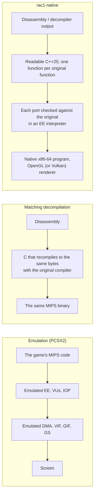
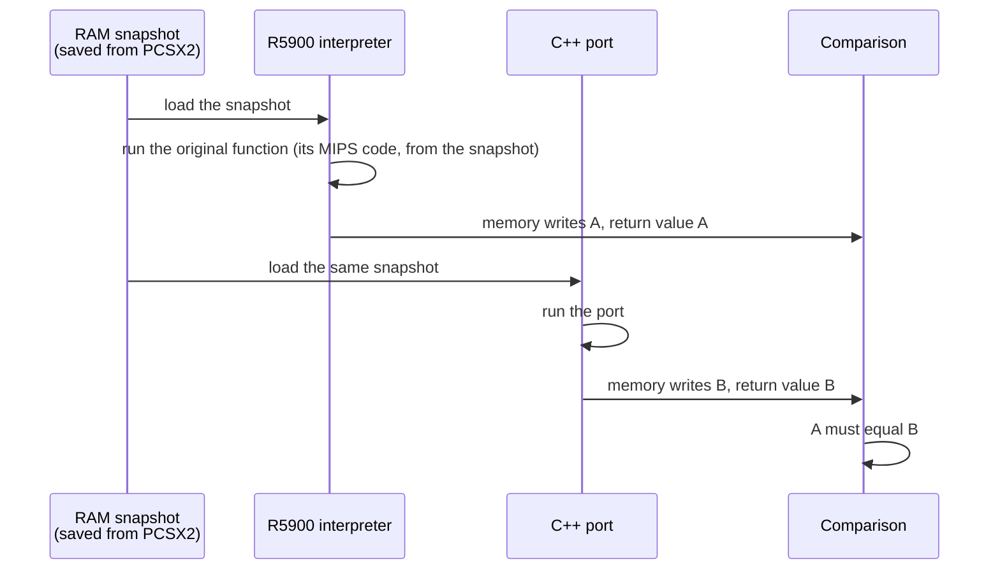

# The approach

rac1-native runs Ratchet & Clank (PS2, NTSC-U, `SCUS-97199`) as a native Linux and Windows program. It does
this by porting the game's own code to C++, one function at a time, and proving each port against
the original. This page explains what that means, how it differs from emulation and from
decompilation projects, and how a port is checked.

## Three ways to bring a PS2 game to a PC

**Emulation.** An emulator such as PCSX2 reproduces the console's hardware: the Emotion Engine
(EE, the R5900 CPU), the vector units VU0 and VU1, the DMA controller, the GS rasteriser, the IOP
and the sound chip. It runs the unmodified disc. Because it reproduces the hardware, it also
inherits the hardware's data flow: the 3D reaches it as screen-space primitives already projected
for a 4:3 frame, textures are whatever the game fitted into 4 MB of video memory, and widescreen
usually needs patches that change the game's own code or data.

**Matching decompilation.** Projects such as the Super Mario 64 decompilation rebuild C source
that, compiled with the original compiler and flags, produces a byte-identical binary. That proves
equivalence mechanically, but every line is shaped by the old compiler, and the result is still
the console's binary.

**This project** is a non-matching, port-style decompilation, the approach OpenGOAL took for Jak
and Daxter:

1. Each function of the game's executable (`SCUS_971.99`), of its boot module and of its per-level
   overlays is rewritten as readable C++20. The C++ carries a `// orig: 0xADDR` comment naming the
   original function it ports.
2. The goal is the same behaviour, not the same bytes. The port has the same control flow as the
   original and reads and writes the same state at the same addresses in a model of the EE's
   memory (see [Architecture](architecture.md)).
3. The program is compiled with a normal host compiler and runs natively. The hardware parts the
   game talks to (EE memory, timers, the IOP's sound driver, the GS for 2D) are provided by a small
   hardware layer, `runtime/`.
4. The 3D is not drawn through an emulated GS. A native renderer, the MRP, draws what the game's own
   render code decided to draw, with OpenGL, or with Vulkan as an experimental option (see
   [Rendering](rendering.md) and [Vulkan](vulkan.md)).

It is not an emulator: no MIPS code runs while you play. Everything that runs is C++ compiled for
your machine. (The repository does contain an R5900 interpreter, `runtime/ee/ee_interpreter.cpp`,
and a VU interpreter, `runtime/vu/vu_interpreter.cpp`. The first is the reference used to prove
ports and is not called by the game. The second is the reference the translated VU microprograms
are proved against; while playing, it only runs a VU0 program that has no C++ translation yet. See
[Decisions](decisions.md), sections 5 and 6.)

## Faithful to the game's code, not to the PS2's limits

The project's rule for what "faithful" means:

- **The game's behaviour is the original's, proved.** Its logic, its state in EE memory, and the
  timing and results of its simulation are the original's. This is what the oracle checks, and it
  is never traded away.
- **The console's compromises are not kept.** These are the things the original does only because
  of the hardware:
  - frame-rate drops when the PS2 could not keep up;
  - fades and waits that hide disc loading;
  - aggressive level of detail and short draw distances;
  - low texture resolution;
  - the 4:3 frame.
- **How a compromise is removed:** the game's state stays exactly the original's, and the
  original's way stays available as an option, as the reference.
- **Enhancements are labelled and off by default.** Anything that changes the game's behaviour or
  state (new controls, Ratchet & Clank 3 movement, a different camera) is an enhancement, not a
  compromise removed. Enhancements are optional and off by default.

How each compromise is removed in practice:

| PS2 compromise | What the port does | The original's way |
|---|---|---|
| Frame-rate drops and load shedding. The game measures each frame's load with the EE's timer 1 and drops particles, lights and explosion effects when the frame is heavy. | The host's timer 1 only moves when a vsync passes (`runtime/ee/ee_timer.h`), so every frame reads as unloaded: an ideal PS2 that never misses a vsync. | Not selectable: an overloaded PS2 cannot be reproduced on a PC. |
| Screen fades that hide disc loading | The fade's loop still runs whole, with the same memory writes and frame counter, but inside one host frame: the screen cuts. | Options > Advanced > Fades > Original |
| Level of detail and draw distance | A Level of Detail setting draws more detail further away. The game's own decisions are not changed (see [Rendering](rendering.md#level-of-detail)). | Options > Graphics > Level of Detail > Original |
| Texture resolution | The MRP keeps every mip level of every texture, so distant objects are not drawn from the small mip the PS2 had room for. | Debug tools only: `RAC1_MRP_MIP=faithful` and `RAC1_MRPW_MIP=faithful`, or the debug menu |
| The 4:3 frame | The 3D can be widened to fill the screen, and the HUD spread over it; the game itself still sees its 4:3 view. | Options > Graphics > Aspect Ratio > 4:3 Original, HUD > 4:3 Original |

The enhancements (quick-select pause, modern aiming, Ratchet & Clank 3 movement, modern lighting)
are described in [Advanced options](advanced.md) and [Lighting](lighting.md).

## How a function is ported and proved

### The porting rules

A function under `src/game/` counts as ported only if all of this holds:

1. **Right function.** There is evidence that the address is the code it is believed to be: the
   caller chain, a cross-reference, or a trace in PCSX2.
2. **Same control flow.** Every branch of the original is present, in the same order. A branch
   that is not ported yet is a `TODO_PORT(0xADDR)` stub that logs once. It is never silently left
   out and never replaced by a guess.
3. **Same state, same place.** The globals and struct fields the original reads and writes are read
   and written in the model of EE memory, at the original addresses. There are no private copies.
4. **Every constant is quotable.** A number in a port appears in the original code or is loaded
   from game data. There are no tuned values.
5. **Callees.** A callee that is not ported yet is called through a stub carrying its original
   address. Nobody writes a guess of what it does.
6. **Labels are claims.** Code may be called a faithful port only if these rules hold. Code that is
   openly invented (debug tools) lives in `src/_devtools/`.
7. **Proof.** A port is done when it produces the same EE memory writes and the same return value
   as the original, on recorded game states.

### The oracle

The proof uses the original code itself as the oracle:

1. The EE's RAM is set up at a known moment (Ratchet standing, running, jumping, in a fight...):
   a level laid out from the player's own disc, or a snapshot of the game running, saved from
   PCSX2 or from a headless run of the game. Snapshots are the user's own data and are never
   committed.
2. The original function is run from the snapshot by an R5900 interpreter
   (`runtime/ee/ee_interpreter.cpp`). Its memory writes and its return value are recorded. The
   interpreter is not an emulator: it has no timing, no interrupts and no GS, and hardware
   registers read as 0. It is enough to run one function, or a frame's worth of game code, from a
   memory image.
3. The snapshot is restored and the C++ port runs on it.
4. The two must match. A port that differs is not done, however plausible it looks.

The same idea proves the translated VU microprograms against the VU interpreter, and the MRP's
assets and shaders against the faithful renderer (see [Rendering](rendering.md#how-the-mrp-is-checked)).

The float arithmetic has to match too. The EE rounds additions, subtractions and multiplications
toward zero and has no denormals; a host CPU rounds to nearest. The thread that runs the game
therefore switches the host FPU to the EE's mode at start (`ps2fpu::enter_ee_rounding()` in
`runtime/ee/ps2_fpu.h`, called from `main` in `src/host/orig_main.cpp`), and an original FPU
divide, which rounds to nearest on the EE, is written `fpu_div(a, b)` in a port. Without this, a
Vendor's animation ended on a different value than on the PS2, and a later function looped
forever.

The oracle is in `tests/oracle/`: how to build and run it, how to add a batch, and where its RAM
snapshots go (they are never committed) are in [The oracle](oracle.md). Every change to ported game
code ships with a batch and passes it before it is merged.
