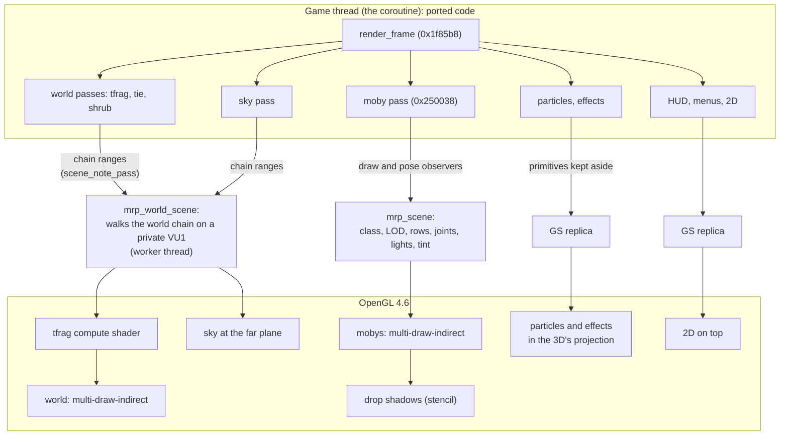

# Rendering

How a frame is drawn. In short: the game's own render code still runs, ported, and decides what is
drawn, where, with which level of detail and which lighting. The **MRP** (Modern Rendering Pipeline)
then draws those decisions natively with OpenGL 4.6, instead of sending them through an emulated
PS2 graphics chip. A GS replica is kept for the 2D, and the PS2's way of drawing the 3D is kept as
the reference that the MRP is proved against.

The optional modern lighting (sun shadows, point lights, ambient occlusion) has its own page:
[Lighting](lighting.md). The same renderer can also draw with Vulkan instead of OpenGL (experimental,
Options > Graphics > Renderer): [Vulkan](vulkan.md).

## How the PS2 drew a frame

The PS2 hardware involved: the EE (the R5900 CPU, 32 MB of RAM and a 16 KB scratchpad), two vector
units (VU0 and VU1, the latter with 16 KB of code and 16 KB of data memory), the VIF that unpacks DMA
data into VU memory, the GIF that feeds the graphics chip, and the GS, a rasteriser with 4 MB of
embedded memory for the frame, the depth buffer and the textures.

One frame of Ratchet & Clank:

1. **The EE runs the game and builds DMA chains.** `render_frame` (0x1f85b8) runs the sky pass, then
   the three world passes, tfrag (0x294240, the terrain), tie (0x295c80, instanced objects such as
   buildings and rocks) and shrub (0x286e60, small instanced vegetation and details), then the moby
   pass (0x250038), the particles, the effects and the 2D. Each pass culls, picks levels of detail
   and appends VIF and GIF packets to the frame's chain. Mobys are skinned on VU0 from the EE.
2. **The VIF loads VU1.** Each world pass uploads its own microprogram, then its per-object data.
   Each world pass has two programs: one for objects inside the view, one that clips polygons crossing
   its edges.
3. **The VU1 programs** transform, light, fog and clip the geometry, and send GS packets.
4. **The GS rasterises** them in 16.4 fixed-point screen coordinates, with its texture function,
   alpha test, blending and fog.

The game also worked around the hardware's limits: textures streamed per frame by distance, with
far objects only getting their small mip; level-of-detail bands and draw distances; everything culled
against a 4:3 view; and, when a frame was too heavy, particles and lights dropped.

## The game's render code still decides

`render_frame` (0x1f85b8, `src/game/ovl/overlay_entry.cpp`) is ported and runs every gameplay frame,
in the original's order:

1. the sky, `sky_pass` (`src/game/ovl/sky_levels.cpp`, its EE side in `sky_ee.cpp`);
2. tfrag, tie and shrub through `world_pass` (`world_tfrag_pass`, `world_tie_pass`,
   `world_shrub_pass`);
3. the shadows and draw lists, then the moby pass `moby_pass` (0x250038, `moby_pass.cpp`, its draw
   loop 0x2559c0 in `moby_draw.cpp`);
4. the overlay effects: glows, lens flare, decals, the particles (`particles_draw.cpp`), sparkles,
   screen effects, the HUD and the help text;
5. screen tints and flashes, the world's lighting passes and the moby texture slots.

All of their decisions are the game's own: which objects are visible, which level of detail each one
uses, the animation pose and its bone matrices, the lights chosen for each moby, tints and fades.
The MRP does not re-derive any of them.

## How the MRP gets the frame

The MRP takes the frame from two places.

**Mobys: observers on the ported moby pass.** `mrp_scene_install` (`src/game/render/mrp_scene.cpp`)
installs two hooks in the ported code: `g_moby_draw_observer` in the moby draw loop and
`g_moby_pose_observer` in the skinning (`moby_skin.cpp`). For each moby drawn, the scene records its
class and level of detail, its model-to-view rows, its joint matrices, its three light directions and
colours, its tint and alpha, its fade and whether it must be drawn after the drop shadows. The frame
adds the camera and the projection block.

**World and sky: the pass's own VU1 chain.** The world passes still build their DMA chain, and
`world_pass` notes each pass's range of it (`mrpw::scene_note_pass`). `mrp_world_scene.cpp` then
walks that chain on a **private VU1**: the same VIF unpacking, with the set-up programs run as the
game would run them. At each place where the game would start a drawing program, it matches the
VU1 memory against the level's assets and evaluates the program's math (`src/formats/world_mrp.cpp`
holds the CPU reference). So the culling, the level of detail and the lit vertex colours are exactly
the original's. The walk runs on a worker thread (`mrp_world_renderer.cpp`).

**What is skipped.** Some of the EE's work only feeds the PS2's way of drawing. With the MRP drawing
the mobys, it is skipped (`g_moby_mrp_skip`, `src/game/ovl/moby_pass.h`): the VU0 skinning, the
sub-mesh colour fill, the texture-slot patching, and the GS replica's processing of the moby chain.
The skip is decided per frame before the update (in `src/host/orig_main.cpp`) and is off on the boot,
the level exit, movies and the Vendor. Before it was enabled, the whole of EE memory was hashed after
every frame with and without it, and every difference was traced to one of those GS-only outputs.

**The frame on the host** (`orig_main.cpp`): after the update, a `prepare` step captures the view,
the world chain, the moby lists and the shadow data; a `draw` step then issues, in order, the tfrag
compute dispatch, the sky, the world batches, the mobys, the drop shadows and the mobys deferred
after them, and finally the GS replica's effects and 2D on top. With pipelining on, a frame is drawn
while the next game frame is already being updated.

## The world on the GPU

**Assets.** The setup generates, from the player's ISO, the geometry and textures of every tfrag,
tie and shrub of every level (`assets/generated/mrp/world/level<N>/world.mrpw` and texture files
`textures_{tfrag,tie,shrub}.mrpt`; written by `export_mrp_world` in `src/setup/mrp_export.cpp`).
Each asset keeps the geometry **as the VU program assembles it**: the exporter traces the ported VU
programs' output, every level of detail and every mip included. The format and its CPU reference are
in `src/formats/world_mrp.{h,cpp}`.

**Level load** (`mrp_world_renderer.cpp`): textures go into one `GL_TEXTURE_2D_ARRAY` per size, with
their mips; geometry templates into vertex buffers; the tfrag "plans" (below) and the resident lit
colours are built.

**Per frame**, only what changes is uploaded:

- **tie and shrub** packets are templates evaluated once at load. Per frame, each visible instance
  gets a record (its rows, morph factor, fog and alpha) and its lit colours. The colours are kept
  resident on the GPU: a copy is compared with EE memory after each update, and only the instances
  whose colours changed are uploaded (`ResidentColours`, `src/game/render/mrp_world_static.h`).
  The vertex shader evaluates the templates from storage buffers indexed by `gl_BaseInstance`.
- **tfrag** runs on a compute shader (next section).
- **Draws are merged**: consecutive draws with the same GL state become one
  `glMultiDrawElementsIndirect`. A Veldin frame at the highest level of detail went from 157 world
  batches to 15.

**The fragment shader is the GS**: its texture function, the alpha test including its "fail" modes
(drawn in two passes where needed), its mip-level formula, and fog with the fog colour.

### tfrag on a compute shader, with the EE's rounding

tfrag, the terrain, is the data-dependent pass: each frame its VU1 program morphs vertices between
levels of detail, substitutes vertices with their parents at the boundaries, and fixes up its lists.
`src/game/render/mrp_tfrag_gpu.cpp` runs that program's steps on the GPU: one workgroup of 64
threads per visible piece, with the piece in shared memory, following a per-level "plan" built at
load from the program's structure.

The difficulty is the arithmetic. The VU rounds every addition, subtraction and multiplication
toward zero; a GPU rounds to nearest. The compute shader reproduces the VU's rounding exactly, in
32-bit floats:

- `addz(a, b)` computes the sum and its exact rounding error with a two-sum;
- `mulz(a, b)` computes the product and its exact error with `fma(a, b, -p)`;
- `chop` then steps the rounded result one unit toward zero when the exact error has the opposite
  sign, which is exactly rounding toward zero;
- denormals are flushed (`ftz`), divisions are rounded toward zero with `fma` residuals, and the
  one world-space point is computed in double precision toward zero and narrowed toward zero.

The result is checked bit for bit: `RAC1_MRPW_TFRAG_VERIFY=1` reads back the GPU's vertices and
triangle lists and compares them byte for byte with the CPU reference. The project's measurements
found 0 differing vertices out of 904,570 on Veldin, and likewise on the intro, Novalis and Kerwan.

### The sky

The sky has no VU1 program of its own: its shells are packets the EE builds, and its sprites use the
particle program. The MRP decodes the sky pass's packets, runs the particle program for its sprites
on the walker's VU1, and draws each vertex as a direction at the far plane, so the sky sits behind
everything in the shared projection. Its textures are decoded once per level.

## Mobys

`src/game/render/mrp_moby_renderer.cpp` draws every moby.

**Assets.** Every moby class of every level is generated by the setup into
`assets/generated/mrp/moby/level<N>/<class>.mrpm` plus `textures.mrpt` (`export_mrp_mobys` in
`src/setup/mrp_export.cpp`, format in `src/formats/moby_mrp.{h,cpp}`). As for the world, the packets
are kept as the game sends them to the VU. Each vertex carries its skinning record, resolved to a
joint or a blend of two or three joints.

**The vertex shader is the VU0 skinning plus the VU1 program:**

- skinning from the frame's joint matrices (one joint, or a blend of two or three), truncated to
  16-bit as the original's;
- the original's lighting: the skinning record's rows hold three light directions and colours (the
  game's two directional lights, the third being the sum of the nearby point lights), plus the tint
  row. It even reproduces the EE's fixed-point colour step, on the float's bits;
- the VU1 transform, declared `precise` so that no fused multiply-add changes a result;
- the fog value, computed per vertex as the program does.

**The fragment shader is the GS** (texture function, mip rule, fog, alpha test with its fail modes),
with blending set from the GS state.

**One projection.** The mobys are drawn through the same view-projection as the world, into the same
depth buffer. In the PS2's way of drawing, the mobys' depth and the world's depth came from different
transforms, and parts of Ratchet showed through the ground; that is gone.

**Drop shadows** (`src/game/render/mrp_shadows.cpp`). The PS2 draws a moby's blob or projected shadow
as shadow volumes counted in the frame's alpha channel. The MRP draws the same shadow volumes from the
game's own data with a stencil counter instead, then darkens the counted pixels with the original's
blend. The mobys that must appear on top of their shadow are drawn after it. Compared with a CPU run
of the original's integer alpha arithmetic, 0 of 203.6 million pixels differed.

**Batching**: draws are merged into multi-draw-indirect calls, with one upload of joints, parts and
draw records per frame.

## Particles and effects

The particles (their VU1 program, 0x267c98's), the quad effects (glows, the ship's canopy shine,
decals), sparkles and the nanotech orbs are produced by the ported code as GS packets. The GS replica
still runs those ranges, with the ported particle program on its VU1, but instead of drawing their
primitives it keeps them aside. `src/game/render/mrp_fx.cpp` takes them back to world space and draws
them in the shared projection and depth buffer, from a texture atlas, in the GS's primitive order,
breaking batches only on a blend or depth change. Effects that need it use dual-source blending.
What the chain draws before the moby pass (the draw lists `render_frame` runs before it, such as Hoven's
water) is drawn before the MRP's mobys, the rest after them, as in the original's order: a moby part that
writes its colour but no Z (Ratchet's ice cube on Hoven) is not covered by them. On the Vendor's screens'
frames that put their stored picture back, no world pass and no effect runs, so the MRP neither draws nor
skips anything there (the passes noted last were an older frame's, and skipped the screens' own packets).
The atlas holds at most 1024 layers (fewer if the GPU allows fewer array layers); when it is full, the
layer least recently drawn with is reused. Some effects get new texture pixels every frame (Aridia's
sand sea), so an atlas that only grew reached the GPU's limit after about half a minute there, and every
effect then lost its texture ([issue #19](https://github.com/RAC-Native/rac1-native-game/issues/19)).

## Level of detail

The original decides levels of detail and draw distances for a 4:3 PS2. Options > Graphics > Level of
Detail offers Original, Low, Medium, High and Maximum (`mrp_lod.cpp`: 0, 25, 50, 75 and 100 on a
slider).

The game's own decisions are never changed, because they are game state. Instead:

- **Mobys and the sky**: before the real pass runs, the same ported pass runs a second time as a
  "shadow run" on a **journal of EE memory** (`ee_journal_begin` and `ee_journal_restore`,
  `runtime/kernel/ee_journal.h`), with its distances scaled by 16^(v/100), unlimited at 100. What
  that shadow run produced is copied out and drawn, then memory is put back, and the real pass runs
  from the original state. For mobys the scaled values are the draw distance, the far-model switch
  distance and the global maximum.
- **The world**: the host makes the tie, shrub and tfrag per-instance decisions itself, with C++
  copies of the passes' culls and the scaled distances (`mrp_world_static.cpp`, `tfrag_decide`).
  That includes the shrubs' far billboard variants (antennas, spires, lights and plants seen from
  afar), whose camera-facing quads the shrub pass writes as a GIF stream: the host writes the same
  stream (`variant_stream`). These copies were checked draw for draw against the game's own
  (`RAC1_MRPW_STATIC_CHECK=1`; the billboards' stream word for word).
- **Original** runs no shadow run at all.

With the whole of EE memory hashed after every frame, the game's state was identical at Original and
at Maximum on Veldin, Novalis and Kerwan.

## Widescreen and render scale

`src/game/render/render_view.cpp` sets the host's view from Options > Graphics:

- **Aspect Ratio**: 4:3 Original, 16:9, or Fill Screen (the 3D widened to the window's shape).
- **Fit to Screen**: when the picture's shape is not the window's, black bars or stretched.
- **Field of View**: a scale of the original's field of view (both its horizontal and vertical angles).

To widen the 3D, the host writes a wider projection into the game's projection block and runs the
game's own projection set-up (0x1f7980) inside a journal. `render_view_projection_undo` restores the
bytes before every game update, so **the game only ever sees its own 4:3 projection**. Objects in the
side bands are culled by the same shadow-run mechanism as the level of detail, with the view widened:
horizontally by the widescreen and the field of view, vertically by the field of view (the sky too).
Before the vertical part, a Field of View above x1.00 lost the sky and the objects in bands at the
top and bottom of the screen.
The 3D that sits under the game's 2D keeps the game's own projection, so the two stay together at any
field of view and shape (issue #68): the full-screen menus' mobys are drawn in the game's 4:3
projection on the centred 4:3 frame; on the title's main menu only the menu's boxes are (the mobys the
game draws from the menu's camera), the title scene and its own mobys keep the widened view; on the
Vendor's screens (game mode 5), whose monitors are the scene's own mobys, the field of view is the
game's (x1.00) while the widescreen still widens the 3D around the 4:3 frame.
The levels' water, lava and sand-sea surfaces (Novalis's pond, Aridia's sand sea, Gaspar's lava, the
water grids of Rilgar, Umbris and other levels) are drawn by draw-list callbacks that cull their tiles
against the game's 4:3 clip matrix; those draw lists run as shadow blocks too, with that matrix
widened, and the GS replica walks each shadow's chain in place of the real block's (several
substitutes a frame). Before this, tiles at the sides of a widened view were missing.
Many of those callbacks test their cells with the game's point test (0x2002e0), which reads its own
copies of the projection's tangents (0x16cd00..0x16cd2f), and the quad drawer (0x1fd228) rejects a
quad past about twice the 4:3 frame's half width: the shadow blocks widen those too (keeping the
guard band the game clips at). Before this, at 32:9 Gaspar's lava was still cut in the outer part of
each side, and the effect quads (Rilgar's water quads, glows) were rejected there. The shadow-mesh
program (VU1 program 7: the drop shadows, the prim lists of Aridia's sand sea and other surfaces)
draws a triangle that crosses the guard band clipped, but first drops one lying wholly past a third
of the guard band (4 / 3 of the 4:3 frame's half width), which a 32:9 view shows: in a widened view
that test is scaled by the view's widening (the GS replica's walk hands it to the program,
`gs::Gs::set_side_widen`), the clipping itself left at the game's guard band. Before this, the sand
sea's cells near the camera at the far left of a 32:9 view (crossing the near plane, so clipped)
were missing there, black. What is still cut: a surface a moby's update queues
only when the moby pass drew that moby in the last frame (moby +0x31, the 4:3 view's decision, which
the shadows cannot change without changing the game's state): one of Rilgar's water patches (class 79),
the ships' cockpit glass.
The shadow runs also put back the collision routines' contact registers (vf25..vf29, which the port
keeps outside the VU0 state): the ship's shadow callback (0x28e670, queued near the parked ship)
probes the ground, and a shadow that probed where the real block did not left them changed for the
game's next collision.
Before this, the game's state diverged on most frames of the Veldin intro when the view was widened;
after it, its state is identical at 4:3 and at 5120x1440.

The HUD (unless Options > Graphics > HUD spreads it, see below) and the menus stay 4:3 in the middle of the screen; full-screen 2D such as fades reaches the
edges: a primitive covering the frame's whole width or height has its vertices on the frame's edges
moved to the window's. A flat fill counts when it covers every pixel of the frame as the GS fills it,
so the fills the game draws with the HUD's half-pixel offset (x -0.5 .. 511.5: the Visibomb's green
screen and its scan lines, 0x1f9df8) reach the edges too; a textured one only when it reaches the
edges themselves, so a picture (the level exit's card banners) keeps its shape. The Visibomb's
out-of-range static (class 832's draw-list callback, a grid of 32 x 32 sprites over the frame, the
same code on every level that has it) is a full-screen layer drawn in pieces: its chain range is
noted when the callback runs and the GS replica stretches it horizontally about the frame's centre to
the window's width (`gs::Primitive::layer`). The whole frame is shown, as the PS2 drew it, with one exception: a HUD element hiding parks its
3 leftmost columns at the frame's right edge for 16 frames (the Suck Cannon's gauge and the air meter, the
game's own `hud_plain_update` 0x235ea0), which a TV's overscan hid and which in widescreen sits inside the
picture; the modern view does not draw such slivers (a textured 2D primitive with at most 4 frame pixels
inside the frame, the rest past its left, right or top edge; `RAC1_EDGE_SLIVERS=1` draws them, the faithful
reference always does). `RAC1_OVERSCAN` (testing) can still hide a 4-pixel strip of the 2D at the frame's
left, right and top edges as a TV did; it never cuts the 3D, fades or the edge fills.

### The HUD in a widened view

Options > Graphics > HUD (4:3 Original, 16:9, 21:9, 32:9, Fit Screen; `RAC1_HUD` for tests) spreads the
HUD over a box wider than the 4:3 frame: its width is the chosen shape (21:9 is 64:27) but never wider
than the view's (`min(choice, the view's aspect)`; Fit Screen is the view's), centred. 4:3 Original
changes nothing (the default: the same pictures and the same game state as before). The game's state
is never touched: the HUD is moved when the GS replica draws it.

The game lays its HUD out in 13 element slots (0x17dc50, 0x90 bytes each; each holds the draw function
of the element requested into it, `hud_draw` 0x23af48 calls them). Each slot has its own place and
layout flags (+0x50 x, +0x54 y, +0x60 flags), the same on every level: `hud_element_place` (0x235a70)
aligns an element left of x with flag 4, right of x with 8, centres it on x otherwise, and
`hud_element_offset` (0x235ad8) slides it out toward that same side. So the flags are the game's own
anchor, and they decide what moves (`hud_element_side`, hud.cpp, read only):

| Slot | Place (x, y) | Flags | Anchor | Elements (draw function) |
|---|---|---|---|---|
| 0 | 20, 15 | 5 (top, left) | left | the weapon's ammo (0x23a7a8), hero mode 2's bar (0x23a640), the races' (Rilgar, Kalebo III) |
| 1 | 256, 32 | 1 (top) | centre | health (0x239810), Gemlik's boss element (request 0x11) |
| 2 | 492, 15 | 9 (top, right) | right | bolts (0x239df8) |
| 3 | 20, 208 | 4 (left) | left | the quick select (0x2382a0), Gadgebot's commands (0x238f88) |
| 4 | 492, 208 | 8 (right) | right | the air meter (0x2365a8), the Morph-o-Ray (0x236e50) |
| 5 | 20, 376 | 6 (bottom, left) | left | the races' (Rilgar's request 5), Skid's (Aridia) |
| 6 | 256, 376 | 2 (bottom) | centre | |
| 7 | 492, 376 | 0xa (bottom, right) | right | the Metal Detector (0x23a2d0 and the level copies of Batalia, Drek's fleet, the Veldin finale), the races' (request 7), Skid's |
| 8..11 | 492, 208 | 9 | right | |
| 12 | 142, 50 | 0 | centre | the help panel (0x237200) |

`hud_draw` notes the chain range of each left or right element as it draws it (the packet cursor before
and after its draw function, `render_view_hud_note`); the chain's stage hands the ranges to the GS replica
(`Gs::set_chain_hud`), which marks their primitives (`gs::Primitive::hud`, 1 left, 2 right), and the
drawing moves them by `Viewport::hud_shift` frame pixels, half the frame's width times the box's
widening over 4:3 less one, toward their side, their scissor with them (what slides out is cut at the
box's edge, as at the frame's before). Health, the help messages (0x23cf80), the help desk, subtitles,
the cutscene letterbox, the menus, the pause screen, the Vendor, the planet cards, pictures, fades and
the Visibomb's layer are not elements of a side and keep their places. The ship flight's planet banner
and save icon (`flight_draw`) are not HUD slots and stay on the 4:3 frame; so does the 2D the space fights'
levels draw from draw-list callbacks rather than HUD slots (Pokitaru 0x311d50, Gemlik 0x2b97f8, Drek's
fleet 0x2eaae0 / 0x2eb9a8; not looked at in a fight yet).

**Render scale** (Options > Graphics > Render Resolution, 50 % to 200 %): the world and the mobys are
drawn into an off-screen buffer at that fraction of the window's resolution, then scaled to the
window; effects and the 2D are drawn after, at the window's resolution.

## Textures

The PS2 kept only what fitted in 4 MB, so distant objects were drawn from their small mip. The MRP
keeps every mip of every texture resident and chooses the mip from the screen as a modern GPU does,
so objects stay sharp at any distance ("full texture"). This is the default. `RAC1_MRP_MIP=faithful`
(mobys) and `RAC1_MRPW_MIP=faithful` (world) bring back the GS's own mip choice; like other testing
switches they need `--debug-tools`, and the debug menu has the same choice.

## The 2D: the GS replica

`runtime/gs/gs_emu.cpp` and `gs_draw.cpp` are a replica of the parts of the PS2's graphics path the
2D needs. They walk the frame's DMA chain, take the GIF packets and texture uploads into a model of
the GS's 4 MB memory, run VU1 programs where the chain starts them (ported programs registered by the
hash of their code, see [Decisions](decisions.md#5-a-vu-interpreter-for-the-microprograms-not-yet-ported)),
and draw the result with OpenGL. They draw the HUD, the help text and fonts, the menus, screen tints
and flashes, fades, and any effect the MRP does not take. The 2D maps cleanly to the screen, so
emulating it is simple and exact. What the game draws into its own memory to use as a texture (the
menus' pictures, such as the ship's planet menu's planet, made of three blended layers) goes into a
render target that keeps the GS's alpha (0x80 = 1.0); its blending reads that alpha at the GS's scale.
With the modern renderer a font's glyph (a 16 x 16 or 24 x 16 texel cell, a quad whose texture coordinates follow x and y apart)
is sampled only inside its own cell: scaled up from the PS2's resolution, the bilinear filtering of a glyph's outer half texel
blended in the neighbouring glyphs' edges in the font's texture, thin lines under, over and through the letters (issue #76; the
GS drew the glyphs 1:1, at its texels' centres). The faithful reference (`RAC1_MRP=0`) samples as the GS.
Every ALPHA register's `(A - B) C + D` maps to the GL's blending (add, subtract or reverse subtract; the two
combinations with a factor `1 + C` use 1), for the replica, the MRP's mobys, world and effects alike: the
subtractive second pass of the force fields, Orxon's O2 barriers and Quartu's gates (`(Cd - Cs) FIX`) was drawn
as an opaque copy of the source before, black.

## The original rendering, kept as the reference

The PS2's way of drawing the 3D is kept, ported: the VU microprograms the game uploads were
translated to C++ instruction by instruction (`src/game/ovl/moby_vu1.cpp` and `moby_vu1_fast.cpp`
for the mobys, `world_vu1_{tfrag,tie,shrub}_{a,b}.cpp` and their `_fast` forms for the world,
`particles_vu1.cpp`), and the GS replica draws their output. It is exact but slow: the faithful world
alone cost 56 to 58 ms a frame on Veldin.

It can be selected with `RAC1_MRP=0` (mobys) plus `RAC1_WORLD_FAITHFUL=1` (world), or in the debug
menu (Rendering > Renderer > "VU emulation (faithful reference)"). Both need the debug tools (see
[Settings](settings.md#debug-tools)). `RAC1_MRP=0` alone draws the mobys the faithful way and the
world with older host renderers (`tfrag_render.cpp`, `tie_render.cpp`, `shrub_render.cpp`,
`sky_render.cpp`), which are kept for comparison.

## How the MRP is checked

All of these come from the project's own measurements during development:

- **Assets against the VU programs.** Every moby class of levels 0 to 17 was compared with the ported
  VU programs' output (4.8 million GS triangles); every tfrag, tie and shrub program start captured
  in play, plus perturbed variants, matched to the last word.
- **Shaders against the CPU reference, read back from the GPU.** Moby positions: all exact over tens
  of millions of vertices, colours exact but for a handful (`RAC1_MRP_CHECK=1`). tfrag: 0 differing
  vertices (`RAC1_MRPW_TFRAG_VERIFY=1`). Drop shadows: 0 differing pixels.
- **In-game kick check** (`RAC1_WORLD_MRP_CHECK=1`, `mrp_world_check.cpp`): the faithful world runs
  alongside and every drawing program start is compared.
- **Image differences** against the faithful path, small and each explained (clipped pieces'
  texture interpolation, sub-pixel edges).
- **Game state.** `RAC1_RAMHASH` hashes every 4 KB page of EE memory after every update. It came out
  identical with and without the MRP, at every level of detail, at 4:3 and widened, and with fast and
  original fades.

Not bit-exact by design: GPU rasterisation, perspective-correct interpolation on clipped pieces and
sub-pixel edges differ from the GS.

## Performance

From the project's measurements, on a shared development machine with an integrated Radeon 890M GPU
(compare within a row, not across rows):

| Scenario | Before | After |
|---|---|---|
| World, faithful VU path vs MRP | ~23 ms | ~3 ms |
| Mobys by the MRP: the EE's GS-only work run vs skipped | 39.5 ms | 24.2 ms |
| Drop shadows: GS replica vs stencil | 17.2 ms (1288 GS draws) | 9.1 ms (3 GS draws) |
| 5120x1440, highest level of detail, windowed play | about 15 fps | 40 to 60 fps |

The GPU was never the limit: about 3 to 4 ms at 1080p and 8 to 11 ms at 5120x1440 on that
integrated GPU, while the CPU side was 25 to 40 ms before the work above.

## Limits

- The HUD, menus, and effects other than particles, glows, decals and sparkles still go through the
  GS replica.
- The mobys' flattened shadow meshes (a second, flattened model some classes have) are not drawn by
  the MRP (`mrp_moby_renderer.cpp`).
- Drop shadows of mobys drawn only because of a higher level of detail are missing.
- A moby whose class logic reads its own "drawn" flag behaves as in 4:3 when it is only visible in
  the widened side bands: that flag is game state, and the port does not change it.
- OpenGL 4.6 by default; a Vulkan 1.3 backend is experimental and opt-in ([Vulkan](vulkan.md)).
