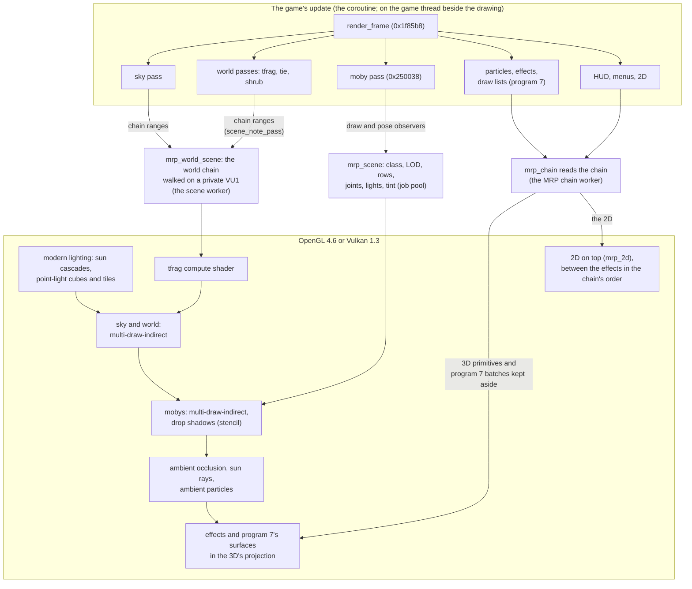

# Rendering

How a frame is drawn. In short: the game's own render code still runs, ported, and decides what is
drawn, where, with which level of detail and which lighting. The **MRP** (Modern Rendering Pipeline)
then draws those decisions natively, with OpenGL 4.6 or Vulkan 1.3, instead of sending them through an
emulated PS2 graphics chip. The MRP draws all of it: the world, the sky, the mobys, the particles and
effects, the water, lava and sand seas of VU1 program 7, and the 2D (the HUD, text, menus, fades),
which it reads from the frame's chain itself ([The 2D](#the-2d)). The PS2's way of drawing - a GS
replica and the ported VU1 programs - is kept as the reference that the MRP is proved against.

The specialised pages: [Lighting](lighting.md) (the original lighting and the optional modern
lighting), [Materials](materials.md) (Surface Detail), [Ambient particles](particles.md),
[Performance](performance.md) (where a frame's CPU time goes, the threads) and [Vulkan](vulkan.md)
(the second backend).

## How the PS2 drew a frame

The PS2 hardware involved: the EE (the R5900 CPU, 32 MB of RAM and a 16 KB scratchpad), two vector
units (VU0 and VU1, the latter with 16 KB of code and 16 KB of data memory), the VIF that unpacks DMA
data into VU memory, the GIF that feeds the graphics chip, and the GS, a rasteriser with 4 MB of
embedded memory for the frame, the depth buffer and the textures.

One frame of Ratchet & Clank:

1. **The EE runs the game and builds DMA chains.** `render_frame` (0x1f85b8) runs the sky pass, then
   the three world passes, tfrag (0x294240, the terrain), tie (0x295c80, instanced objects such as
   buildings and rocks) and shrub (0x286e60, small instanced vegetation and details), then the moby
   pass (0x250038), the particles, the effects and the 2D. Each pass culls, picks levels of detail
   and appends VIF and GIF packets to the frame's chain. Mobys are skinned on VU0 from the EE.
2. **The VIF loads VU1.** Each world pass uploads its own microprogram, then its per-object data.
   Each world pass has two programs: one for objects inside the view, one that clips polygons crossing
   its edges.
3. **The VU1 programs** transform, light, fog and clip the geometry, and send GS packets.
4. **The GS rasterises** them in 16.4 fixed-point screen coordinates, with its texture function,
   alpha test, blending and fog.

The game also worked around the hardware's limits: textures streamed per frame by distance, with
far objects only getting their small mip; level-of-detail bands and draw distances; everything culled
against a 4:3 view; and, when a frame was too heavy, particles and lights dropped.

## The game's render code still decides

`render_frame` (0x1f85b8, `src/game/ovl/overlay_entry.cpp`) is ported and runs every gameplay frame,
in the original's order:

1. the sky, `sky_pass` (`src/game/ovl/sky_levels.cpp`, its EE side in `sky_ee.cpp`);
2. tfrag, tie and shrub through `world_pass` (`world_tfrag_pass`, `world_tie_pass`,
   `world_shrub_pass`);
3. the shadows and draw lists, then the moby pass `moby_pass` (0x250038, `moby_pass.cpp`, its draw
   loop 0x2559c0 in `moby_draw.cpp`);
4. the overlay effects: glows, lens flare, decals, the particles (`particles_draw.cpp`), sparkles,
   screen effects, the HUD and the help text;
5. screen tints and flashes, the world's lighting passes and the moby texture slots.

All of their decisions are the game's own: which objects are visible, which level of detail each one
uses, the animation pose and its bone matrices, the lights chosen for each moby, tints and fades.
The MRP does not re-derive any of them.

## Two backends

The renderer has two backends, chosen at Options > Graphics > Renderer and read when the window is
made: **OpenGL 4.6**, the default, and **Vulkan 1.3**, experimental and opt-in (`RAC1_RENDERER=vulkan`
for one run). Each rendering module keeps its OpenGL code and has a Vulkan branch beside it
(`vk::is_active()`); the shaders are the same GLSL, made Vulkan's by `tools/gen_vk_shaders.py` and
compiled at build time. Both draw the same picture from the same scene, the modern lighting, the
materials and the ambient particles included; when Vulkan cannot start the game opens with OpenGL.
The reference images are OpenGL's. See [Vulkan](vulkan.md).

## How the MRP gets the frame

The MRP takes the frame from three places.

**Mobys: observers on the ported moby pass.** `mrp_scene_install` (`src/game/render/mrp_scene.cpp`)
installs two hooks in the ported code: `g_moby_draw_observer` in the moby draw loop and
`g_moby_pose_observer` in the skinning (`moby_skin.cpp`). For each moby drawn, the scene records its
class and level of detail, its model-to-view rows, its joint matrices, its three light directions and
colours, its tint and alpha, its fade and whether it must be drawn after the drop shadows. The frame
adds the camera and the projection block. The chains' decoding and the draw lists' transforms are
spread over the cores by the job pool (`src/jobs`), their results put together in a fixed order.

**World and sky: the pass's own VU1 chain.** The world passes still build their DMA chain, and
`world_pass` notes each pass's range of it (`mrpw::scene_note_pass`). `mrp_world_scene.cpp` then
walks that chain on a **private VU1**: the same VIF unpacking, with the set-up programs run as the
game would run them. At each place where the game would start a drawing program, it matches the
VU1 memory against the level's assets and evaluates the program's math (`src/formats/world_mrp.cpp`
holds the CPU reference). So the culling, the level of detail and the lit vertex colours are exactly
the original's. The walk, and then the frame's triangles, draw commands and batches
(`build_triangles`), run on the scene worker thread (`mrp_world_renderer.cpp`).

**Effects, VU1 program 7 and the 2D: the MRP's chain reader.** `mrp_chain.cpp` reads the frame's chain
(on the MRP chain worker): its GIF packets, its texture uploads, and in the effects' ranges the ported VU1
programs they start, on a VU1 of its own. It keeps the particles and quad effects as primitives, program
7's surfaces as the program's input batches, and the 2D as primitives with their GS state; `mrp_fx.cpp`
draws the first two in the world's projection ([Particles and effects](#particles-and-effects),
[VU1 program 7's surfaces](#vu1-program-7s-surfaces)), `mrp_2d.cpp` the 2D ([The 2D](#the-2d)).

The loading screen's flight between planets is a level of its own for the MRP: its 3D comes from the
flight's own assets (`assets/generated/mrp/{moby,world}/flight/`).

**What is skipped.** Some of the EE's work only feeds the PS2's way of drawing. With the MRP drawing
the mobys, it is skipped (`g_moby_mrp_skip`, `src/game/ovl/moby_pass.h`): the VU0 skinning, the
sub-mesh colour fill, the texture-slot patching, and the chain reader's processing of the moby chain.
The skip is decided per frame before the update (in `src/host/orig_main.cpp`) and is off on the boot,
the level exit, movies and the Vendor. Before it was enabled, the whole of EE memory was hashed after
every frame with and without it, and every difference was traced to one of those GS-only outputs.
The ranges of the moby chain the reader skips are recorded for every game frame, also those a slow
host frame runs without drawing them: a frame that builds no chain of its own walks the one before it,
and before #104 an undrawn frame's chain was walked without its ranges (stray VU1 programs; at Aridia's
arrival the game froze).

## The host frame: prepare and draw

The host draws a frame in two halves (`src/host/orig_main.cpp`):

- **prepare**, right after the game's update, takes what the drawing needs from the game's state: the
  view and the projection, the chain reader's run of the frame's chain (started on its worker), the
  world scene's inputs (captured, then built on the scene worker), the moby draw lists, the drop
  shadows' data, the level of detail's widening, and a copy of the game's memory that the modern
  lighting and the ambient particles read (`runtime/kernel/ee_copy.h`);
- **draw** issues the GPU work from that, then the frame is presented, paced to the frame-rate cap.

**Pipelined frames** (on by default in a window; the debug menu's Display tab, `RAC1_PIPELINE`): the
frame prepared at the end of one host frame is drawn in the next, its world scene built on the worker
meanwhile (one frame of latency). With the **game thread** (`RAC1_GAME_THREAD`, on with the pipelined
frames) the next game frames run on a thread of their own while the main thread draws the prepared
frame; the drawing reads only what its preparation took. The game's code still runs on one thread at a
time, in its order, so its state is the same word for word. Movies, fades, the full-screen menu, a
level's exit and load, the boot and every deterministic headless run prepare and draw in a row. The
details and the measurements: [Performance](performance.md#a-host-frame) and
[Architecture](architecture.md#threads-and-the-cores).

The draw step, in order, during play:

1. the modern lighting's shadow pass, when Lighting is not Original (the sun's cascades, the
   point-light cubes, the lights per screen tile);
2. the sky and the world's batches (the tfrag compute shader dispatched with the frame's first world
   draw);
3. the effects the chain draws before the moby pass (Hoven's water), with the 2D between them;
4. the mobys, with the drop shadows (stencil) and the mobys deferred after them;
5. the ambient occlusion, the sun rays, the copy of the picture kept for the next frame's reflections
   (Surface Detail High), then the ambient particles;
6. with a render scale other than 100 %, the 3D put on the window ([Render scale](#render-scale));
7. the rest of the chain in its order: the MRP's effects and program 7's surfaces, and the 2D between
   them. With the ambient particles on, program 7's surfaces that write Z (Batalia's sea) are drawn
   before them, in step 5 ([Particles and effects](#particles-and-effects)).

## The world on the GPU

**Assets.** The setup generates, from the player's ISO, the geometry and textures of every tfrag,
tie and shrub of every level (`assets/generated/mrp/world/level<N>/world.mrpw` and texture files
`textures_{tfrag,tie,shrub}.mrpt`; written by `export_mrp_world` in `src/setup/mrp_export.cpp`).
Each asset keeps the geometry **as the VU program assembles it**: the exporter traces the ported VU
programs' output, every level of detail and every mip included. The format and its CPU reference are
in `src/formats/world_mrp.{h,cpp}`. When these assets (or the mobys') are missing, deleted since the
setup, the game says so at start, and `./setup.sh` makes them again.

**Level load** (`mrp_world_renderer.cpp`): textures go into one 2D array texture per size, with
their mips; geometry templates into vertex buffers; the tfrag "plans" (below) and the resident lit
colours are built.

**Per frame**, only what changes is uploaded:

- **tie and shrub** packets are templates evaluated once at load. Per frame, each visible instance
  gets a record (its rows, morph factor, fog and alpha) and its lit colours. The colours are kept
  resident on the GPU: a copy is compared with EE memory after each update, and only the instances
  whose colours changed are uploaded (`ResidentColours`, `src/game/render/mrp_world_static.h`).
  The vertex shader evaluates the templates from storage buffers indexed by the draw's base instance.
- **tfrag** runs on a compute shader (next section).
- **Draws are merged**: consecutive draws with the same state become one multi-draw-indirect call.
  A Veldin frame at the highest level of detail went from 157 world batches to 15.

**The fragment shader is the GS**: its texture function, the alpha test including its "fail" modes
(drawn in two passes where needed), its mip-level formula, and fog with the fog colour.

### tfrag on a compute shader, with the EE's rounding

tfrag, the terrain, is the data-dependent pass: each frame its VU1 program morphs vertices between
levels of detail, substitutes vertices with their parents at the boundaries, and fixes up its lists.
`src/game/render/mrp_tfrag_gpu.cpp` runs that program's steps on the GPU: one workgroup of 64
threads per visible piece, with the piece in shared memory, following a per-level "plan" built at
load from the program's structure.

The difficulty is the arithmetic. The VU rounds every addition, subtraction and multiplication
toward zero; a GPU rounds to nearest. The compute shader reproduces the VU's rounding exactly, in
32-bit floats:

- `addz(a, b)` computes the sum and its exact rounding error with a two-sum;
- `mulz(a, b)` computes the product and its exact error with `fma(a, b, -p)`;
- `chop` then steps the rounded result one unit toward zero when the exact error has the opposite
  sign, which is exactly rounding toward zero;
- denormals are flushed (`ftz`), divisions are rounded toward zero with `fma` residuals, and the
  one world-space point is computed in double precision toward zero and narrowed toward zero.

The result is checked bit for bit: `RAC1_MRPW_TFRAG_VERIFY=1` reads back the GPU's vertices and
triangle lists and compares them byte for byte with the CPU reference. The project's measurements
found 0 differing vertices out of 904,570 on Veldin, and likewise on the intro, Novalis and Kerwan.

### The sky

The sky has no VU1 program of its own: its shells are packets the EE builds, and its sprites use the
particle program. The MRP decodes the sky pass's packets, runs the particle program for its sprites
on the walker's VU1, and draws each vertex as a direction at the far plane, so the sky sits behind
everything in the shared projection. Its textures are decoded once per level.

## Mobys

`src/game/render/mrp_moby_renderer.cpp` draws every moby.

**Assets.** Every moby class of every level is generated by the setup into
`assets/generated/mrp/moby/level<N>/<class>.mrpm` plus `textures.mrpt` (`export_mrp_mobys` in
`src/setup/mrp_export.cpp`, format in `src/formats/moby_mrp.{h,cpp}`). As for the world, the packets
are kept as the game sends them to the VU. Each vertex carries its skinning record, resolved to a
joint or a blend of two or three joints.

**The vertex shader is the VU0 skinning plus the VU1 program:**

- skinning from the frame's joint matrices (one joint, or a blend of two or three), truncated to
  16-bit as the original's;
- the original's lighting: the skinning record's rows hold three light directions and colours (the
  game's two directional lights, the third being the sum of the nearby point lights), plus the tint
  row. It even reproduces the EE's fixed-point colour step, on the float's bits;
- the VU1 transform, declared `precise` so that no fused multiply-add changes a result;
- the fog value, computed per vertex as the program does.

**The fragment shader is the GS** (texture function, mip rule, fog, alpha test with its fail modes),
with blending set from the GS state.

**One projection.** The mobys are drawn through the same view-projection as the world, into the same
depth buffer. In the PS2's way of drawing, the mobys' depth and the world's depth came from different
transforms, and parts of Ratchet showed through the ground; that is gone.

**Drop shadows** (`src/game/render/mrp_shadows.cpp`). The PS2 draws a moby's blob or projected shadow
as shadow volumes counted in the frame's alpha channel. The MRP draws the same shadow volumes from the
game's own data with a stencil counter instead, then darkens the counted pixels with the original's
blend. The mobys that must appear on top of their shadow are drawn after it. Compared with a CPU run
of the original's integer alpha arithmetic, 0 of 203.6 million pixels differed. With the modern
lighting on they are not drawn (see [Lighting](lighting.md)).

**Batching**: draws are merged into multi-draw-indirect calls, with one upload of joints, parts and
draw records per frame.

## Particles and effects

The particles (their VU1 program, 0x267c98's), the quad effects (glows, the ship's canopy shine,
decals), sparkles and the nanotech orbs are produced by the ported code as GS packets. The chain reader
runs those ranges, with the ported particle program on its own VU1, and keeps their primitives. `src/game/render/mrp_fx.cpp` takes them back to world space and draws
them in the shared projection and depth buffer, from a texture atlas, in the GS's primitive order,
breaking batches only on a blend or depth change. Effects that need it use dual-source blending.
What the chain draws before the moby pass (the draw lists `render_frame` runs before it, such as Hoven's
water) is drawn before the MRP's mobys, the rest after them, as in the original's order: a moby part that
writes its colour but no Z (Ratchet's ice cube on Hoven) is not covered by them. On the Vendor's screens'
frames that put their stored picture back, no world pass and no effect runs, so the MRP neither draws nor
skips anything there (the passes noted last were an older frame's, and skipped the screens' own packets).
The atlas holds at most 1024 layers (fewer if the GPU allows fewer array layers); when it is full, the
layer least recently drawn with is reused. Some effects get new texture pixels every frame (Aridia's
sand sea), so an atlas that only grew reached the GPU's limit after about half a minute there, and every
effect then lost its texture ([issue #19](https://github.com/RAC-Native/rac1-native-game/issues/19)). The atlas
is emptied at each level change, with the other texture caches (the decoded textures of the GS's memory,
the 2D's).

Our [ambient particles](particles.md) write no Z. Program 7's surfaces that write Z and come after the
moby pass in the chain (Batalia's sea; Hoven's, Gaspar's and Umbris's come before it) are therefore drawn
before the ambient particles (`mrp_fx_draw_surfaces`), not at their place in the chain: drawn after them,
the sea covered the rain in front of it. Only with the ambient particles on; the translucent effects and
the 2D keep the chain's order.

### VU1 program 7's surfaces

VU1 program 7 (`shadows_vu1.cpp`, uploaded by 0x1fc740) draws textured triangle strips: the level's baked shadow meshes
(`shadows_draw` 0x1fca48), and from the draw lists' callbacks the levels' water, lava and sand seas (Novalis, Rilgar, Umbris, Hoven,
Pokitaru, Aridia's sand sea, Gaspar's lava sea, Blarg, Batalia, Kalebo, Drek's fleet...) and the nanotech orbs. Its start at 0xc
projects a batch and kicks it; its start at 0xe first clips at the guard band each triangle that crosses it or the near plane and
kicks it as a fan. These were the last projected 3D the GS replica drew (see the inventory below).

The MRP draws them itself (`RAC1_MRP_SEAS`, on by default; `mrp_fx.cpp`, "program 7 surfaces"):

- **The input, before the program.** The draw lists' callbacks (`draw_list_run`) and the shadow meshes note their chain ranges
  (`mrp_fx_note_list`); the chain reader sees each start of program 7 in those ranges before it runs
  (`vu1::StartObserver`) and keeps the batch as the program finds it in VU1 memory: per vertex S T Q, RGBA and the
  point, the program's constants (the screen and clip matrices, the screen offset, the Q numerator, the fog's clamp) and the GS
  state its kick would have (`MrpChainInput::vu7`, `gs::Vu7Batch`). The program still runs (the VU1's state and the GS registers
  as on the PS2); its kicks are read only for the triangles it clipped (their ADC flags) and not kept. A primitive of type 9 keeps the batch's place in the primitives' order.
- **Drawn in the world.** The batch's screen matrix is compared with the frame's 0x1fc740 matrix (with its x, y, z rows times its Q
  numerator: a callback that scales the w row and the numerator together, for its own fog, Kerwan's class 994, projects the same):
  the points are world points, drawn with the MRP's view-projection into its depth buffer, so the GPU clips them. Nothing past the
  4:3 frame is lost: no side test, no guard band, no full-span rule (those stay for the replica's path).
- **As the GS drew them.** Texture, texture function, alpha test, blending and the GS's fog as the effects' shader (the atlas shared);
  the fog per vertex as the program computes it (`clamp(w + vf30.w)`, its integer part), interpolated over the screen; the depth is
  the GS's Z through the host's map of it (`render_gs_depth`), linear on the screen as the GS's, so a surface meets the world as
  in the original. The program's own decisions are taken from its kick: a triangle it clipped is drawn with the fans' GS state (their
  GIF tag's PRIM, context 1 - a second pass in context 2 draws its clipped triangles with context 1's texture and blending), one past
  the guard band's sides is not drawn, and one it kicked whole with a point behind the camera or past the GS's 12.4 coordinate range
  is not drawn (the PS2 drew it torn across or off the screen).
- **The modern lighting** (Lighting not Original): the sun's shadows (the surface's colour taken as 55 % sun, our choice), the point
  lights per pixel, the emissive surfaces and the materials (Surface Detail) by texture: an `emissive surface` or `material surface`
  line names the callback's moby class and the texture's GS block ([Emissive surfaces](lighting.md#emissive-surfaces),
  [Materials](materials.md#the-levels-seas-and-pools)). OpenGL and Vulkan.

**Checked** (headless, 4:3, Lighting Original, every level started directly and walked forward 480 frames, against
`RAC1_MRP_SEAS=0`): the three reference images unchanged byte for byte; the levels with no surface in view identical; Gaspar and
Rilgar differ where the far lava and water are fogged: the GS replica never applied the GS's fog (`RAC1_GS_FOG`, off), the MRP does,
as the world and the effects. Against the replica with its fog on the mean difference is 0.0035 (Gaspar), 0.0046 (Rilgar) and at
most 0.015 (Kalebo) per channel, a few dozen edge pixels. The game's state is identical (`RAC1_RAMHASH`, widened 32:9, on and off).

**The inventory.** Measured with a temporary count of the projected 3D the GS replica would draw, by the chain range that kicked it
(the draw-list callback), the VU1 program and its start, over every level (500 frames each). Before: everything else was already
the MRP's, and program 7 was the only source left, from 1 to 1 600 triangles a frame (Gaspar's lava sea 1 700, Blarg 1 090, Batalia
1 170 a frame; the shadow meshes on Veldin, Novalis and Aridia). After: none (0 projected primitives drawn by the replica on any
level). The ship's flight (`flight_draw`) and the Vendor's screens were not covered by that run.

## The modern lighting, in the frame

Optional, off by default (Options > Graphics > Lighting: Original), and only in play, with the MRP
drawing both the world and the mobys. It changes the picture, never the game's state. Its parts, in
the order a frame meets them (each one's page has the details):

1. **The sun's shadows**: three cascades from the zone's own key light, or from the level's own sun
   in its light file, the world's casters cached between frames; the world and the mobys lit by that
   sun times its shadow, Shadow Strength setting how much a shadow hides
   ([Sun shadows](lighting.md#sun-shadows-cascaded-shadow-maps)). Interiors marked in the level's file
   turn the sun off.
2. **Point lights per pixel**: the game's own dynamic lights, the automatic emitters, the lights per
   object class and those placed by hand, walked per screen tile, with cube shadows for up to four of
   them (Dynamic Shadows) ([Point lights per pixel](lighting.md#point-lights-per-pixel)).
3. **Emissive surfaces**: marked textures keep the original lighting's brightness where the modern
   lighting would darken them ([Emissive surfaces](lighting.md#emissive-surfaces)).
4. **Materials** (Surface Detail): metal, wet ground, puddles, water, lava, mud, shaded after the
   emissive step in the same world and moby shaders ([Materials](materials.md)).
5. **Ambient occlusion**, over the 3D after the mobys, gentler on the mobys (AO Intensity)
   ([Ambient occlusion](lighting.md#ambient-occlusion)).
6. **Sun rays**, after the occlusion; off on a level whose file says so, and in the ship's flights
   ([Sun rays](lighting.md#sun-rays)). Then, with Surface Detail High, the picture and its depth are
   copied for the next frame's reflections.
7. **Ambient particles** (Options > Graphics > Ambient Particles): our own dust, embers, rain and snow,
   drawn over the world after the occlusion and the rays, before the game's effects. They do not need
   the modern lighting ([Ambient particles](particles.md)).
8. **Fog** stays the game's: computed per vertex as the VU programs compute it and applied last in each
   fragment shader, after the lighting, the emissive surfaces and the materials.

The game's effects and the 2D are drawn after all of it, as the game drew them.

## Level of detail

The original decides levels of detail and draw distances for a 4:3 PS2. Options > Graphics > Level of
Detail offers Original, Low, Medium, High and Maximum (`mrp_lod.cpp`: 0, 25, 50, 75 and 100 on a
slider).

The game's own decisions are never changed, because they are game state. Instead:

- **Mobys and the sky**: before the real pass runs, the same ported pass runs a second time as a
  "shadow run" on a **journal of EE memory** (`ee_journal_begin` and `ee_journal_restore`,
  `runtime/kernel/ee_journal.h`), with its distances scaled by 16^(v/100), unlimited at 100. What
  that shadow run produced is copied out and drawn, then memory is put back, and the real pass runs
  from the original state. For mobys the scaled values are the draw distance, the far-model switch
  distance and the global maximum.
- **The world**: the host makes the tie, shrub and tfrag per-instance decisions itself, with C++
  copies of the passes' culls and the scaled distances (`mrp_world_static.cpp`, `tfrag_decide`).
  That includes the shrubs' far billboard variants (antennas, spires, lights and plants seen from
  afar), whose camera-facing quads the shrub pass writes as a GIF stream: the host writes the same
  stream (`variant_stream`). These copies were checked draw for draw against the game's own
  (`RAC1_MRPW_STATIC_CHECK=1`; the billboards' stream word for word).
- **Original** runs no shadow run at all.

With the whole of EE memory hashed after every frame, the game's state was identical at Original and
at Maximum on Veldin, Novalis and Kerwan.

## Widescreen and render scale

`src/game/render/render_view.cpp` sets the host's view from Options > Graphics:

- **Aspect Ratio**: 4:3 Original, 16:9, or Fill Screen (the 3D widened to the window's shape).
- **Fit to Screen**: when the picture's shape is not the window's, black bars or stretched.
- **Field of View**: a scale of the original's field of view (both its horizontal and vertical angles).

### The 3D in a widened view

To widen the 3D, the host writes a wider projection into the game's projection block and runs the
game's own projection set-up (0x1f7980) inside a journal. `render_view_projection_undo` restores the
bytes before every game update, so **the game only ever sees its own 4:3 projection**. Objects in the
side bands are culled by the same shadow-run mechanism as the level of detail, with the view widened:
horizontally by the widescreen and the field of view, vertically by the field of view (the sky too).

The draw lists' callbacks that draw the levels' water, lava and sand seas cull their tiles against the
game's 4:3 clip matrix. They run as shadow blocks too, with that matrix widened, and the chain reader
reads each shadow's chain in place of the real block's (its 3D from the shadow's, its 2D from the real
block's; the real block's VU1 programs still run, their kicks dropped, for the VU1 state they leave). Many of them also test their cells with the
game's point test (0x2002e0), which reads its own copies of the projection's tangents
(0x16cd00..0x16cd2f), and the quad drawer (0x1fd228) rejects a quad past about twice the 4:3 frame's
half width: the shadow blocks widen those too, keeping the guard band the game clips at. The shadow
runs also put back the collision routines' contact registers (vf25..vf29, which the port keeps
outside the VU0 state), which the ship's shadow callback (0x28e670) changes as it probes the ground.
The game's state is identical at 4:3 and at 5120x1440.

What the callbacks then emit is drawn by the MRP in the world's own projection
([VU1 program 7's surfaces](#vu1-program-7s-surfaces), [Particles and effects](#particles-and-effects)),
so no 3D needs a rule for the frame's sides any more: the GPU clips it. The old rules stay only for the
GS replica's own 3D path (`RAC1_MRP_SEAS=0`, or the MRP off): program 7's side test scaled by the
view's widening (`gs::Gs::set_side_widen`); and the full-span rule of the 2D (below) leaves projected
3D alone (Rilgar's large water triangles near the camera lost a wedge to it before).

The 3D that sits under the game's 2D keeps the game's own projection, so the two stay together at any
field of view and shape (issue #68): the full-screen menus' mobys are drawn in the game's 4:3
projection on the centred 4:3 frame; on the title's main menu only the menu's boxes are (the mobys the
game draws from the menu's camera), the title scene and its own mobys keep the widened view; on the
Vendor's screens (game mode 5), whose monitors are the scene's own mobys, the field of view is the
game's (x1.00) while the widescreen still widens the 3D around the 4:3 frame.

What is still cut at the sides: the level's baked shadow meshes (their pass has no widened shadow run),
and a surface a moby's update queues only when the moby pass drew that moby in the last frame (moby
+0x31, the 4:3 view's decision, which the shadow runs cannot change without changing the game's
state): one of Rilgar's water patches (class 79), the ships' cockpit glass.

### The 2D in a widened view

The HUD (unless Options > Graphics > HUD spreads it, below) and the menus stay 4:3 in the middle of the
screen. Full-screen 2D reaches the edges:

- **Full-span primitives**: a 2D primitive covering the frame's whole width or height has its vertices
  on the frame's edges moved to the window's (fades, darkening strips). A flat fill counts when it
  covers every pixel of the frame as the GS fills it, so the fills the game draws with the HUD's
  half-pixel offset (x -0.5 .. 511.5: the Visibomb's green screen and its scan lines, 0x1f9df8) reach
  the edges too; a textured one only when it reaches the edges themselves, so a picture (the level
  exit's card banners) keeps its shape.
- **Screen layers**: a full-screen layer the game draws in pieces is stretched as a whole. The
  Visibomb's out-of-range static (class 832's draw-list callback, a grid of 32 x 32 sprites over the
  frame) has its chain range noted when the callback runs, and the 2D drawer stretches it horizontally
  about the frame's centre to the window's width (`gs::Primitive::layer`).
- **Edge slivers**: the whole frame is shown, as the PS2 drew it, with one exception. A HUD element
  hiding parks its 3 leftmost columns at the frame's right edge for 16 frames (the Suck Cannon's gauge
  and the air meter, the game's own `hud_plain_update` 0x235ea0), which a TV's overscan hid and which in
  widescreen sits inside the picture; the modern view does not draw such slivers (a textured 2D
  primitive with at most 4 frame pixels inside the frame, the rest past its left, right or top edge;
  `RAC1_EDGE_SLIVERS=1` draws them, the faithful reference always does). `RAC1_OVERSCAN` (testing) can
  still hide a 4-pixel strip of the 2D at the frame's left, right and top edges as a TV did; it never
  cuts the 3D, fades or the edge fills.

### The HUD in a widened view

Options > Graphics > HUD (4:3 Original, 16:9, 21:9, 32:9, Fit Screen; `RAC1_HUD` for tests) spreads the
HUD over a box wider than the 4:3 frame: its width is the chosen shape (21:9 is 64:27) but never wider
than the view's (`min(choice, the view's aspect)`; Fit Screen is the view's), centred. 4:3 Original
changes nothing (the default: the same pictures and the same game state as before). The game's state
is never touched: the HUD is moved when the MRP draws the 2D.

The game lays its HUD out in 13 element slots (0x17dc50, 0x90 bytes each; each holds the draw function
of the element requested into it, `hud_draw` 0x23af48 calls them). Each slot has its own place and
layout flags (+0x50 x, +0x54 y, +0x60 flags), the same on every level: `hud_element_place` (0x235a70)
aligns an element left of x with flag 4, right of x with 8, centres it on x otherwise, and
`hud_element_offset` (0x235ad8) slides it out toward that same side. So the flags are the game's own
anchor, and they decide what moves (`hud_element_side`, hud.cpp, read only):

| Slot | Place (x, y) | Flags | Anchor | Elements (draw function) |
|---|---|---|---|---|
| 0 | 20, 15 | 5 (top, left) | left | the weapon's ammo (0x23a7a8), hero mode 2's bar (0x23a640), the races' (Rilgar, Kalebo III) |
| 1 | 256, 32 | 1 (top) | centre | health (0x239810), Gemlik's boss element (request 0x11) |
| 2 | 492, 15 | 9 (top, right) | right | bolts (0x239df8) |
| 3 | 20, 208 | 4 (left) | left | the quick select (0x2382a0), Gadgebot's commands (0x238f88) |
| 4 | 492, 208 | 8 (right) | right | the air meter (0x2365a8), the Morph-o-Ray (0x236e50) |
| 5 | 20, 376 | 6 (bottom, left) | left | the races' (Rilgar's request 5), Skid's (Aridia) |
| 6 | 256, 376 | 2 (bottom) | centre | |
| 7 | 492, 376 | 0xa (bottom, right) | right | the Metal Detector (0x23a2d0 and the level copies of Batalia, Drek's fleet, the Veldin finale), the races' (request 7), Skid's |
| 8..11 | 492, 208 | 9 | right | |
| 12 | 142, 50 | 0 | centre | the help panel (0x237200) |

`hud_draw` notes the chain range of each left or right element as it draws it (the packet cursor before
and after its draw function, `render_view_hud_note`); the chain's stage hands the ranges to the chain reader
(`MrpChainInput::hud`), which marks their primitives (`gs::Primitive::hud`, 1 left, 2 right), and the
drawing moves them by `Viewport::hud_shift` frame pixels, half the frame's width times the box's
widening over 4:3 less one, toward their side, their scissor with them (what slides out is cut at the
box's edge, as at the frame's before). Health, the help messages (0x23cf80), the help desk, subtitles,
the cutscene letterbox, the menus, the pause screen, the Vendor, the planet cards, pictures, fades and
the Visibomb's layer are not elements of a side and keep their places. The ship flight's planet banner
and save icon (`flight_draw`) are not HUD slots and stay on the 4:3 frame; so does the 2D the space fights'
levels draw from draw-list callbacks rather than HUD slots (Pokitaru 0x311d50, Gemlik 0x2b97f8, Drek's
fleet 0x2eaae0 / 0x2eb9a8; not looked at in a fight yet).

### Render scale

Options > Graphics > Render Resolution, 50 % to 200 %: the MRP's 3D (the world, the sky, the mobys, the
drop shadows, the ambient occlusion, the sun rays and the ambient particles) is drawn into an off-screen
buffer at that fraction of the window's resolution, then put on the window, its colour scaled
(linear) and its depth copied (nearest); the effects and the 2D are then drawn at the window's
resolution, tested against that depth.

## Textures

The PS2 kept only what fitted in 4 MB, so distant objects were drawn from their small mip. The MRP
keeps every mip of every texture resident and chooses the mip from the screen as a modern GPU does,
so objects stay sharp at any distance ("full texture"). This is the default. Options > Graphics >
Texture Detail: Original (PS2) brings back the GS's own mip choice (`RAC1_MRP_MIP=faithful` for the
mobys and `RAC1_MRPW_MIP=faithful` for the world do the same with `--debug-tools`).

## The 2D

The game builds its 2D - the HUD, text, menus, fades, screen tints, the menus' pictures - as GIF packets
in the frame's chain, and the MRP reads them there: one reader for all of it, rather than hooks in each
ported function that draws 2D (the HUD's, the fonts', the menus', the fades', the Vendor's...), each of
which would still need the GS state the packets set. The 2D is drawn as the GS drew it, in the chain's
order, between the effects.

**Reading the chain** (`src/game/render/mrp_chain.cpp`, on the MRP chain worker). The chain is captured
on the game's thread and read on a worker of its own: its DMA tags, its VIF codes, the GIF packets (the
GS registers and the primitives they kick, each with the state it was kicked with), the texture uploads.
It skips what the MRP draws from its own decoding (the world's and the mobys' ranges: their VU1 program
starts only flip the VU1's double buffer) and runs the VU1 programs everywhere else as the PS2 would: in
the effects' ranges for their output, elsewhere (the moby program's set-up) for the VU1's state the next
programs read - its clip flags reach program 7's first triangle - their kicks read for the GS registers
only. Those registers matter in two places, so there the moby programs run too, for them alone: on the
boot's title the logo after the mobys draws with the state their last kick left, and on the Vendor's
screens the panels are drawn from a render target with the texture filter (TEX1's MMAG) the last moby's
kick set. Without it the panels took the nearest filter a font draw had left: the Vendor's text, icons
and item pictures came out blocky at any window size larger than the PS2's (the first version of the
reader, fixed since).

**The GS's local memory** (`runtime/gs/gs_memory.cpp`) is kept, as game state: the game stores parts of
it back into its own memory (`gs_exec_store_image`: the pause menu's picture, `movie_mode_end` 0x2997c8),
so the uploads - libgraph's and the chain's - are written into its 4 MB with the GS's layouts. Nothing is
drawn into it. The textures the 2D and the effects sample are decoded from it at their first use and
kept while the bytes they read are unchanged (a texture the game uploads again unchanged is the same
image). The cache's key is what the decode reads: TEX0's base, width, format and size, its CLUT fields only for an
indexed format, TEXA only for a 16 or 24-bit texture or a 16-bit CLUT (not the texture function, TCC or CLD: a texture
drawn with another function is the same image). The bytes a texture reads are followed as a range, so a change inside
that range decodes it again even when its texels end up as they were (written back, or bytes between them that it does
not read): when the pixels come out the same, the image is kept, with its id. The title's menus' textures are decoded
again so every frame; before this check each frame made a new image of each of them, and a new GPU texture of each image: about 8 a frame, 1835 held at the first level change of a boot to
Kerwan (2293 in a windowed run with the title shown longer), 92 MB. Now 9.

The 2D's GPU textures are made once per decoded image, by its id. When the image is gone (the cache replaced it, a texture
the game changed, and no frame holds it any more) or after 600 calls unused, its GPU texture goes back to a pool by size;
the next image of that size takes it and is uploaded into it (`glTexSubImage2D`; in Vulkan a copy in the frame's command
buffer, whose barriers order it after the draws, this frame's and the earlier frames' still on the queue, that sampled it
before), so an image that changes every frame keeps the same few textures, and no texture is made or destroyed in a steady
state. The pool's textures unused for 600 calls are destroyed. These caches are emptied at each level change.
A render target is the game's frame page, and the game may draw into one page at two widths in a frame (the pause menu
does, every frame); the target was then made again at each change of size, twice a frame. Its buffers of the other size are
kept instead, by page and size, and taken back (the colour cleared as a new one is, Vulkan's depth too); they are dropped
at a level change.
`RAC1_2D_TEX_STATS=N` prints the counts every N calls (made, reused, destroyed, held, pooled, their memory, by source).
The movies do not go through it: their picture is one streaming texture of the host's, filled each frame.

**Drawing it** (`src/game/render/mrp_2d.cpp`). A call builds the vertices and the draw runs on the CPU
first, the same for OpenGL and Vulkan - the widened view's rules ([The 2D in a widened view](#the-2d-in-a-widened-view)),
the HUD's shift, the glyphs' sampling in their cells - then submits them: one vertex upload, one draw per
run of primitives with the same state. The GS's pixel arithmetic is kept where the picture depends on
it: its texture functions, alpha test, the ALPHA register as the GPU's blending (`runtime/gs/gs_blend.cpp`,
shared with the MRP's world, mobys and effects), the render targets of the menus' pictures keeping the
GS's alpha, the models the menus draw into them (the MRP's mobys, at their place in the chain), the
picture the Vendor's screens put back as the frame.

What the game draws into its own memory to use as a texture goes into a render target that keeps the GS's
alpha (0x80 = 1.0; the ship's planet menu's planet is three blended layers drawn into one); its blending
reads that alpha at the GS's scale. The game draws a whole menu
panel into a render target at 512 x 512 (the Vendor draws each of its monitors' contents into the same target, then
that target onto the screen, bilinear; the pause menu's weapon and gadget screens draw their item models
the same way); at the PS2's resolution, on a 1440-line window, that panel would be the PS2's picture scaled 3.5 times,
softer than the 2D drawn on the screen itself. So the targets are drawn at the window's scale (its height over the
frame's, rounded up: 4 at 1440 lines); `RAC1_2D_RT_SCALE=1` keeps the PS2's size (the original's look), N draws them N times. The game's
coordinates, scissors and texture coordinates in a target stay in GS pixels; only its viewport, texture
and depth buffer grow, and the models drawn into it are the MRP's at that size. The text and models are
then as sharp as on the screen; the look changes a little (the monitors' static and scan lines are finer). A font's glyph (a 16 x 16 or 24 x 16 texel cell, a quad whose texture
coordinates follow x and y apart) is sampled only inside its own cell: scaled up from the PS2's
resolution, the bilinear filtering of a glyph's outer half texel blended in the neighbouring glyphs'
edges in the font's texture, thin lines under, over and through the letters (issue #76; the GS drew the
glyphs 1:1, at its texels' centres). The faithful reference (`RAC1_MRP=0`) samples as the GS. Every ALPHA
register's `(A - B) C + D` maps to the GPU's blending (add, subtract or reverse subtract; the two
combinations with a factor `1 + C` use 1): the subtractive second pass of the force fields, Orxon's O2
barriers and Quartu's gates (`(Cd - Cs) FIX`) was drawn as an opaque copy of the source before, black.

Two kinds of frame the GS replica used to draw some 3D for:

- **The Vendor's screens** over the picture they stored: their mobys (the monitors' frames, the item, the
  Vendor) were the faithful moby program's, drawn by the replica; the MRP draws them now, after the
  picture, at their place in the chain. They are lit as the MRP lights mobys, so they differ from the
  faithful pass as every MRP moby does (the monitor's static over the Vendor looks finer).
- **A frame that built no chain of its own** (a new level's first frame walks the chain the level's load
  left): its world and mobys are not the MRP's scene, and the replica drew them from that chain's VU1
  programs. The picture shown before (the loading screen's) is kept one frame longer instead.

**Checked** (headless): the three reference images identical (6faa80a7; b0b9aa45, with the replica;
3c83c728), with OpenGL and Vulkan; the pause menu, the map, the level exit's cards and flight, widened
views at 16:9 and 32:9 (the HUD spread, the effects' substitutes) on five levels, in both renderers,
identical to the replica's pictures; the game's state identical (`RAC1_RAMHASH`: level chains at 4:3 and
32:9, the boot with its movies, the Vendor, the pause menu, the pipelined frames with the game thread).
The Vendor's screens (Novalis, OpenGL and Vulkan, 4:3 and 32:9 at 5120 x 1440): their 2D as the replica's, the
mobys aside. `RAC1_MRP_CHAIN_CHECK=1` reads each chain both ways - the reader and the replica, from the same local
memory - and compares their primitives, marks and program 7's batches field by field: no difference on
any of the 19 levels at 4:3 and at 32:9 but the new level's first frame above.

## The original rendering, kept as the reference

The PS2's way of drawing the 3D is kept, ported: the VU microprograms the game uploads were
translated to C++ instruction by instruction (`moby_vu1.cpp` and `moby_vu1_fast.cpp`, generated: see [The generated code](architecture.md#the-generated-code),
for the mobys, `world_vu1_{tfrag,tie,shrub}_{a,b}.cpp` and their `_fast` forms for the world,
`particles_vu1.cpp`), and the GS replica (`runtime/gs/gs_emu.cpp`, which walks the chain into its own
model of the GS's registers, and `gs_draw.cpp`, which draws its primitives) draws their output. It is
exact but slow: the faithful world alone cost 56 to 58 ms a frame on Veldin. The replica is used only on
this path, and when one of the MRP's parts is turned off for a comparison (`RAC1_MRP_FX=0`,
`RAC1_MRP_SEAS=0`, testing `RAC1_MRP_CHAIN=0`): it then reads the frame's chain in place of the MRP's reader.

It can be selected with `RAC1_MRP=0` (mobys) plus `RAC1_WORLD_FAITHFUL=1` (world), or in the debug
menu (Rendering > Renderer > "VU emulation (faithful reference)"). Both need the debug tools (see
[Settings](settings.md#debug-tools)). `RAC1_MRP=0` alone draws the mobys the faithful way and the
world with older host renderers (`tfrag_render.cpp`, `tie_render.cpp`, `shrub_render.cpp`,
`sky_render.cpp`), which are kept for comparison (OpenGL only, see [Vulkan](vulkan.md#what-it-does-not-do)).

## How the MRP is checked

All of these come from the project's own measurements during development:

- **Assets against the VU programs.** Every moby class of levels 0 to 17 was compared with the ported
  VU programs' output (4.8 million GS triangles); every tfrag, tie and shrub program start captured
  in play, plus perturbed variants, matched to the last word.
- **Shaders against the CPU reference, read back from the GPU.** Moby positions: all exact over tens
  of millions of vertices, colours exact but for a handful (`RAC1_MRP_CHECK=1`). tfrag: 0 differing
  vertices (`RAC1_MRPW_TFRAG_VERIFY=1`). Drop shadows: 0 differing pixels.
- **In-game kick check** (`RAC1_WORLD_MRP_CHECK=1`, `mrp_world_check.cpp`): the faithful world runs
  alongside and every drawing program start is compared.
- **Image differences** against the faithful path, small and each explained (clipped pieces'
  texture interpolation, sub-pixel edges).
- **Game state.** `RAC1_RAMHASH` hashes every 4 KB page of EE memory after every update. It came out
  identical with and without the MRP, at every level of detail, at 4:3 and widened, with fast and
  original fades, and with the game thread on and off.

Not bit-exact by design: GPU rasterisation, perspective-correct interpolation on clipped pieces and
sub-pixel edges differ from the GS.

## Performance

From the project's measurements while the MRP was built, on a shared development machine with an
integrated Radeon 890M GPU (compare within a row, not across rows):

| Scenario | Before | After |
|---|---|---|
| World, faithful VU path vs MRP | ~23 ms | ~3 ms |
| Mobys by the MRP: the EE's GS-only work run vs skipped | 39.5 ms | 24.2 ms |
| Drop shadows: GS replica vs stencil | 17.2 ms (1288 GS draws) | 9.1 ms (3 GS draws) |
| 5120x1440, highest level of detail, windowed play | about 15 fps | 40 to 60 fps |

The GPU was never the limit: about 3 to 4 ms at 1080p and 8 to 11 ms at 5120x1440 on that
integrated GPU, while the CPU side was 25 to 40 ms before the work above. Since then the CPU's part
has kept shrinking (the job pool, the scene's triangles on its worker, the game's update on its own
thread): see [Performance](performance.md).

## Limits

- The VU1 programs in the effects' ranges still run, as ported, on the chain reader's VU1 - twice where a
  widened view's substitute stands in for a range (the substitute's for its 3D, the real range's for the VU1
  state it leaves): about 5 ms a frame of the chain worker on Gaspar at 32:9, beside the main thread.
- A new level's first frame shows the loading screen's last picture ([The 2D](#the-2d)).
- The menus' render targets (the Vendor's monitors, the pause menu's item models) are drawn at the window's
  scale, sharper than the original: the monitors' static and scan lines are finer. `RAC1_2D_RT_SCALE=1` gives
  the PS2's size ([The 2D](#the-2d)).
- The level's baked shadow meshes are culled by the game against its 4:3 view (no widened shadow run
  for that pass): their parts past the sides of a widened view are missing. So are the surfaces a
  moby's update queues only when the moby was drawn in the 4:3 view (one of Rilgar's water patches,
  the ships' cockpit glass).
- The inventory of the replica's projected 3D did not cover the ship's flight (`flight_draw`): a VU1
  program's kick outside the effects' ranges is not drawn by the MRP (`MrpChainFrame::dropped_3d` counts them).
- The mobys' flattened shadow meshes (a second, flattened model some classes have) are not drawn by
  the MRP (`mrp_moby_renderer.cpp`).
- Drop shadows of mobys drawn only because of a higher level of detail are missing.
- A moby whose class logic reads its own "drawn" flag behaves as in 4:3 when it is only visible in
  the widened side bands: that flag is game state, and the port does not change it.
- With the HUD spread, the 2D the space fights draw from draw-list callbacks stays on the 4:3 frame.
- OpenGL 4.6 by default; the Vulkan 1.3 backend is experimental and opt-in ([Vulkan](vulkan.md)).
