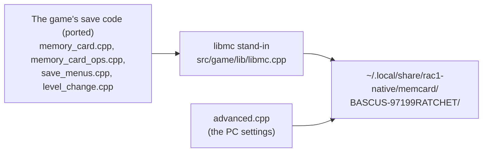

# Saves

How the game saves, and where the port keeps the saves on a PC.

> **Note:** saving and loading work, but this part may still change. The save files' format, where
> they are kept and their size have not yet been checked by hand, so a later version may move or
> convert them.

## The memory card, as the game sees it

On the PS2 the game saves through Sony's memory card library, `libmc`, which talks to the card
server on the IOP. The port keeps the game's own save code (ported) and replaces the library with a
host stand-in, `src/game/lib/libmc.cpp`: `mc_init`, `mc_get_info`, `mc_open`, `mc_read`, `mc_write`,
`mc_close`, `mc_seek`, `mc_mkdir`, `mc_get_dir`, `mc_chdir`, `mc_delete`, `mc_format`, `mc_sync` and
the rest, each standing in for the library function at its original address. To the game it is a
formatted 8 MB card in port 0, slot 0. Its files are kept in memory and written through to a
directory on the PC, each through a temporary file renamed over the old one (a crash or a full disk never leaves a save
cut short); when the card is inserted, the files already there are read in (a leftover `.tmp` is ignored).

## What the game writes

The game's save directory is named after the disc's product code, read from the disc's `SYSTEM.CNF`
by `save_names_init` (0x24b410): `BASCUS-97199RATCHET` for the North American disc,
`BESCES-50916RATCHET` for the PAL disc (the two discs' saves are kept apart, as on a console). In it, the card
machine (0x24b690, `src/game/ovl/memory_card_ops.cpp`) writes:

- `icon.sys` and `static.ico`, the icon a PS2's browser shows, copied from the disc;
- `save0.bin` to `save4.bin`, the five save slots;
- a settings file, the game's own options.

**A save slot** holds the sizes of its two kinds of block, then one game block and 20 level blocks,
one per level (`save_blocks_write`, 0x24ce68, in `memory_card_ops.cpp`). Each block is built from a
list of the game's variables to save: the game block from the list at 0x1845c0, the level blocks from
the one at 0x1848c0. Each block carries a 16-bit checksum (`save_checksum`, 0x24cf78, in
`src/game/ovl/level_change.cpp`), written by `save_block_write` (0x24d030) and checked by
`save_block_check` (0x24cff0); a block that fails it is reported as damaged when the slot is read.

**When the game saves:**

- From the menus: the Save and Load pages (`save_menus.cpp`) and the new game's slot choice
  (`new_game_slots_update`, 0x281200).
- On leaving a planet: `level_change_request` (0x24d430, `level_change.cpp`) saves into the slot the
  player chose, if one was chosen.
- At the start, the boot module checks the card (`boot_card_check`) and shows the PS2's memory card
  screens (game mode 4).

**Checkpoints** are not saves: they live in the game's memory, and dying returns Ratchet to the last
one without touching the card.

## Where the saves are on a PC

The card's directory is, in order of preference:

1. `$RAC1_MEMCARD_DIR`, if set;
2. `$XDG_DATA_HOME/rac1-native/memcard`;
3. `~/.local/share/rac1-native/memcard`.

On Windows, 2 and 3 are `%APPDATA%\rac1-native\memcard`.

(`mc_default_card_dir` in `libmc.cpp`.) So by default the saves are in
`~/.local/share/rac1-native/memcard/BASCUS-97199RATCHET/`. `RAC1_MEMCARD=0` runs without a card
(with `--debug-tools`); an automated headless run only has a card when `RAC1_MEMCARD_DIR` is set.

The files are the ones the game writes, stored as plain files. There is no import from or export to
PS2 memory card images (`.ps2`, `.mcd`) yet; moving a save to or from PCSX2 or a real PS2 needs an
outside memory card tool.

## The PC settings next to each save

The port's own settings (see [Settings](settings.md)) travel with the saves without touching the
game's files. Whenever the game writes `save<N>.bin` (a save, a planet change's save, a new game's
first save), `advanced_save_written` writes `save<N>.pc` next to it; whenever the game loads
`save<N>.bin`, `advanced_save_loaded` applies the matching `save<N>.pc` (`src/game/enhance/advanced.cpp`).
The game's own files stay exactly as the game writes them, so the original game would read the
card as before and ignore the extra files.

The format is small and forward compatible, all little-endian:

| Offset | Size | Contents |
|---|---|---|
| 0 | 4 | `R1PC` |
| 4 | 2 | format version (1) |
| 6 | 2 | item count |
| 8 | ... | items: a 2-byte id, a 2-byte size, then the data |

Ids 1 to 5 and 10 are the Advanced page's rows kept with the saves (Quick Select, Aiming, Movement, Fades, Buy All Ammo;
Skip Cutscenes 10). Ids 6 and 9 (Vibration, Adaptive Triggers) belong to the machine and are not written; 7 and 8 (the
ship selector and Clank's movement, removed) are ignored when read. Ids 32 to 51 are the
Graphics page's picture settings, the New Game mode, the lighting rows, Texture Detail, Shadow Strength (45), AO Intensity (47), HUD (48), Sun Rays (49: Off, Low, Medium, High), Ambient Particles (50: Off, Low, High) and Surface Detail (51: Off, Low, High)
(`graphics_save_items` in `graphics.cpp`; id 44, the Overscan row removed after 0.4, is no longer written and is ignored when read;
id 46, Sun Rays until 0.4.x - Off, Low, High -, is no longer written and is read as Off, Medium, High). A reader skips ids it does not know and keeps its current value for ids that are
missing, so older and newer versions read each other's files. A save without a `.pc` file keeps the
settings as they are.
